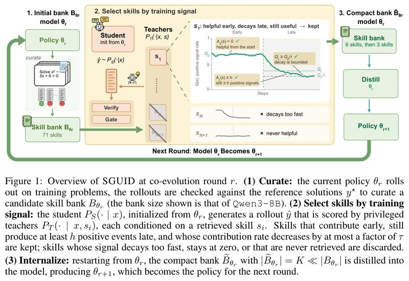
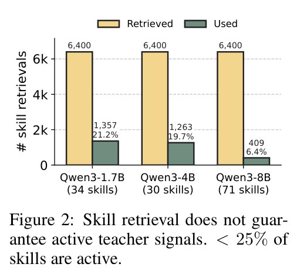
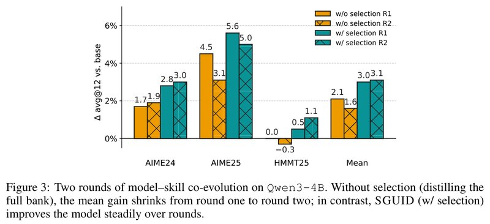

# Which Skill to Distill? SGUID: Selecting a Compact Skill Bank for Model-Skill Co-Evolution

[中文](./SGUID-Selecting-a-Compact-Skill-Bank.md) | English

- **Source**: [Which Skill to Distill? SGUID: Selecting a Compact Skill Bank for Model-Skill Co-Evolution](https://arxiv.org/abs/2610.12367v1)
- **Paper**: [arXiv:2610.12367](https://arxiv.org/abs/2610.12367)
- **Published**: 2026-10-08
- **Scope**: A plain-language explainer based on arXiv v1 (submitted 2026-10-08, the only version so far), not a full translation. The authors are Yuhan Liu and others, 7 in total, from New York University (first author Yuhan Liu) and Amazon (the other six). The code is not public yet: the paper is currently a preprint under review, and the authors say they will release the code, the prompts used to summarize skills, and all the candidate skill banks after acceptance.

## In One Sentence

A recent way to improve reasoning is to first prepare a batch of "problem-solving tips" for the model (the paper calls them skills, and so will this note), then train these tips into the model's parameters. This paper finds that most skills retrieved because they "look relevant" did nothing in training: on three Qwen3 models, only 6.4% to 21.2% of skill retrievals actually made it into training. The authors therefore argue that skill selection should look not only at semantic relevance but also at whether a skill consistently gives a signal in the right direction during training. The method they propose on this basis, SGUID (skill Selection GUIded by training Dynamics, that is, picking skills by how they behave during training), first runs a trial training pass with all the skills, records how each skill performs, and keeps only the best few, then goes back to the original model and retrains it with only those few. The improved model then summarizes new skills, which are selected and learned again; the authors call this loop model-skill co-evolution.

Results: on Olmo-3-7B and three Qwen3 models, measured by average accuracy on three math competition sets, AIME24, AIME25 and HMMT25 (each problem attempted 12 times and averaged), learning only the 6 selected skills matches or beats learning all the skills (30 to 71 per model) on 3 of the 4 models. After the improved model selects 3 new skills and a 2nd round of training, all 4 models match or beat it; Qwen3-8B's average accuracy rises from the original model's 62.9% to 66.3% (64.3% after round 1). On Qwen3-4B, if there is no selection and every round learns all the skills, the average gain actually shrinks in round 2, and HMMT25 ends 0.3 percentage points (shortened to "points" below) below the original model.

---

## 1. Key Terms

| Term | In plain words |
| --- | --- |
| Skill | A short problem-solving tip written for the model, such as "for divisibility problems, try modular arithmetic first". It goes into the prompt when used |
| Skill bank | A set of candidate skills. In this paper the model builds the skill bank itself, by solving training problems and summarizing after comparing with the reference solutions, with no help from a stronger model |
| Rollout | A complete response the model writes on its own for one problem |
| Verifier | Checks the model's final answer against the reference solution. Math problems can be checked automatically |
| Distillation | Has a "student" imitate a "teacher's" outputs, so it picks up the teacher's abilities |
| Self-distillation | The teacher and the student are the same model. The teacher gets to see some extra information (the paper calls it privileged information, for example the reference solution or a skill) that the student cannot see |
| on-policy | The rollouts used for training are written by the student itself on the spot, not written in advance by someone else |
| token | The smallest unit of text a model outputs; roughly, a word |
| Co-evolution | After the model learns skills and gets stronger, the new model summarizes a new batch of skills, which are selected and then learned, round after round |
| Thinking mode | The model first writes out its reasoning, then gives the final answer. When it is off, the model answers directly |
| avg@12 | The model attempts each problem 12 times, and the accuracy is averaged |
| Checkpoint | A version of the model saved at regular intervals during training |
| LoRA | A resource-saving fine-tuning method that trains only a small number of added parameters |

## 2. What Problem It Tackles

Skills can be used in two ways. One is to put them in the prompt at inference time, like bringing a cheat sheet into an exam. The other is to train the skills into the parameters, like memorizing the cheat sheet so you no longer need to bring it to exams (the analogy is mine, not the paper's). This paper studies the second.

To train skills into the parameters, this paper uses on-policy self-distillation: the student sees only the problem and writes its own rollout; the teacher is the same model but sees one extra piece of information, and scores the student's rollout per token. For what the teacher gets to see, there are two existing approaches:

| Approach | What the teacher also sees | Problem |
| --- | --- | --- |
| OPSD (arXiv 2601.18734) | The reference solution to this problem | Prior work found that a teacher given a skill often gives a more useful signal |
| SGSD (arXiv 2605.28791) | One skill retrieved by semantic similarity | Skills are retrieved only by "semantic relevance", and nobody checks whether each skill actually helped |

This paper builds on SGSD and improves it. SGSD handles one training problem as follows:

1. **The student solves the problem**: the student sees only the problem and writes its own rollout.
2. **Retrieve skills, bring in teachers**: skills are retrieved by the semantic similarity between the problem and the skill descriptions (in the paper's setup each problem gets 8 teachers). Each teacher is "the same model + one skill".
3. **The teacher scores per token**: the teacher reads the student's rollout token by token, estimates "with this skill, how likely is it that this part is written this way", and compares that with the student's own estimate. A higher estimate from the teacher means the teacher approves of this step more. Averaged over the whole rollout, this gives the skill's **support** for this rollout.
4. **Threshold (Gate)**: if the absolute value of the support is at most 0.05, the teacher and the student see things about the same way, the skill has effectively said nothing, and this signal is discarded.
5. **Check the answer (Verify)**: the reference solution decides whether the student got it right. If the teacher's stance agrees with correctness (the teacher supports a correct rollout, or opposes a wrong one), the student moves toward the teacher; if the two conflict (the teacher opposes a correct rollout, or supports a wrong one), it goes the other way and the student is pushed away from the teacher.

My reading is this: the reference solution sets the direction (correct rollouts are strengthened, wrong ones weakened), and the teacher's per-token opinion sets the strength, telling the student which places to change more and which to change less.

**An example** (my own illustration, not from the paper): the student solves a problem correctly. After reading the rollout, the teacher holding the skill "try modular arithmetic first" approves of it more than the student itself does, with a support of 0.2. It passes the threshold, and its direction agrees with "correct", so this is one useful training signal.

**Optional: the formulas for support, the threshold and the answer check.** You can skip this without losing the thread. Let the difference between the teacher's and the student's log probabilities at token $`n`$ be

```math
\Delta_n=\log P_T(\hat y_n\mid x,s,\hat y_{< n})-\log P_S(\hat y_n\mid x,\hat y_{< n})
```

The support $`\tilde a`$ is roughly the average of $`\Delta_n`$ over the whole rollout (the actual computation masks irrelevant tokens and clips extreme values). The threshold is $`|\tilde a|>\kappa`$ with $`\kappa=0.05`$; the answer check is $`\mathrm{sign}(r\cdot\tilde a)`$, with $`r=+1`$ for a correct rollout and $`r=-1`$ for a wrong one.

The problem lies in how the skills are chosen. Not every skill retrieved by semantic relevance is useful: earlier work on software engineering tasks found that only 7 of 49 programming skills clearly helped, and many did nothing or even hurt (SWE-Skills-Bench, arXiv 2603.15401).

The question the paper wants to answer is: **which skills are worth distilling into the model? If only these skills are distilled, can the loop of "the model gets stronger, summarizes new skills, learns again" keep turning steadily, round after round?**

## 3. The Overall SGUID Workflow

Figure 1 draws SGUID as a three-step loop:

1. **Summarize skills**: the current model solves training problems, its rollouts are checked against the reference solutions, and the model then summarizes a batch of candidate skills from these rollouts.
2. **Select skills**: run a trial training pass with all the candidate skills, record how each skill performs during training, and keep only the few best performers (6 in round 1, 3 in round 2).
3. **Learn skills**: go back to the model from before the trial run and retrain it with only the selected skills, which gives the new model.



*Figure 1: The SGUID workflow in round r of co-evolution, in three blocks from left to right. Left, "summarize skills": the current model $`\theta_r`$ answers training problems, these rollouts are checked against the reference solutions, and a candidate skill bank is summarized (the 71 in the figure is the bank size for Qwen3-8B). Middle, "select skills by training signal": the student starts from $`\theta_r`$ and writes rollouts, several teachers each holding one retrieved skill score them, and then come two steps, Verify (check the answer) and Gate (threshold). The curve in the middle is a skill that is kept, s1: the vertical axis is the contribution rate (0 to 1), the horizontal axis is training steps, and a vertical dashed line separates the early and late phases; its contribution rate is high early and drops later, but it never falls below the "early contribution rate divided by τ" line, and its late useful count is no lower than h, so it is kept; the three check-marked labels on the curve correspond to the three retention rules in Section 5.3. Below it, sN decays too fast and sN+1 never helps, so both are dropped; the paper's caption adds that skills that are never retrieved are dropped too. Right, "internalize": starting again from $`\theta_r`$, a compact skill bank of only K skills (far fewer than the original bank; the figure says 6 in round 1 and 3 in round 2) is distilled into the model, giving $`\theta_{r+1}`$, and the arrow at the bottom shows that it becomes the model for the next round.*

The new model goes back to step 1, summarizes a new batch of skills, and starts the next round. Below, Section 4 first looks at why selection is needed, and Section 5 covers how to select and how to use the selected skills.

## 4. Why Select at All: Most Retrieved Skills Are Idling

On each of three Qwen3 models, the authors logged 6,400 skill retrievals and counted how many of them gave a signal that passed the threshold and actually took part in training:



*Figure 2: The vertical axis is the number of skill retrievals. Each model has two bars: light yellow is the number of retrievals (6,400 for every model), and gray-green is the number whose signal passed the threshold and was actually used in training. The horizontal axis shows the three models, with each one's skill bank size in parentheses. The paper's caption concludes that "retrieving a skill does not mean the teacher gives a useful signal; fewer than 25% of skills are active"; what the figure actually counts is retrievals, see below.*

| Model | Skill bank size | Retrievals | Retrievals used | Share |
| --- | --- | --- | --- | --- |
| Qwen3-1.7B | 34 | 6,400 | 1,357 | 21.2% |
| Qwen3-4B | 30 | 6,400 | 1,263 | 19.7% |
| Qwen3-8B | 71 | 6,400 | 409 | 6.4% |

I noticed two things when reading these numbers:

- The unit counted is retrievals, not skills. The abstract and the caption say "fewer than 25% of skills" gave a useful signal; given how the figure counts, the precise meaning is "fewer than 25% of retrievals produced a strong enough signal".
- "Used" only means the signal passed the threshold; it also includes cases that conflicted with the reference solution and were used in reverse.

Qwen3-8B has the lowest share, only 6.4%, and also the largest skill bank (71 skills). From this the authors put forward a hypothesis: since most retrievals are idling, keeping only the few skills that stay useful may be enough; and judging "useful" should look not only at semantic relevance but also at the model's own training dynamics.

## 5. How SGUID Selects Skills

### 5.1 One record per retrieval

Train normally once with all the candidate skills (200 steps). Each time a skill is retrieved and has finished scoring the student's rollout, one record is made:

| Score | Meaning |
| --- | --- |
| +1 | Passed the threshold, and the teacher's stance agrees with correctness. Counts as one **useful contribution** |
| 0 | The signal was too weak and did not pass the threshold |
| −1 | Passed the threshold, but the teacher's stance conflicts with correctness |

As a formula, this is $`c=\mathrm{Verify}\times\mathrm{Gate}`$. In the example in Section 2, the student is right and the teacher approves more, so the record is +1.

### 5.2 Counting the early and late phases separately

Split training into an early phase and a late phase, and for each skill count three numbers separately: the number of retrievals $`N`$, the number of useful contributions $`A`$, and the contribution rate $`Q=A/N`$. The subscript E marks the early phase and L the late phase.

### 5.3 Three retention rules

To be kept, a skill must meet all of the following:

```math
A_E(s)>0,\qquad A_L(s)\ge h,\qquad Q_L(s)\ge Q_E(s)/\tau
```

1. **It contributed early**: at least one useful contribution in the early phase.
2. **It still contributes often late**: at least $`h`$ useful contributions in the late phase ($`h=10`$ in round 1). Too few occurrences do not count, so that no conclusion rests on a handful of cases.
3. **Its contribution rate did not drop too much**: the late contribution rate is at least $`1/\tau`$ of the early one; round 1 uses $`\tau=5`$, that is, one fifth. This rule weeds out skills that "are useful at first and gradually stop being useful".

The skills that qualify are sorted by their late useful contribution count $`A_L`$ from high to low (ties are broken by $`Q_L`$), and the top $`K`$ are taken: $`K=6`$ in round 1 and $`K=3`$ in round 2.

### 5.4 An example

Suppose that after the round 1 trial run, four skills have the statistics below (my own illustration, not from the paper; the numbers only demonstrate the rules), with the round 1 rules $`h=10`$ and $`\tau=5`$:

| Skill | Early: retrievals / useful → rate | Late: retrievals / useful → rate | Outcome |
| --- | --- | --- | --- |
| A | 40 / 12 → 30% | 80 / 16 → 20% | Kept: 16 ≥ 10, and 20% ≥ 30% ÷ 5 = 6% |
| B | 20 / 10 → 50% | 120 / 11 → 9.2% | Dropped: the late rate is below one fifth of the early rate (9.2% < 10%) |
| C | 30 / 0 → 0% | 60 / 12 → 20% | Dropped: it did not help even once in the early phase |
| D | 10 / 3 → 30% | 30 / 5 → 16.7% | Dropped: too few useful contributions in the late phase (5 < 10) |

Note skill B: its late useful count (11) meets the requirement of 10, but its contribution rate fell from 50% to 9.2%, so it "decays too fast". Section 6.5 will show that mixing in two skills of this kind lowers the average score by 2.8 points.

### 5.5 After selection: retrain from the starting point

After picking K skills, SGUID does not keep training the model from the trial run. It goes back to the model from before the trial run, $`\theta_r`$, and retrains it for 200 steps with only these K skills, which gives $`\theta_{r+1}`$. Appendix A of the paper states that this training retrieves all K skills, with K teachers per problem (6 in round 1, 3 in round 2), which means every selected skill is used on every problem.

So each round actually trains twice: once with all the skills as a trial run, for selection; and once with the selected skills, as the real training.

### 5.6 Round 2: the model and the skills evolve together

The new model $`\theta_{r+1}`$ solves the training problems again and summarizes a new batch of candidate skills; the same rules pick 3 of them, and another round of training starts from $`\theta_{r+1}`$, giving $`\theta_{r+2}`$. Round 2 learns only the 3 newly selected skills.

The model gets stronger and summarizes new skills; once selected, they are learned into the model, and the model gets stronger again. The authors call this loop model-skill **co-evolution**.

The authors' reason for keeping only 3 in round 2 is that, after round 1 is learned, the training statistics show fewer skills that can still give a signal consistently. The authors stress that K is fixed in advance and shared by all models, not tuned per model or by test scores; the thresholds used for selection also rely only on statistics from training.

## 6. Experimental Results

### 6.1 How the experiments were set up

- **Models**: Olmo-3-7B, Qwen3-1.7B, Qwen3-4B, Qwen3-8B.
- **Training problems**: the DAPO-Math-17K math problem set.
- **Evaluation**: three math competition sets, AIME24, AIME25 and HMMT25; each problem is attempted 12 times and averaged (avg@12), and then the average score over the three sets is computed.
- **Methods compared**:
  - Original model: no training at all.
  - GRPO: a common reinforcement learning method that looks only at whether the final answer is right and gives the whole rollout a single score.
  - OPSD: self-distillation, where the teacher sees the reference solution.
  - SGSD: self-distillation, where the teacher sees retrieved skills, using the full skill bank (38 skills for Olmo-3-7B, 34 for Qwen3-1.7B, 30 for Qwen3-4B, 71 for Qwen3-8B).
  - SGUID round 1 (6 skills), and round 2 (3 more new skills learned on top of the round 1 model).
- **Training setup**: each method trains for 200 steps with LoRA fine-tuning on 4 H200 GPUs. During training the student has thinking mode off and the teacher has it on; in the distillation methods the student writes at most 1,024 tokens per rollout (16,000 for GRPO). Thinking mode is on at test time.
- **Reporting**: within the 200 steps, the checkpoint with the highest average score over the three test sets is reported.

### 6.2 Main results: 6 skills are mostly enough, and after round 2 all models match or beat the full bank

Average scores from Table 1 of the paper (the mean of avg@12 on AIME24, AIME25 and HMMT25, in %), with the full skill count in parentheses:

| Model (full skill count) | Original model | GRPO | OPSD | SGSD (all skills) | SGUID round 1 (6 skills) | SGUID round 2 (3 more) |
| --- | --- | --- | --- | --- | --- | --- |
| Olmo-3-7B (38) | 39.8 | 40.6 | 33.6 | 40.0 | 40.9 | **41.3** |
| Qwen3-1.7B (34) | 36.4 | 36.9 | 41.9 | **43.0** | 42.3 | **43.0** |
| Qwen3-4B (30) | 62.1 | 62.7 | 64.3 | 64.2 | 65.1 | **65.2** |
| Qwen3-8B (71) | 62.9 | 63.4 | 65.3 | 63.9 | 64.3 | **66.3** |

*Each method reports the checkpoint with the highest average score over the three test sets within its 200 training steps. SGSD uses the skill bank from its original paper. The best score in each row is in bold. The skills selected in each round are listed in Appendix B of the paper.*

How to read this table:

- **Round 1: 6 skills are mostly enough**: compared with SGSD, which learns all the skills, Olmo-3-7B is 0.9 points higher, Qwen3-4B 0.9 points higher and Qwen3-8B 0.4 points higher; only Qwen3-1.7B is 0.7 points lower. On Olmo-3-7B and Qwen3-4B, each of the three test sets taken separately is also higher than SGSD. At its largest, the full bank is more than 11 times the size of the 6 skills (Qwen3-8B has 71).
- **Round 2 learns 3 more**: all 4 models match or beat SGSD, and all of them beat OPSD.
- **On larger models, more skills actually get in the way**: in the Qwen3 family, the larger the model, the smaller SGSD's advantage over OPSD. On Qwen3-1.7B SGSD is 1.1 points above OPSD, on Qwen3-4B the two are almost the same (64.2% vs 64.3%), and on Qwen3-8B SGSD is instead 1.4 points lower, only 1.0 point above the original model. The authors' explanation: when the teacher is already strong enough with just the reference solution, what is retrieved from a large pile of unfiltered skills acts more like noise. SGUID round 1 on Qwen3-8B is still 1.0 point below OPSD; round 2 rises to 66.3%, overtaking OPSD by 1.0 point. From this the authors argue that the problem lies in which skills the teacher holds, not in the practice of "giving the teacher skills" itself.
- **GRPO gains little**: only 0.5 to 0.8 points above the original model. The authors attribute this to GRPO giving a single score based on whether the whole rollout is right, which makes the signal too sparse; the signals of OPSD, SGSD and SGUID reach every token.
- **On Olmo-3-7B, OPSD actually regresses**: it is 6.2 points below the original model (33.6% vs 39.8%), and the paper does not analyze why.

Per-benchmark scores from Table 1 of the paper (avg@12, %):

| Model | Method | Skills | AIME24 | AIME25 | HMMT25 | Average |
| --- | --- | --- | --- | --- | --- | --- |
| Olmo-3-7B | Original model | n/a | 53.1 | 39.4 | 26.9 | 39.8 |
| | GRPO | n/a | 53.6 | 42.5 | 25.8 | 40.6 |
| | OPSD | n/a | 42.5 | 37.5 | 20.8 | 33.6 |
| | SGSD | 38 | 54.4 | 41.1 | 24.4 | 40.0 |
| | SGUID round 1 | 6 | 55.0 | 42.2 | 25.6 | 40.9 |
| | SGUID round 2 | 3 | 55.0 | 42.8 | 26.1 | 41.3 |
| Qwen3-1.7B | Original model | n/a | 50.6 | 35.6 | 23.1 | 36.4 |
| | GRPO | n/a | 49.2 | 36.9 | 24.7 | 36.9 |
| | OPSD | n/a | 56.4 | 41.7 | 27.5 | 41.9 |
| | SGSD | 34 | 55.6 | 46.1 | 27.2 | 43.0 |
| | SGUID round 1 | 6 | 55.3 | 43.1 | 28.6 | 42.3 |
| | SGUID round 2 | 3 | 56.9 | 43.3 | 28.9 | 43.0 |
| Qwen3-4B | Original model | n/a | 73.9 | 65.8 | 46.7 | 62.1 |
| | GRPO | n/a | 76.1 | 66.7 | 45.3 | 62.7 |
| | OPSD | n/a | 77.8 | 68.9 | 46.1 | 64.3 |
| | SGSD | 30 | 75.6 | 70.3 | 46.7 | 64.2 |
| | SGUID round 1 | 6 | 76.7 | 71.4 | 47.2 | 65.1 |
| | SGUID round 2 | 3 | 76.9 | 70.8 | 47.8 | 65.2 |
| Qwen3-8B | Original model | n/a | 77.5 | 67.2 | 43.9 | 62.9 |
| | GRPO | n/a | 76.9 | 68.1 | 45.3 | 63.4 |
| | OPSD | n/a | 78.1 | 69.7 | 48.1 | 65.3 |
| | SGSD | 71 | 77.2 | 67.2 | 47.2 | 63.9 |
| | SGUID round 1 | 6 | 75.3 | 71.9 | 45.6 | 64.3 |
| | SGUID round 2 | 3 | 78.3 | 73.9 | 46.7 | 66.3 |

*"Skills" is the number of skills the teacher can retrieve. The 3 in round 2 are newly selected, and by then the model has already learned the 6 from round 1.*

### 6.3 Without selection, the round 2 gain shrinks

The authors ran a comparison on Qwen3-4B: one arm learns all the candidate skills every round (no selection; judging by the numbers, its round 1 is the SGSD in Table 1), and the other arm selects with SGUID every round. Both arms run two rounds.



*Figure 3: Two rounds of co-evolution on Qwen3-4B. The vertical axis is the avg@12 gain over the original model (points), and the horizontal axis shows AIME24, AIME25, HMMT25 and the average of the three. Orange is no selection (all skills distilled every round), and teal is SGUID selection; solid bars are round 1, and cross-hatched bars are round 2. The paper's caption says that without selection the average gain shrinks from round 1 to round 2, while SGUID improves the model steadily across rounds. For the actual size of "steadily", see Section 8.*

- **No selection**: the average gain drops from +2.1 points in round 1 to +1.6 points in round 2. Mostly, the AIME25 gain falls from 4.5 points to 3.1 points, and HMMT25 goes from level with the original model to 0.3 points below it.
- **Selection**: the average gain is +3.0 points in round 1 and +3.1 points in round 2. The HMMT25 gain rises from 0.5 points to 1.1 points.

The authors' reading is that selection does more than shrink the skill bank: before each round it also filters out skills that are outdated, redundant or in conflict with each other, and this is what keeps multi-round evolution stable.

### 6.4 Selecting with statistics from only the first 25 steps: workable on 1.7B, less reliable on 4B

The default approach first needs a full 200-step trial run with all the skills, which is not cheap. The authors tried selecting from the statistics of only the first 25 steps. Table 2 of the paper (three-benchmark average avg@12, %):

| Model | Original model | Selected with 200-step statistics (default) | Selected with first-25-step statistics only |
| --- | --- | --- | --- |
| Qwen3-1.7B | 36.4 | 42.3 | 42.5 |
| Qwen3-4B | 62.1 | 65.1 | 63.4 |

*The paper's table note concludes that the 25-step approximation is on par with the full version on Qwen3-1.7B and less reliable on Qwen3-4B.*

On Qwen3-1.7B, the skills selected at 25 steps are even slightly better (0.2 points higher). On Qwen3-4B they are 1.7 points lower, and AIME24 is only 72.5%, below even the original model (73.9%). The authors conclude that early training statistics are informative, but selecting skills reliably at a very early stage needs further research.

### 6.5 Keeping 4 to 12 skills all works, but the "no decay" rule cannot be removed

How far should the skill bank be trimmed? Table 3 of the paper compares different numbers of retained skills in round 1 on Qwen3-4B (avg@12, %):

| Setting | AIME24 | AIME25 | HMMT25 | Average |
| --- | --- | --- | --- | --- |
| Original model | 73.9 | 65.8 | 46.7 | 62.1 |
| OPSD | 77.8 | 68.9 | 46.1 | 64.3 |
| SGSD (all 30) | 75.6 | 70.3 | 46.7 | 64.2 |
| Keep 2 | 76.9 | 69.4 | 43.6 | 63.3 |
| Keep 4 | 75.6 | 70.8 | 46.9 | 64.4 |
| Keep 6 (default) | 76.7 | 71.4 | 47.2 | **65.1** |
| Keep 12 | 75.8 | 68.9 | 49.2 | 64.6 |
| Keep 6, without "the contribution rate must not drop too much" | 73.3 | 67.8 | 45.8 | 62.3 |

*The last row also keeps 6, but ranks only by the late useful count, dropping the rule "the late contribution rate is no lower than 1/τ of the early one". The highest average score is in bold.*

- Keeping 4, 6 or 12 all match or beat SGSD. The default of 6 is best, 3.0 points above the original model. So K does not need precise tuning.
- Keeping only 2 falls short of SGSD, mostly on HMMT25 (43.6%, 3.1 points below even the original model). The authors think that with too few skills, not enough problem types are covered.
- Without the "no decay" rule, two skills whose contribution rate drops sharply between the early and late phases get mixed in. The average score falls to 62.3%, 2.8 points below the default and only 0.2 points above the original model. The authors conclude that being useful early is not enough: a skill must stay useful after the student gets stronger.
- The authors note that this experiment is a post-hoc check on a single model, and K=6 was not set based on it.

### 6.6 Which 6 are kept matters: the top-ranked ones give the highest average score

Table 4 of the paper (Qwen3-1.7B, always keeping exactly 6, avg@12, %):

| Selection (all keep 6) | AIME24 | AIME25 | HMMT25 | Average |
| --- | --- | --- | --- | --- |
| Original model | 50.6 | 35.6 | 23.1 | 36.4 |
| SGSD (all 34) | 55.6 | 46.1 | 27.2 | 43.0 |
| Top-ranked 6 | 55.3 | **43.1** | **28.6** | **42.3** |
| Random 6 | 54.1 ± 0.8 | 42.6 ± 1.2 | 26.9 ± 0.9 | 41.2 ± 0.9 |
| Bottom-ranked 6 | **55.6** | 42.8 | 26.1 | 41.5 |

*Only which 6 are kept changes: top-ranked, random (picked once with each of 3 random seeds), and bottom-ranked. The paper notes that the selections compared here all train for 100 steps (whether the top-ranked row also trained for only 100 steps is in doubt; see Section 8). The original model and SGSD rows are for reference. In each column, bold marks the highest score among the three selections.*

The ranking here is among the candidate skills that pass the three rules.

- The top-ranked 6 give the highest average score, only 0.7 points behind SGSD with all 34.
- The random 6 and the bottom-ranked 6 score close to each other, and both average lower than the top-ranked 6. From this the authors argue that the gain comes from which skills are kept, not just from a smaller skill bank.
- From another angle (this is my view; the paper does not make this comparison): all three selections are 4.8 to 5.9 points above the original model, and only about 1 point apart from each other. For reference, OPSD in Table 1, which uses no skills at all and whose teacher sees only the reference solution, also reaches 41.9% on this model. This suggests that most of the gain over the original model may come from self-distillation as a training method itself, and which skills are selected mainly affects the last 1 point or so (the two sides may have trained for different numbers of steps, so this is only a rough comparison).

### 6.7 The selected skills: mostly general methods, plus some very narrow conclusions

Appendix B of the paper lists the skills selected for each model in each round. Take the 6 from round 1 on Qwen3-4B as an example (paraphrased):

| Skill | Content |
| --- | --- |
| Simplify expressions | Use algebraic tricks, factoring or number theory to break a complex expression or ratio into simple parts |
| Translate conditions into algebra | Write geometric, number-theoretic or combinatorial conditions as equations or algebraic expressions, so as to solve for variables or find relations |
| Use symmetry | When counting, divide by the order of the symmetry group to remove equivalent duplicate arrangements |
| Optimize under constraints | Analyze relations between variables, parity or integer properties to find maxima and minima or narrow down the cases |
| Verify the answer | Substitute candidate answers back into the original conditions or edge cases to test them |
| Angle and ratio analysis | Use trigonometric identities or vector ratio relations to handle angles, directions and ratios |

Most of these are general problem-solving methods. I noticed that the other models' skills also include very narrow conclusions that look as if they were summarized straight from a single problem, for example:

- "Pythagorean triple generation" from Qwen3-1.7B round 1: use integer parameters m > n to generate primitive Pythagorean triples, and verify the ratio of area to perimeter.
- "Parity-balanced counting" from Qwen3-1.7B round 1: when the numbers of odd and even elements are equal, the minimum number of swaps is half the total number of elements.
- "Planar triangulation and edge counting" from Olmo-3-7B round 2: in a triangulation of a convex n-gon, there are at most 2n − 4 interior triangles.

The last one is in fact stated incorrectly, and the selected skills may also overlap heavily with each other. Section 8 covers both points.

## 7. Limitations the Authors Acknowledge

- **Only single-turn math reasoning was tested.** The authors expect the method to extend to multi-turn agent tasks, but did not verify this.
- **Using skills directly at inference time was not studied.** The paper studies only the role skills play as teachers during training, not whether putting skills directly into the prompt at inference time helps. The SGSD paper (arXiv 2605.28791) found that adding the skills used for distillation to the original model at inference time can actually lower scores; the authors guess the reason is a mismatch between training and test conditions: during training the student has thinking mode off and writes at most 1,024 tokens. Another study (arXiv 2604.01348) found that adding math skills at inference time helps. The authors leave co-evolution of "skills useful for both training and inference" to future work.
- **The cheaper early-selection approach is not yet stable.** The cost-saving approach of selecting skills from only the first 25 steps behaves inconsistently across model sizes (Section 5 of the paper, Section 6.4 of this note).

## 8. Points Worth Noticing While Reading

Below are points I noticed while reading the paper that it does not discuss at length, offered for reference.

### How strong the evidence is

- **Checkpoints are chosen on the test sets.** Each method reports the checkpoint within 200 steps with the highest average score on AIME24, AIME25 and HMMT25, and these three sets are the test problems. This follows SGSD's setup and treats all methods alike, but the scores will be optimistic, and chance fluctuations get amplified too.
- **The gaps are small, and no spread is reported.** These three sets usually have 30 problems each, 90 in total. An average-score gap of 1 point is roughly 1 more problem solved out of 90. The gap between SGUID round 1 and SGSD ranges from −0.7 to +0.9 points, and none of the main results give a spread over multiple runs. One point of reference is Table 4 (Section 6.6): picking 6 skills at random with 3 different seeds already gives an average-score spread (±) of 0.9 points, which includes both the differences from using different skills and the randomness of training itself.
- **Round 2 trains one more round, and compute is not compared either.** The SGUID round 2 model was trained for two 200-step runs in sequence, while the other methods in Table 1 trained for only one 200-step run, so part of round 2's advantage may come from more training. The "no selection, also two rounds" comparison in Figure 3 partly rules this out, but it was only run on Qwen3-4B. Also, every round needs a trial run and then the real training, 4 training runs over two rounds, and the paper does not compare compute with the baseline methods.
- **The size of the "steady improvement".** In Figure 3, the selection arm's average gain in round 2 versus round 1 only goes from 3.0 points to 3.1 points, and AIME25 even drops from 5.6 points to 5.0 points. "Kept the round 1 gain" describes this better than "improves steadily"; the no-selection arm fell back by 0.5 points.
- **Table 4's training steps are unclear.** The "top-ranked 6" row in Table 4 is identical to the 200-step result in Table 1, while the table note says the comparison arms trained for 100 steps, and the paper does not make clear whether both sides trained for the same number of steps. If the comparison arms trained for only 100 steps, this comparison is not entirely fair.

### Where it applies

- **The supplementary experiments cover little ground.** Figure 3 and Table 3 use only Qwen3-4B, and Table 4 uses only Qwen3-1.7B.

### The selection rules ignore skill content

- **The rules look only at the training signal.** SGUID's rules look only at the training signal a skill gives when it acts as a teacher; they do not check whether the skill's content is correct, or whether it duplicates other skills. The paper does not discuss what this leads to, and the two examples below can be found in the appendix.
- **A skill with wrong content can still be selected.** The last skill in Section 6.7 ("planar triangulation and edge counting" from Olmo-3-7B round 2) is stated incorrectly. A triangulation of a convex n-gon that only draws diagonals between vertices always yields exactly n − 2 triangles, however it is done. A square, for example, can only be split into 2 triangles, yet this skill's formula gives 4. In this round Olmo-3-7B's average score still rose from 40.9% to 41.3%, and the paper does not analyze the effect of this wrong skill.
- **The selected skills may overlap heavily.** The 3 skills selected for Qwen3-8B in round 2 are "case analysis", "combinatorial counting" and "combinatorial analysis", and all of them are about systematically counting cases under constraints. The authors say selection can filter out duplicate skills, but the rules themselves do not compare how similar skills are to each other. Still, it was this very round that lifted Qwen3-8B from 64.3% to 66.3%, so overlap is not necessarily harmful.

### Small issues in the manuscript (none affect the main conclusions)

- **The round 2 settings are not fully stated.** The appendix gives only the round 1 thresholds (h=10, τ=5) and does not list the round 2 values; the boundary between the early and late phases is written as "75 / 100", with no explanation of what exactly it means.

## 9. Relation to Related Work

Section 6 of the paper splits related work into two groups: one maintains skill banks, mostly optimizing the skill bank at inference time for a fixed model; the other uses self-distillation to train skills into the parameters. SGUID touches both: it also maintains a skill bank, but the selected skills are trained into the parameters, and the trained model then summarizes the next round's skill bank. Compared with SGSD, it shifts the focus from "how to use each score" to "which skills the whole bank should keep". The table below lists the papers it discusses:

| Direction | Paper | Relation to this paper |
| --- | --- | --- |
| Skill distillation | SGSD (arXiv 2605.28791) | The method this paper directly improves on; both the "threshold" and "answer check" steps come from it |
| Skill distillation | Skill-SD (arXiv 2604.10674) | Uses skills as extra context for the teacher, applied to multi-turn agent tasks |
| Self-distillation | OPSD (arXiv 2601.18734) | Self-distillation where the teacher sees the reference solution; a baseline in this paper |
| Self-distillation | Reinforcement Learning via Self-Distillation (arXiv 2601.20802) | Uses extra information such as environment feedback as the teacher's context |
| Self-distillation | On-Policy Distillation of Language Models (ICLR 2024, arXiv 2306.13649) | Early work on on-policy distillation: learning from the teacher on rollouts the student writes itself |
| Skill effectiveness evaluation | SWE-Skills-Bench (arXiv 2603.15401) | Found that only 7 of 49 programming skills clearly helped |
| Skill effectiveness evaluation | SkillsBench (arXiv 2602.12670) | Skill effects vary by task and model; compact, focused skills can beat large, all-in-one skill packs |
| Skills at inference time | Procedural Knowledge at Scale Improves Reasoning (arXiv 2604.01348) | Found that adding math skills at inference time helps |
| Baseline | DeepSeekMath (arXiv 2402.03300) | The source of the baseline method GRPO |

## 10. Summary

The first sentence of the paper's conclusion sums up the whole paper: **retrieval decides which skills the teacher can see, but not which skills actually teach.** On this basis, SGUID runs one trial training pass with all the skills, keeps the skills that were useful early, are still often useful late, and whose contribution rate did not drop too much, takes the top few, and then goes back to the original model to retrain; the trained model then summarizes new skills and starts the next round.

On the evidence: on three Qwen3 models, about 79% to 94% of semantic retrievals of skills did not produce a strong enough training signal. Learning only 6 skills matches or beats learning dozens on 3 of the 4 models; after picking 3 more for round 2, all 4 models match or beat it. In two rounds of evolution on Qwen3-4B, without selection the model after round 2 is actually worse than after round 1, while selection keeps the gain. The cost is that every round trains twice, first a trial run to select skills, then the real training. The gains over SGSD are mostly around 1 point, the checkpoints were also chosen on the test sets, and no spread is reported, so these conclusions need more experiments to confirm.

---

## Where Things Are in the Paper

| In this note | In the paper |
| --- | --- |
| Problem and motivation | Abstract, Section 1 |
| Skill bank, self-distillation, SGSD's threshold and answer check | Sections 2.1 to 2.3, Eqs. (1) to (9) |
| The overall SGUID workflow | Start of Section 3, Figure 1 |
| Most retrieved skills go unused | The Motivation paragraph of Section 3, Figure 2 |
| Scoring, early and late statistics, the three retention rules | The Skill Selection paragraph of Section 3, Eqs. (10)(11) |
| Retraining from the starting point, round 2 | The Skill Internalization and Evolution paragraph of Section 3, Eqs. (12)(13) |
| Experimental setup, how K is chosen | Section 4.1, Appendix A, Table 5 |
| Main results | Section 4.2, Table 1 |
| Two-round comparison without selection | Section 5, Figure 3 |
| Selecting with statistics from only the first 25 steps | Section 5, Table 2 |
| How many to keep, removing the "no decay" rule | Section 5, Table 3 |
| Top-ranked, random, bottom-ranked | Section 5, Table 4 |
| The selected skills | Appendix B, Tables 6 to 9 |
| Limitations the authors acknowledge | Section 8; for early selection, see Section 5 |
| Related work | Sections 1 and 6 |
| Summary | Section 7 |
