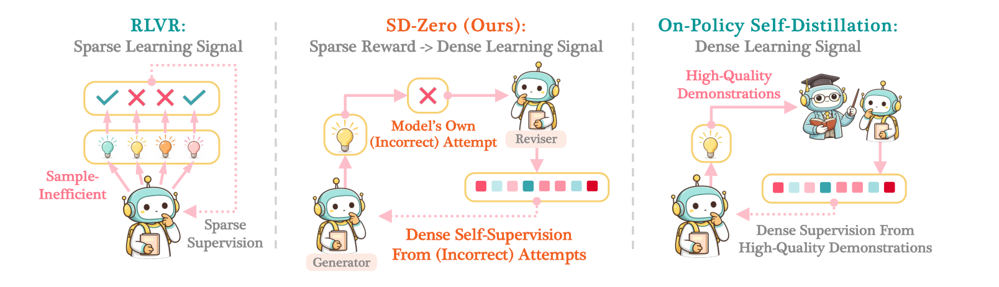
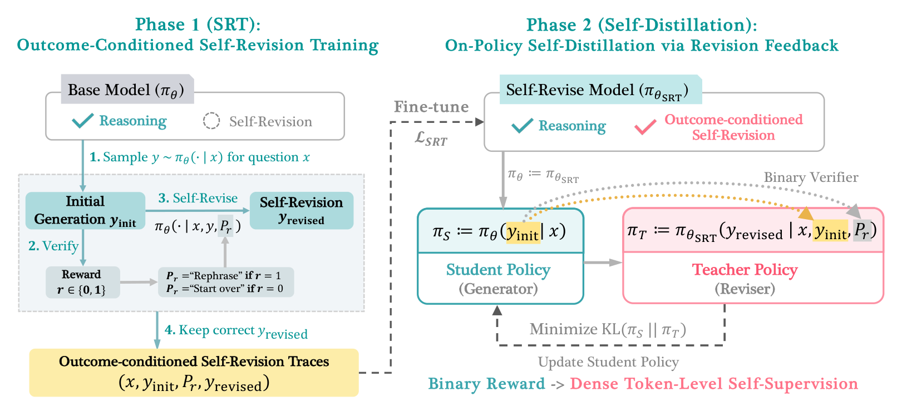
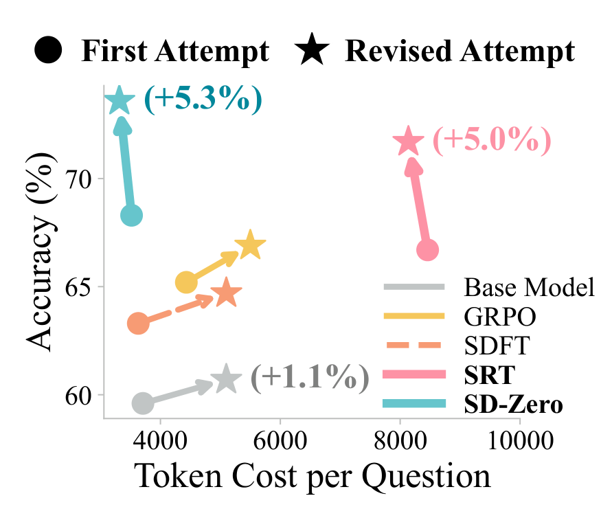
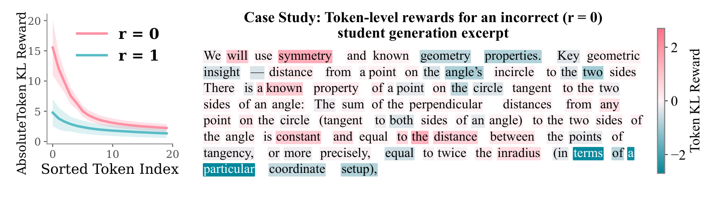
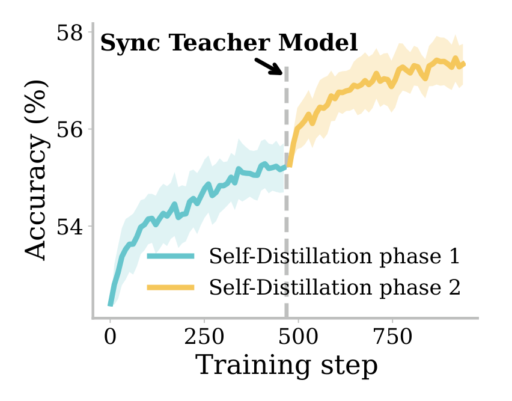
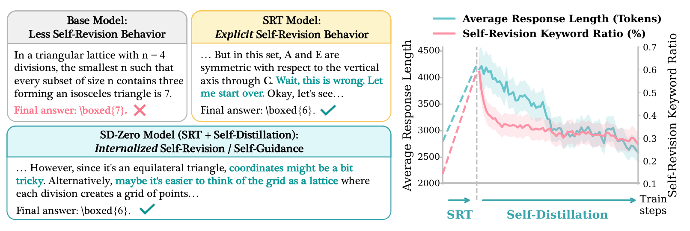

# Self-Distillation Zero: Self-Revision Turns Binary Rewards into Dense Supervision（自蒸馏 Zero：用自我修改把"对/错"奖励变成逐词的监督）

中文 | [English](./Self-Distillation-Zero_en.md)

- **原文链接**: [Self-Distillation Zero: Self-Revision Turns Binary Rewards into Dense Supervision](https://arxiv.org/abs/2604.12002v2)
- **论文**: [arXiv:2604.12002](https://arxiv.org/abs/2604.12002)
- **官方资料**: [princeton-pli/Self-Distillation-Zero](https://github.com/princeton-pli/Self-Distillation-Zero)
- **发布日期**: 2026-04-13
- **范围**: 按 arXiv v2（2026-06-11 修订）写的通俗解读，不是全文翻译。作者是 Yinghui He 等 10 人，来自普林斯顿大学、多伦多大学和卡内基梅隆大学。

## 一句话版本

训练大模型做数学题、写代码，常用的强化学习只给"对/错"两种分数（答对 1 分，答错 0 分），信号很粗：一道题写了几千个 token，最后只知道"错了"，不知道错在哪一步。这篇论文提出 SD-Zero（Self-Distillation Zero，自蒸馏 Zero）：同一个模型扮演两个角色，答题者先写一版答案，修改者看到这版答案和它的对错之后，把答案逐词重读一遍，在每个位置给出"换我会怎么写"，然后训练答题者朝修改者的意见靠拢。答错的答案里，修改者的不同意见会比较集中地落在出错的步骤上。原模型不太会改答案，所以要先拿它自己写的、最终答案正确的修改稿把它练一轮，这一步叫 SRT（Self-Revision Training，自我修改训练）。整个过程不需要更强的老师模型，也不需要标准解题过程，只要能判断最终答案对不对。

效果：在 Qwen3-4B-Instruct 和 Olmo-3-7B-Instruct 两个模型、8 个数学和编程测试集上，平均正确率分别从 49.8% 提到 60.3%、从 41.1% 提到 51.5%，各涨 10 多个百分点（下文简称"分"）。按论文的记账，对照方法 RFT、GRPO、SDFT 各生成 6 万次答案，SD-Zero 生成 4.9 万次，生成的 token 总量相当。在这个条件下，SD-Zero 比这三种方法和 SFT 都高，领先 4.8～10.3 分。在 AIME24 上，最终模型的回答长度和原模型差不多，比只做第一阶段 SRT 的模型短一半多。附录里有几笔账前后对不上，见第 9 节。

---

## 1. 先认识几个词

| 词 | 大白话 |
| --- | --- |
| token | 模型读写文字的基本单位，可以理解成一个词或词的一部分 |
| 强化学习、RLVR | 强化学习是让模型自己作答，按得分高低调整：得分高的写法以后多写。RLVR（可验证奖励的强化学习）指分数由程序自动判对错给出，比如核对数学题的最终答案 |
| 二元奖励 | 只有 0 和 1 两种取值的对错分数 |
| GRPO | 大模型上常用的一种强化学习算法：同一道题写好几份答案，按对错互相比较来更新模型 |
| SFT（监督微调） | 拿现成的答案让模型逐字模仿 |
| RFT（拒绝采样微调） | 模型自己写几份答案，只留做对的拿来做 SFT |
| 蒸馏 | 老师模型在学生答案的每个位置给出"这里我会写什么"的概率分布，学生朝这个分布靠拢 |
| 在线（on-policy） | 练习用的答案是模型自己现写的，不是别人事先写好的 |
| 自蒸馏 | 老师就是模型自己，只是提示词里多看了一些信息，再逐词指导只看题目的自己 |
| KL 散度 | 衡量两个概率分布差多远的一个数，越小越接近 |
| 答题者、修改者 | 同一个模型的两个角色。答题者只看题目写答案；修改者看题目、一版答案和它的对错，再写一版更好的。第二阶段里，答题者当学生，修改者当老师 |
| SRT | SD-Zero 的第一阶段：用模型自己写的、最终答案正确的修改稿做微调，教会它改答案 |
| avg@8、pass@8 | 每道题让模型做 8 次。avg@8 是 8 次的平均正确率，pass@8 是 8 次里至少做对 1 次的题目比例 |
| Token KL Reward | 论文分析时给每个 token 算的一个数：学生给这个 token 的 log 概率减去老师给的。正数表示老师不认同，负数表示老师更认同 |

## 2. 它想解决什么问题

### 现在的两条路

想让模型在"程序能自动判对错"的任务上变强，目前主要有两类做法：

| 做法 | 怎么学 | 好处 | 毛病 |
| --- | --- | --- | --- |
| 强化学习，这类设定叫 RLVR（可验证奖励的强化学习），常用算法是 GRPO | 模型自己写答案，程序判分，对了 1 分、错了 0 分 | 只要能判对错就能用，适用面广 | 一份答案只得一个分数，不知道哪几步写得好、哪几步写错了。模型只能同一道题多写几份、互相比较来摸索，很费生成次数 |
| 蒸馏 | 老师模型在学生答案的每个位置给出"这里我会写什么" | 每个 token 都有指导，学得快 | 需要一个更强的老师，或者高质量的示范解答，成本高，有时根本拿不到 |

打个比方（类比是我加的，不是论文原文）：强化学习像老师批卷只打勾打叉；蒸馏像请家教逐行批改，但家教贵，水平还得比学生高。

### 自蒸馏走了一半

最近的几篇"自蒸馏"论文，OPSD（arXiv 2601.18734）、SDFT（arXiv 2601.19897）和 SDPO（arXiv 2601.20802），把外部老师去掉了：老师就是模型自己，只是在提示词里多看一些信息，再逐词指导只看题目的自己。剩下的问题出在"多看的信息"上。OPSD 和 SDFT 要看标准解法或专家示范；SDPO 要看环境给的详细反馈（比如程序报错），或同一道题里别的做对的答案。这些东西要么得从外面拿，要么得反复采样再筛出来，同样有成本。

论文要回答的问题是（原文直译）：**模型能不能只看自己的初次尝试（可能是错的）和这些尝试的对错结果，就给自己提供更好的逐词监督？**



*图 1：左边是 RLVR，模型写好几份答案，每份只得到一个勾或叉，信号稀疏、费样本。右边是常见的在线自蒸馏，老师看过高质量示范，再逐词指导学生，信号密集，但要有示范。中间是 SD-Zero：修改者看的是模型自己做错的那一版答案，由它给出逐词的指导。*

## 3. 核心想法：一个模型，两个角色

- **答题者（Generator）**：只看题目，写出一版答案。
- **修改者（Reviser）**：看题目、答题者写的这版答案，再加一句由对错决定的提示语，然后写一版更好的答案。
  - 答对了，接 "Let me rephrase the above solution."（我把上面的解答换个说法再写一遍）
  - 答错了，接 "Wait, this response is not correct, let me start over."（等等，这个答案不对，我重新来）

两个角色是**同一个模型**，区别只在输入里有没有"上一版答案 + 提示语"。名字里的 Zero 大意是"零外部老师"，论文源码注释里，这个方法早期就叫 Zero-Teacher Self-Distillation。

修改者为什么能当老师：它知道"这版答案错了"之后再去读这版答案，读到出错的步骤时会不认同，想换一种写法；读到没问题的地方，基本照写。把修改者在每个位置上"下一个 token 想写什么"的概率分布拿出来，就是一份逐词的批改意见。答题者去模仿这份分布，就等于学到"一开始就别在这里犯错"。标题里"自我修改把二元奖励变成密集监督"说的就是这件事。

这里有个前提：模型得真的会改答案。论文发现，原模型做题还行，改答案很弱（数字见 6.3 节），所以训练分两个阶段：先教它会改，再用它改答案的本事去教答题。



*图 2：左半是第一阶段 SRT。原模型会推理，但不太会自我修改（虚线圈）。1. 对题目 x 采样一版初稿 y_init；2. 判对错得到 r，按 r 选提示语 P_r（"换个说法"或"重新来"）；3. 让同一个模型接着写出修改稿 y_revised；4. 只保留修改稿做对的，得到"题目、初稿、提示语、修改稿"组成的数据，用损失 L_SRT 微调出 SRT 模型。右半是第二阶段自蒸馏。SRT 模型同时当学生和老师：学生（答题者）只看题目写答案，老师（修改者）看题目、学生答案和提示语，两者的差距用 KL(π_S‖π_T) 衡量，只更新学生。底部那行字是"二元奖励 → 逐 token 的密集自监督"。图注说老师"生成一版修改稿"，按论文的公式，老师其实不写新答案，只在学生答案的每个位置给出概率分布。*

## 4. 具体怎么训练

训练题分成互不重叠的两份，第一阶段用一份，第二阶段用另一份。

### 第一阶段：先教会模型改答案（SRT）

数据怎么来（以数学为例，编程同理）：

1. 取 OpenR1-Math 的前 1 万道题，每道题让原模型写 1 版初稿。大约 5000 版对、5000 版错。
2. 每版初稿按对错接上提示语，让模型再写 3 版修改稿：答对的写 3 版"换个说法"，答错的写 3 版"重新来"。
3. 只保留**修改稿最终答案正确**的记录，最后剩下约 6000 条。

这一步一共生成 4 万次（1 万版初稿 + 3 万版修改稿）。"只留改对的"这一步不能省：论文在附录 G 的另一个任务上试过，不筛就拿去训练，效果还不如直接用模型自己做对的初稿训练（见 7.4 节）。

然后用这 6000 条数据同时练两件事：

- **练改答案**：输入"题目 + 初稿 + 提示语"，学着写出那版改对的修改稿。
- **练一口气做完**：只输入题目，学着写出"初稿 + 提示语 + 修改稿"这一整段。也就是说，模型要学会写完一版后自己判断对不对，然后接"换个说法再写一遍"或"等等，这不对，重来"，最后给出正确答案。

两件事都是普通的监督微调（让模型提高写出目标文字的概率），两个损失直接相加。

副作用是回答变长。模型学会了在一个回答里"写一遍、检查、再写一遍"，AIME24 上 SRT 模型的回答平均 8458 个 token，是原模型（3708 个）的 2.3 倍。

### 第二阶段：把"改答案"的本事蒸馏回"答题"（自蒸馏）

1. 把 SRT 模型复制两份：一份冻住当老师（修改者），一份当学生（答题者）继续训练。
2. 从另一份题目（9000 道）里取题，学生每道题只写 1 版答案。
3. 判断这版答案的对错，接上对应的提示语。
4. 老师的输入是"题目 + 学生的整份答案 + 提示语"，然后把学生的答案从头**原样再读一遍**，在每个位置算出"如果我正在写修改稿、而且已经写到这里，下一个 token 会写什么"的概率分布。老师只读不写，算一遍概率就够，不用真的生成。
5. 学生在同样的位置也有自己的分布。训练让学生的分布朝老师的分布靠拢，差距用 KL 散度衡量。老师的参数不更新，只当参照。

为什么这样能学到东西：

- 学生答错时，老师的提示语是"这不对，我重新来"。老师重读到出错的那几步，不会认同学生写下的 token，会把概率放到别的写法上。学生在这些位置被往回拉，在其他位置基本不动。
- 学生答对时，老师的提示语是"换个说法"。论文观察到，模型换说法时通常写得更短，认为这可能让第二阶段的答案更简洁。

结果是学生慢慢学会"一次写对"，不再需要明着写"等等，重来"。第二阶段结束后，AIME24 上的回答降到平均 3518 个 token，不到 SRT 模型的一半，和原模型（3708 个）差不多。

### 额外一招：定期换老师

第二阶段的老师一直是冻住的 SRT 模型。学生学到一定程度，老师就没什么可教的了，成绩会停在某个水平。但第二阶段练完的学生，改答案的本事没丢，还略有提高（数字见 6.3 节），所以可以把学生提拔成新老师，再练一轮。论文把这叫**迭代式自我进化**（iterative self-evolution），实验见 6.6 节。

### 选读：公式

不看也不影响理解。记题目为 $`x`$，标准最终答案为 $`a`$（只有最终答案，没有解题过程），模型为 $`\pi_\theta`$，模型写的答案为 $`y`$，对错奖励为 $`r(y,a)\in\{0,1\}`$：从 $`y`$ 里提取的最终答案和 $`a`$ 一致就是 1，否则是 0。

提示语由对错决定：

```math
P_r=\begin{cases}\text{Let me rephrase the above solution.} & r=1\\ \text{Wait, this response is not correct, let me start over.} & r=0\end{cases}
```

第一阶段的两个损失，$`y_{\text{init}}`$ 是初稿，$`y_{\text{revised}}`$ 是改对的修改稿（省略了对数据集求平均）：

```math
\mathcal{L}_{\text{revision}}=-\sum_{t}\log \pi_\theta\big(y'_t \mid x,\,y_{\text{init}},\,P_r,\,y'_{<t}\big),\qquad y'=y_{\text{revised}}
```

```math
\mathcal{L}_{\text{generation}}=-\sum_{t}\log \pi_\theta\big(y'_t \mid x,\,y'_{<t}\big),\qquad y'=[\,y_{\text{init}},\,P_r,\,y_{\text{revised}}\,]
```

```math
\mathcal{L}_{\text{SRT}}=\mathcal{L}_{\text{revision}}+\mathcal{L}_{\text{generation}}
```

第二阶段，学生参数 $`\theta`$ 从 SRT 模型的参数 $`\theta_{\text{SRT}}`$ 出发，老师固定为 $`\theta_{\text{SRT}}`$：

```math
\mathcal{L}_{\text{SD}}(\theta)=\mathbb{E}_{(x,a)}\,\mathbb{E}_{y\sim\pi_\theta(\cdot\mid x)}\sum_{t=1}^{|y|}\mathrm{KL}\Big(\pi_\theta(\cdot\mid x,\,y_{<t})\;\Big\|\;\pi_{\theta_{\text{SRT}}}(\cdot\mid x,\,y,\,P_r,\,y_{<t})\Big)
```

KL 左边是学生只看题目、写到第 $`t`$ 个位置时的"下一个 token 概率表"；右边是老师看过整份答案 $`y`$ 和提示语 $`P_r`$ 后，重读到同一位置时的概率表。训练开始时两边参数相同，差别只在老师的输入多了 $`y`$ 和 $`P_r`$。附录表 6 显示，实现时用的是 top-K 蒸馏（K = 64），即每个位置只细算概率最高的 64 个候选 token。

论文分析时把每个位置单独拿出来看，定义了 Token KL Reward：

```math
\log \pi_\theta(y_t\mid x,y_{<t})-\log \pi_{\theta_{\text{SRT}}}(y_t\mid x,y,P_r,y_{<t})
```

它是正数，说明学生比老师更相信自己写下的这个 token，也就是老师不认同，训练会压低它；是负数，说明老师更认同，训练会抬高它。名字里虽然有 Reward，数值越大反而代表老师越不认同，读图 4 时别弄反。

## 5. 和其他做法比，差别在哪

论文附录表 2 把几类方法放在一起：

| 方法 | 练的是谁写的答案 | 信号粗细 | 老师是谁 | 老师能不能看到学生做错的那一版 |
| --- | --- | --- | --- | --- |
| SFT / 蒸馏 | 别人写好的 | 细，每个 token 都有 | 外部 | 不适用 |
| 在线蒸馏 | 模型自己写的 | 细 | 外部更强的模型 | 不适用 |
| RLVR（如 GRPO） | 模型自己写的 | 粗，一份答案一个分 | 没有老师 | 不适用 |
| OPSD / SDFT / SDPO | 模型自己写的 | 细 | 自己 | 不能 |
| **SD-Zero** | 模型自己写的 | 细 | 自己 | **能** |

最后一列是论文强调的区别。按论文的归纳，前几种自蒸馏的老师多看的是学生答案以外的参考材料（标准解法、专家示范、环境反馈或同组做对的答案），拿它去评判学生；SD-Zero 的老师多看的是学生自己这一整版答案和一句对错，没有任何参考材料，靠的是模型自己的纠错能力。（所有在线自蒸馏方法里，老师都会逐词重读学生的答案，区别在于重读之前提示词里先放了什么。）

### 花了多少生成次数

论文强调比较是在"生成次数相当"的条件下做的（附录 C.2、表 3）：

| 方法 | 用到的题 | 每道题生成几次 | 总生成次数 |
| --- | --- | --- | --- |
| RFT | 1.5 万道 | 4 | 6 万 |
| GRPO | 1.5 万道 | 4 | 6 万 |
| SDFT | 1.5 万道 | 4 | 6 万 |
| SD-Zero 第一阶段 | 从 1 万道题采样，留下 6000 条训练数据 | 1 版初稿 + 3 版修改稿 | 4 万 |
| SD-Zero 第二阶段 | 9000 道 | 1 | 9000 |
| **SD-Zero 合计** | | | **4.9 万** |

按 token 数算：每个回答约 3700 个 token 时，RFT 和 GRPO 各生成约 2.22 亿个 token。SD-Zero 第一阶段约 1.48 亿；第二阶段按论文的估算，每个回答最长 8500 个 token，上限约 7650 万；合计不超过约 2.25 亿，和对照方法相当。

所以 SD-Zero 的优势在于同样的花费下成绩更好，总花费本身没少多少。它省在第二阶段：GRPO 要靠同一道题的几份答案互相比较才能打分，每道题至少写好几份；SD-Zero 第二阶段每道题只写 1 份，打分靠老师逐词给意见。这本账有两处说不清，见第 9 节。

## 6. 实验结果

### 6.1 实验怎么设计的

- **模型**：Qwen3-4B-Instruct（2507 版）和 Olmo-3-7B-Instruct，都不开思考模式，回答比较短。
- **训练题**：数学和编程分开训练。数学从 OpenR1-Math 选了 1.5 万道竞赛、奥赛难度的题；编程从 Codeforces 数据集的 C++ 解答和 Python 解答两个子集各取 7500 条。每个领域都按"第一阶段约 6000 条、第二阶段 9000 道"分配。
- **测试**：8 个测试集。竞赛数学 AIME24、AIME25、HMMT25、MATH；奥赛数学 AMOBench，以及从 OpenR1-Math 留出的 500 道题；编程是 Codeforces（同样留出 500 道）和 LiveCodeBench（下文简称 LCB）。每道题生成 8 次，取平均正确率（avg@8），评测时回答上限 32K token。
- **对照方法**，都用同样的 1.5 万道题：
  - **SFT**：用 DeepSeek-R1 写的高质量解答做监督微调。
  - **RFT**（拒绝采样微调）：模型每道题自己写 4 份，只留做对的拿来微调。
  - **GRPO**：标准的强化学习，每道题写 4 份、按对错打分，训练 1 轮，实际用的是它的改进版 DAPO。
  - **SDFT**：在线自蒸馏，老师在提示词里看到标准解法。
- **生成次数**：各方法按总生成次数对齐，账目见第 5 节。

### 6.2 两个模型都涨了 10 分多，大头来自第一阶段

论文表 1，avg@8 正确率（%），粗体是每列最高。Qwen3-4B-Instruct 上：

| 方法 | AIME24 | AIME25 | HMMT25 | AMOBench | OpenR1 | MATH | Codeforces | LCB | 平均 |
| --- | --- | --- | --- | --- | --- | --- | --- | --- | --- |
| 原模型 | 59.6 | 45.8 | 26.7 | 9.8 | 55.8 | 91.0 | 48.0 | 61.8 | 49.8 |
| SFT | 61.7 | 46.3 | 31.3 | 7.3 | 56.1 | 91.3 | 49.1 | 57.2 | 50.0 |
| RFT | 64.2 | 52.1 | 37.1 | 11.3 | 59.3 | 91.9 | 50.9 | 68.0 | 54.3 |
| GRPO | 62.5 | 50.0 | 30.4 | 11.0 | **62.9** | 93.5 | 52.2 | 62.6 | 53.1 |
| SDFT | 63.3 | 47.9 | 32.9 | 9.0 | 57.0 | 91.1 | 49.3 | 59.2 | 51.2 |
| SRT（只做第一阶段） | 66.7 | 59.2 | 40.0 | **16.0** | 59.8 | 92.4 | 52.7 | 74.4 | 57.6 |
| **SD-Zero** | **68.3** | **60.0** | **45.4** | **16.0** | 60.4 | **93.6** | **56.1** | **82.6** | **60.3** |

Olmo-3-7B-Instruct 上：

| 方法 | AIME24 | AIME25 | HMMT25 | AMOBench | OpenR1 | MATH | Codeforces | LCB | 平均 |
| --- | --- | --- | --- | --- | --- | --- | --- | --- | --- |
| 原模型 | 56.7 | 42.1 | 25.0 | 1.3 | 48.9 | 91.1 | 31.7 | 32.4 | 41.1 |
| SFT | 51.3 | 43.8 | 30.4 | 1.3 | 48.5 | 91.4 | 31.7 | 41.0 | 42.4 |
| RFT | 56.7 | 48.3 | 35.8 | 2.3 | 50.9 | 91.4 | 39.2 | 49.4 | 46.7 |
| GRPO | 54.6 | 43.8 | 25.8 | 4.8 | **56.9** | 91.8 | 37.1 | 43.6 | 44.8 |
| SDFT | 52.9 | 45.0 | 32.1 | 1.3 | 49.0 | 91.2 | 33.5 | 42.3 | 43.4 |
| SRT（只做第一阶段） | 59.2 | 52.9 | 39.6 | 3.5 | 52.4 | 92.3 | 42.8 | **59.6** | 50.3 |
| **SD-Zero** | **61.7** | **53.8** | **40.4** | **5.5** | 55.3 | **94.0** | **43.5** | 57.8 | **51.5** |

怎么读这两张表：

- **两个模型都涨了 10 分多。** Qwen 从 49.8% 到 60.3%（+10.5），Olmo 从 41.1% 到 51.5%（+10.4）。
- **大头来自第一阶段。** 只用约 6000 条模型自己写的修改数据，SRT 就让平均分涨了 7.8 分（Qwen）和 9.2 分（Olmo），已经超过所有对照方法。第二阶段再加 2.7 分和 1.2 分。
- **涨得最多的是难题和编程。** Qwen 的 LCB 从 61.8 到 82.6（+20.8），HMMT25 从 26.7 到 45.4（+18.7），AIME25 从 45.8 到 60.0（+14.2）；Olmo 的 LCB 从 32.4 到 57.8（+25.4），HMMT25 从 25.0 到 40.4（+15.4）。MATH 本来就在 91% 以上，没多少涨的空间。
- **抄强模型的解答几乎没用。** 用 DeepSeek-R1 的解答做 SFT，平均只涨 0.2 分（Qwen）和 1.3 分（Olmo），Qwen 在 AMOBench 和 LCB 上还掉了分。RFT 在 AMOBench 这类难题上也涨得很少。论文的解释是，SRT 练的是"纠错"：一条数据里同时有模型自己写错的初稿和改对的版本，模型能从自己的错误里学；RFT 把做错的答案直接扔掉了。
- **不是每一列都赢。** 在和训练题同源的 OpenR1 测试集上，两个模型都是 GRPO 最高（62.9、56.9），SD-Zero 是 60.4、55.3。Olmo 的 LCB 在第二阶段还掉了 1.8 分（59.6 到 57.8）。

**pass@8 也涨了。** pass@8 指同一道题做 8 次、至少对 1 次的比例，看的是模型"会不会做"，而不只是"做得稳不稳"。附录表 7 在 6 个数学测试集上算了平均：Qwen 从 66.7% 到 72.5%，Olmo 从 62.3% 到 70.8%；GRPO 是 65.4% 和 63.1%，Qwen 上还低于原模型。强化学习常见的情况是平均正确率涨了，pass@k 不怎么涨，因为模型只是对原本就会的题更有把握。论文据此认为 SD-Zero 不只是让模型更"自信"，而是真的多会做了一些题。

### 6.3 第一阶段之后，模型真的会改答案了

论文做了一个"先答后改"的测试（Generate-then-Revise），在 AIME24 上用 Qwen：先让模型答一次；再把它的答案和对错告诉它，让它写修改稿。结果见论文附录表 9（正确率和纠正率单位是 %）：

| 模型 | 初稿 token 数 | 修改稿 token 数 | 初稿正确率 | 修改后正确率 | 纠正率 |
| --- | --- | --- | --- | --- | --- |
| 原模型 | 3708 | 5098 | 59.6 | 60.7 | 2.7 |
| GRPO | 4432 | 5499 | 65.2 | 66.9 | 4.9 |
| SDFT | 3630 | 5099 | 63.3 | 64.7 | 3.8 |
| SRT | 8458 | 8137 | 66.7 | 71.7 | 15.0 |
| SD-Zero | 3518 | 3314 | 68.3 | 73.6 | 16.7 |

纠正率 =（修改后正确率 − 初稿正确率）÷（100 − 初稿正确率），意思是原来做错的题里，净改对了多少比例。



*图 3：横轴是每道题花的 token 数，纵轴是 AIME24 正确率。圆点是第一次作答，星号是看过对错后的修改稿，括号里是修改后正确率多出的分数。原模型（灰）修改后只多对 1.1 分，还写得更长，GRPO（黄）和 SDFT（橙）也差不多。SRT（粉）多对 5.0 分，但两次都写得很长。SD-Zero（青）多对 5.3 分，两次都写得短。*

怎么读这张表：

- **原模型几乎用不上"错了"这个信号。** 它被告知"这不对，重来"之后，错题里只净改对 2.7%。SRT 之后是 15.0%，说明模型学会了利用"错了"这个信号去改。
- **修改稿变短了。** SRT 和 SD-Zero 的修改稿都比各自的初稿短，论文认为这说明修改时更有针对性；原模型的修改稿反而更长，可能有不少重复。
- **第二阶段没有削弱改答案的本事。** 纠正率还从 15.0% 升到 16.7%。这一点是后面"换老师"能成立的前提。

### 6.4 第二阶段：更准，回答也短一半多

既然大部分提升在第一阶段就拿到了，第二阶段还有没有必要？论文给了三条理由：

1. **再涨一点。** Qwen +2.7 分、Olmo +1.2 分。Qwen 主要涨在编程和 HMMT25（LCB +8.2、Codeforces +3.4、HMMT25 +5.4）；Olmo 主要涨在数学（AIME24 +2.5、OpenR1 +2.9、AMOBench +2.0）。
2. **回答短一半多，推理更省。** AIME24 上，SD-Zero 的回答平均 3518 个 token，SRT 是 8458 个；也比原模型（3708）、GRPO（4432）、SDFT（3630）都短。
3. **训练时省生成。** 凑第一阶段的数据，每道题要写 1 版初稿加 3 版修改稿；第二阶段每道题只写 1 版。

和两个主要对手比，在 8 个测试集的平均分上，SD-Zero 比 GRPO 高 7.2 分（Qwen）和 6.7 分（Olmo），比 SDFT 高 9.1 分和 8.1 分。附录里还有两组补充对比，都只在 Qwen 的 6 个数学测试集上算平均。

第一组是给 GRPO 更多生成次数，论文附录表 10（6 个数学测试集平均，%）：

| 设置 | 6 个数学测试集平均 |
| --- | --- |
| GRPO，每题 4 份，训练 1 轮（表 1 用的设置） | 51.7 |
| GRPO，每题 8 份，训练半轮（总生成次数相同） | 50.6 |
| GRPO，每题 8 份，训练 1 轮（生成次数翻倍） | 52.3 |
| SD-Zero | 57.3 |

GRPO 的生成次数翻倍，平均分只多 0.6 分，和 SD-Zero 还差 5 分。论文认为 SD-Zero 的优势不在于多采样，而在于把对错信号变成了更有信息量的逐词监督。

第二组是 SDFT 只给最终答案（附录表 8）。SDFT 的老师本来要看完整的标准解法。如果像 SD-Zero 一样只给最终答案，平均 49.5%；给完整解法是 49.7%；原模型 48.1%；SD-Zero 57.3%。论文据此说，已有的自蒸馏方法用不上"只有最终答案"这种监督，而 SD-Zero 就是为这种情况设计的。（这组数字还有另一种读法，见第 9 节。）

### 6.5 修改者能指出错在哪几个词

老师收到的只有一个 0 或 1，它的意见会不会平均摊到每个 token 上？论文做了统计：对每份答案，算出每个位置上老师和学生的分歧，把 token 按分歧从大到小排好，等分成 20 段，再在 200 份答案上取平均；答对的和答错的分开算。



*图 4：左图横轴是排好序的 20 段，纵轴是每段的平均分歧（取绝对值）。粉线是答错的答案（r = 0），青线是答对的答案（r = 1），阴影部分论文没有说明含义。右图是一份答错的数学解答片段，颜色是每个 token 的 Token KL Reward。粉红表示老师不认同（数值为正），青绿表示老师比学生更认同（数值为负）。*

从左图读数（读图估计）：

- 答错时，分歧最大的那一段约 15.5，最小的一段约 2.2，相差约 7 倍；按图上的数算，分歧最大的 20% 的 token 约占全部分歧的 46%。
- 答对时，最大约 4.8，最小约 1.3，整条线又低又平；最大的 20% 约占 34%。（如果分歧完全平均，这个比例是 20%。）

也就是说，答错时老师的意见集中在一部分位置上；答对时老师基本认可学生的写法，只有零散的小意见。

右图是一个具体例子。学生打算"用对称性和已知的几何性质"来解题，后面的推理建立在一个错误的对称论证上。粉色最深的是 "will"、"symmetry"（对称）、"known"、"constant"（常数）这几个词，老师明显不认同；片段末尾 "in terms of a particular coordinate setup"（在某个坐标系下）这句里，"terms"、"particular" 等词是深青色，老师比学生更认同。论文的解读是：老师不只指出"这里错了"，还把概率推向了更好的方向（用坐标法），一个 0 分就这样变成了有正有负的逐词信号。论文把这叫 **token 级自我定位**（token-level self-localization）。

论文也指出，这个信号和"过程奖励模型"（PRM，给每个推理步骤打分的模型）作用类似，区别在成本：PRM 要有逐步骤的人工标注，或者靠大量采样去估计每一步的好坏，还得另外训练一个打分模型；SD-Zero 的信号只来自"同一个模型 + 自己的答案 + 一句对错"。

### 6.6 换老师，还能继续涨

表 1 里的 SD-Zero，第二阶段的老师一直是冻住的 SRT 模型。论文另外只在一个设置上（Qwen、数学）试了换老师：第一轮自蒸馏练完，把老师换成当时的学生，再练一轮。



*图 5：横轴是第二阶段的训练步数，纵轴是正确率。青线是第一轮自蒸馏（老师是 SRT 模型），灰色虚线处把老师换成当时的学生，黄线是第二轮。图注没写任务和模型，正文说是 Qwen3-4B-Instruct 在 OpenR1-Math 上的结果。*

从曲线读数（读图估计）：第一轮从约 52.4% 涨到约 55.2%，后段越来越平；换老师后，第二轮从约 55.3% 涨到约 57.3%，前段涨得快，后段涨速也在放缓。论文正文说第一轮在 400 步左右饱和，第二轮"至少再涨 3 个百分点，而且没有饱和迹象"。按图上的数，第二轮多涨的大约是 2 分（见第 9 节）。

这招能成立，靠的是 6.3 节的发现：第二阶段练完的学生，改答案的本事没丢（纠正率 16.7%，SRT 是 15.0%），够格当新老师。论文把这个循环叫迭代式自我进化：改答案的本事蒸馏进答题，答题变强的同时改答案也没变弱，于是可以一轮轮换老师。

### 6.7 回答风格的变化：从"明着改"到"心里有数"



*图 6：Qwen3-4B-Instruct 在 OpenR1-Math 上训练。左：同一道题（在正三角形网格的格点里取点，问最少取几个点才能保证其中有三点构成等腰三角形），三个阶段模型的回答片段。原模型直接给出错误答案 7；SRT 模型写到一半说"Wait, this is wrong. Let me start over."（等等，这不对，我重新来），最后答对 6；SD-Zero 模型没有推倒重来，而是提前意识到"用坐标可能有点麻烦，不如把它当成格点来想"，直接答对 6。右：训练过程中的平均回答长度（青线，左轴，单位 token）和自我修改关键词的占比（粉线，右轴，单位 %）。左边虚线是 SRT 阶段，右边实线是自蒸馏阶段。*

"自我修改关键词"是论文附录 E.1 列出的一组短语，比如 wait、hold on、actually、let me recheck、my mistake、this is wrong、let me start over、oops。从右图读数（读图估计）：

- **SRT 阶段**：回答长度从约 2800 涨到约 4200 个 token，关键词占比从约 0.14% 涨到约 0.59%。模型学会了在回答里自己检查、发现错误就推倒重来。这一段只有起点和终点两个数，中间用虚线连起来。
- **自蒸馏阶段**：两条线都往下走，长度降到约 2600，关键词占比降到约 0.28%，同时正确率还在涨。

左边的例子里，SRT 模型用的几乎就是训练时那句提示语"这不对，我重新来"。论文的解读是：第二阶段把"明着改"内化成了"一开始就绕开坑"，所以回答更短，正确率更高，而 6.3 节的测试说明改答案的本事并没有丢。

## 7. 拆开看：哪些设计是必要的

以下都在 Qwen3-4B-Instruct 上做。"8 个测试集平均"和表 1 同口径；"先答后改"和 6.3 节同口径，在 AIME24 上测。

### 7.1 第一阶段的两件事缺一不可

论文附录表 11（%）：

| 第一阶段怎么练 | 8 个测试集平均 | 初稿正确率 | 修改后正确率 | 纠正率 |
| --- | --- | --- | --- | --- |
| 原模型（不练） | 49.8 | 59.6 | 60.7 | 2.7 |
| 两件事都练（完整 SRT） | 57.6 | 66.7 | 71.7 | 15.0 |
| 只练"一口气做完" | 56.4 | 65.4 | 67.9 | 7.2 |
| 只练"改答案" | 52.2 | 62.1 | 66.7 | 12.1 |

只练"一口气做完"，答题能力不错，但改答案的本事弱（纠正率 7.2%）；只练"改答案"，会改了（12.1%），答题却没涨多少（52.2）。论文的解读是两者互补："改答案"把纠错能力引出来，"一口气做完"把它带进平时的答题。论文提到，之前用强化学习训练模型自我纠错的工作 SCoRe（arXiv 2409.12917）也有类似结论。

### 7.2 不能跳过第一阶段

论文附录表 12：直接在原模型上做第二阶段，8 个测试集平均 51.4，只比原模型高 1.6 分；纠正率 2.6%，和原模型的 2.7% 几乎一样。完整的两阶段是 60.3 和 16.7%。原模型本身不太会改答案，告诉它"这不对，重来"，它给出的逐词意见也就没什么用。老师得先有本事，才能教学生。

### 7.3 数据更多分给第二阶段

总训练题数固定，改变两个阶段的分配，论文附录表 13（8 个测试集平均，%）：

| 第一阶段 | 第二阶段 | SRT 模型平均 | 最终模型平均 |
| --- | --- | --- | --- |
| 6K | 9K | 57.6 | **60.3** |
| 7.5K | 7.5K | 57.8 | 59.8 |
| 9K | 6K | 57.8 | 59.1 |

总量固定时，多给第一阶段，SRT 模型几乎不涨（57.6 到 57.8），最终成绩反而低一些。论文的解读是：第一阶段只要把改答案的本事引出来就够了，多出来的数据放到第二阶段更划算。几组之间最多差 1.2 分。

### 7.4 换一个任务验证设计（附录 G）

作者在 Countdown 上用 Qwen2.5-7B 做了一组补充实验。Countdown 是凑数游戏：给几个数，用加减乘除凑出目标数。这组实验的模型、任务和流程都和主实验不同，只用来佐证几条设计原则：

- **模型自己写的数据，比更强模型写的好。** 用"经 GRPO 训练后的同一个模型"写的数据做 SFT，pass@1 约 0.88；用 LLaMA-70B、GPT-4o 写的数据（都筛过对错），只有 0.605 和 0.617。论文的结论是"分布匹配比老师水平更重要"。（这是我的看法：GRPO 后的模型在这个任务上本身就有约 0.91，它写的数据质量也更高，这组对比没有完全排除"数据更好"这个因素。）
- **改出来的答案比初稿好。** 筛过对错的修改稿训练后 pass@1 为 0.630，筛过对错的初稿只有 0.552。两者都是模型自己写的，差别只在多了"修改"这一步。
- **一定要筛对错。** 不筛的修改稿训练后只有 0.529，比用筛过的初稿训练（0.552）还低；筛过是 0.630，相对高 19%。论文的说法是，掺着错误的修改稿会拖累训练。
- **修改稿适合给强化学习打底。** 先用修改稿做 SFT 再做 GRPO（这组实验的数据都没筛对错），在没训练过的 AIME24、AIME25 上，pass@128（做 128 次至少对 1 次）是 0.40 和 0.47；先用 LLaMA-70B 的答案做 SFT 再 GRPO 是 0.23 和 0.40；只做 GRPO 是 0.30 和 0.40。不过这三组的 pass@1 都只有 0.06～0.08，提升只体现在多次尝试的上限上。

## 8. 作者自己承认的局限

- **只试了不开思考模式的模型。** 实验只用了 4B、7B 两个回答较短的指令模型。推广到会写很长思考过程的"思考模型"是下一步，但不容易：长思考里本来就有试错和中途改口，这些不一定是错误，很难分清哪些是有用的探索、哪些是真错。附录 F 给了一个初步证据：在 Qwen3-4B 上用 SDFT 训练时打开思考模式（评测时都开思考模式），AIME24、AIME25、HMMT25 分别掉了 9.8、10.8、8.3 分；关掉思考模式训练，掉分少得多（AIME25 掉 3.1，另外两项基本持平）。注意这个实验用的是 SDFT，不是 SD-Zero。
- **只适用于能自动判对错的任务。** 实验只做了数学和编程。写作、对话这类没有标准答案的任务怎么用，还没有解决。作者提到的一个方向是用一致性、自我纠错这类"元认知"信号来定义奖励。附录 G 发现不筛对错的修改稿也带有一些有用的信息，作者认为这给"没有对错可判"的任务留了一点可能。

## 9. 读的时候值得留意的地方

以下是我读原文时注意到、论文没有重点讨论的点，供参考。

### 证据有多强

- **"预算相当"的记账有两处说不清。** 一是题目数：第一阶段从 1 万道题采样，第二阶段又用了"另外"9000 道题。如果两批不重叠，SD-Zero 一共在约 1.9 万道题上生成过答案，对照方法是 1.5 万道；论文说"用同一批题"，但没写清这两批题和那 1.5 万道是什么关系。二是训练步数：按附录表 6，第二阶段每步 128 道题，9000 道题练一轮约 70 步；图 5 里换老师之前已经练了约 460 步，正文却说是"练完一轮"后换的老师。按每步 128 道题算，460 步对应约 5.9 万次生成，比整个 SD-Zero 预算表里的 4.9 万次还多。如果主实验的第二阶段也练了这么久，实际生成次数会远多于预算表里的 9000 次（待确认）。
- **6000 条训练数据里，真正"改错"的可能不多。** 论文没给 6000 条里"改错"和"换说法"各占多少，也没说怎么从合格的记录里取舍。按附录的流程推算，约 5000 版做对的初稿各写 3 版换说法，正确答案就摆在上文里，换说法基本都会对，光这一类筛完就可能有上万条；做错的 5000 版要改对难得多（原模型改错的本事很弱，AIME24 上纠正率只有 2.7%）。所以最后的 6000 条里，换说法的样本很可能占多数（我的推算）。论文把 SRT 的效果主要归因于"从自己的错误里学"，要验证这个解释，得先知道真正改错的样本有多少。另外，"一口气做完"这项练习对做对的初稿也照样做，模型会学到"写完一遍，说一句我换个说法，再写一遍"。SRT 的回答变长 2.3 倍，可能有一部分来自这里，不全是在纠错。
- **"换老师再涨至少 3 个百分点"和图上的数对不上。** 按图 5 的曲线，换老师时约 55.2%，第二轮结束约 57.3%，最高约 57.5%，多涨约 2.1～2.2 分。按相对涨幅算约 4%，论文引言里的"至少 3%"也许是这个意思，但论文第 3.4 节明确写的是"百分点"。图 5 的起点约 52.4%，和表 1 里 SRT 模型在 OpenR1 上的 59.8% 不是同一个数，应该是训练中另一套验证口径（论文没说明）。这组实验只做了 Qwen + 数学一个设置。按论文的描述，表 1 的 SD-Zero 没有换老师，第二轮的成绩没有在表格里单独报告。
- **"集中在少数 token 上"的程度比文字描述温和。** 正文说答错时"大部分分歧集中在一小部分 token 上"。按图 4 左的读数（读图估计），要取分歧最大的约 25% 的 token，才占到全部分歧的一半左右（约 53%）；答对时，同样 25% 的 token 约占 40%（完全平均是 25%）。答错时确实更集中，分歧总量也是答对时的 2 倍多，但"一小部分"要打个折扣。右图是挑出来的单个例子。
- **SDFT 这组对照可以换个读法。** 正文说 SDFT 只给最终答案时"差得多"。但附录表 8 里，给完整解法的 SDFT 是 49.7，只给最终答案是 49.5，只差 0.2，两者都只比原模型（48.1）高一点。这更像是说明 SDFT 在这个设置下本身就没怎么起作用，说明不了"只给最终答案"让它变差。GRPO 的对照也设得比较保守：每题只采 4 份，只练 1 轮，学习率 1e-6。论文自己也承认 GRPO 多练几轮可能更好。
- **测试题少，没给误差范围。** AIME24、AIME25、HMMT25 每个只有 30 道题，一道题就是 3.3 分，pass@8 表里这几列的数都是 3.3 的倍数，也印证了这一点。论文报的是每题 8 次的平均，但没给不同训练种子之间的波动。单个测试集上一两分的差别不一定可靠，8 个测试集的平均涨幅（10 分以上）要可靠得多。
- **编程测试可能和训练题有重叠。** LiveCodeBench 的题来自 LeetCode、AtCoder 和 Codeforces 三个平台，训练题也来自 Codeforces。论文没说用的是 LCB 哪个时间段的版本，也没提去重。涨得最多的恰好是 LCB（Qwen +20.8，Olmo +25.4）。所有方法都用同一批训练题，这个问题对谁都存在，但绝对涨幅要谨慎看。

### 适用范围

- **模型、任务和拆解实验都偏少。** 只试了 4B、7B 两个不开思考的指令模型，只做了数学和编程。拆解实验、先答后改的测试和换老师都只在 Qwen3-4B-Instruct 上做，换老师只换了一次。

### 稿件里的小问题（不影响主要结论）

- SDFT 的 HMMT25 成绩，表 1 是 32.9，附录表 8 是 29.9。
- GRPO 的 AIME24 初稿正确率，表 1 是 62.5，附录表 9 是 65.2，其他方法两张表一致。
- 正文说训练时采样温度 0.7、长度上限 16K，附录表 6 写的是温度 1.0、上限 8192。
- 正文说 GRPO 每题采 4 份，附录表 5 写的是 8 份。
- 附录表 3 写第一阶段训练 1 轮，附录表 4 写 3 轮。
- 附录 D.1 把主表称作 avg@16，正文和表 1 写的是 avg@8。

## 10. 如果想自己跑

- **代码**：官方仓库 <https://github.com/princeton-pli/Self-Distillation-Zero> 。按 README，第一阶段的数据收集、第一阶段微调、第二阶段蒸馏各有一个脚本，第二阶段改自 NVIDIA 的 NeMo-RL 训练框架。仓库没有放训练好的模型，数据要自己从 OpenR1-Math-220k 和 codeforces-cots 准备。
- **基础模型**：`Qwen/Qwen3-4B-Instruct-2507`，关闭思考模式。
- **第一阶段微调**（附录表 4）：AdamW，学习率 5e-6，cosine 调度，预热占 5%，3 轮，全局批大小 4，bf16。
- **第二阶段**（附录表 6）：AdamW，学习率 5e-6，先线性预热 20 步再保持不变；每步 128 道题，每题 1 份答案；采样温度 1.0，最长 8192 个新 token；KL 用 top-64 近似计算（每个位置只细算概率最高的 64 个 token）；4 张 GPU。
- **提示语**：就是第 3 节那两句英文，接在学生答案后面。答对用 rephrase 那句，答错用 start over 那句。
- **注意**：论文里有几处设置前后对不上（采样温度、长度上限、GRPO 每题采几份、第一阶段练几轮），这些大多不影响主要结论，复现时要留意，见第 9 节。

## 11. 总结

SD-Zero 的思路可以用一句话概括：**做完题对一下答案，自己复盘错在哪，再把复盘的结论变成下次做题时的直觉。** 先用约 6000 条模型自己写、自己改对的数据，教会模型"知道错了就能改"；再让"知道对错的自己"逐词批改"不知道对错的自己"，把改答案的本事蒸馏回第一次作答。整个过程只需要能判断最终答案对不对，不需要更强的老师，也不需要标准解题过程。和 OPSD、SDFT、SDPO 放在一起看，这几篇都是让"多看了一些信息的自己"当老师，区别在老师多看的是什么：OPSD 看标准解法，SDFT 看专家示范，SDPO 看环境反馈和同组做对的答案，SD-Zero 只看自己这一版答案和一句对错。

论文的结果是：在两个 4B～7B 的模型、8 个数学和编程测试集上，平均涨了 10 分多，在生成次数相当的条件下超过 SFT、RFT、GRPO、SDFT；回答比只做第一阶段时短一半多。提升的大头来自第一阶段，第二阶段的主要价值是把回答变短、再涨一点，并让"换老师继续练"成为可能。局限是只在不开思考模式的中小模型、能自动判分的任务上验证过，几处训练量的记账也需要作者进一步说明。

---

## 原文位置对照

| 本文内容 | 论文位置 |
| --- | --- |
| 问题和动机、核心问题 | 第 1 节，图 1 |
| 两个角色、两阶段训练、公式 | 第 2 节（2.1、2.2），式 (1)～(4)，图 2，附录 B.1 算法 1 |
| 第一阶段的数据怎么来 | 附录 C.1 |
| 和其他做法的比较 | 附录 B.2 表 2，附录 A |
| 生成次数和 token 预算 | 附录 C.2，表 3 |
| 实验设置 | 第 3.1 节，附录 C.3 表 4～6 |
| 主要成绩 | 第 3.2、3.3 节，表 1 |
| pass@8 | 附录 D.1 表 7 |
| 先答后改的测试 | 第 3.2 节，图 3，附录 D.3 表 9 |
| 第二阶段的作用，和 GRPO、SDFT 的对比 | 第 3.3 节，附录 D.2 表 8、D.4 表 10 |
| 逐词定位、Token KL Reward、和 PRM 的关系 | 第 4.1 节，图 4，附录 A |
| 换老师 | 第 3.4 节，图 5 |
| 回答风格的变化、关键词列表 | 第 4.2 节，图 6，附录 E.1 |
| 拆解实验 | 第 4.3 节，附录 E.2 表 11～13 |
| Countdown 补充实验 | 附录 G 表 15、16 |
| 局限、思考模式实验 | 第 5 节，附录 F 表 14 |
| 超参数 | 附录 C.3 表 4～6 |
