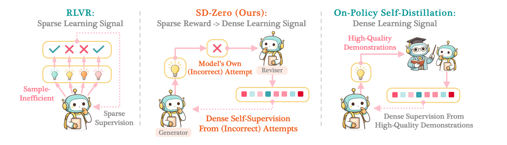
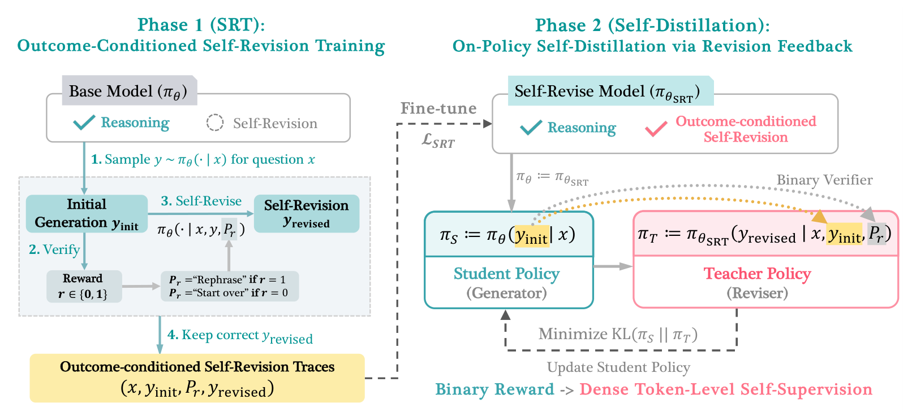
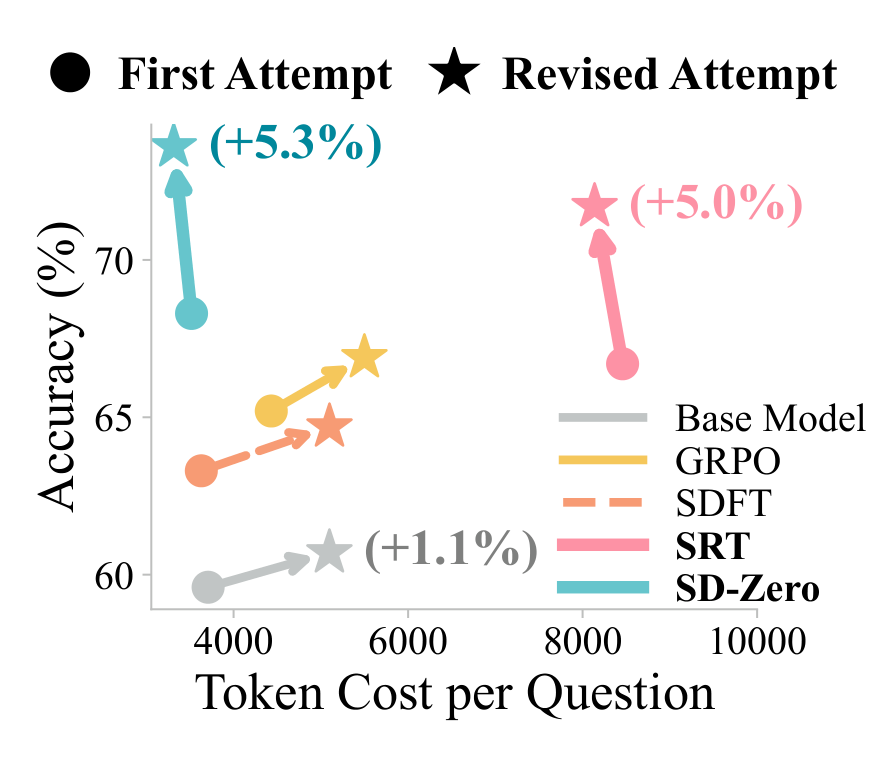
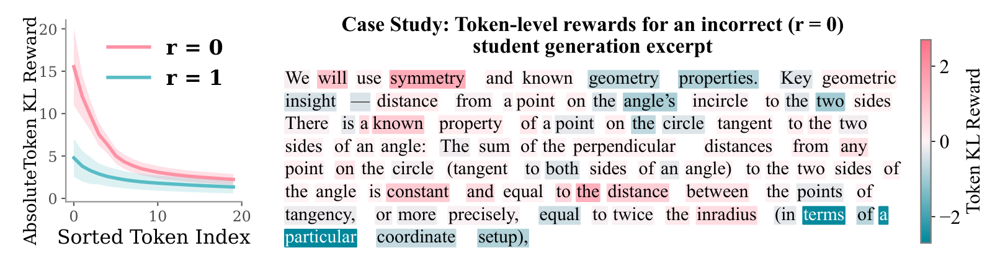
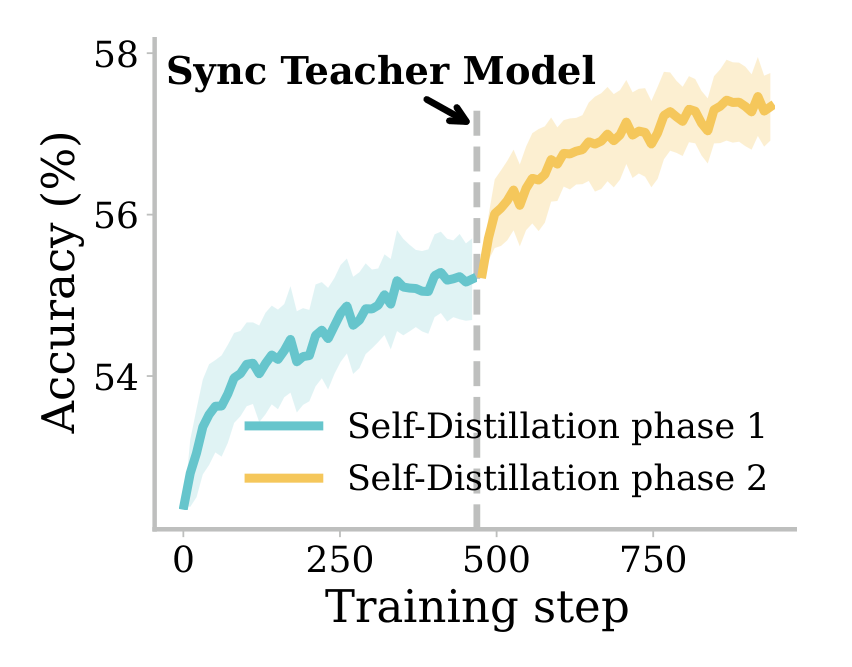
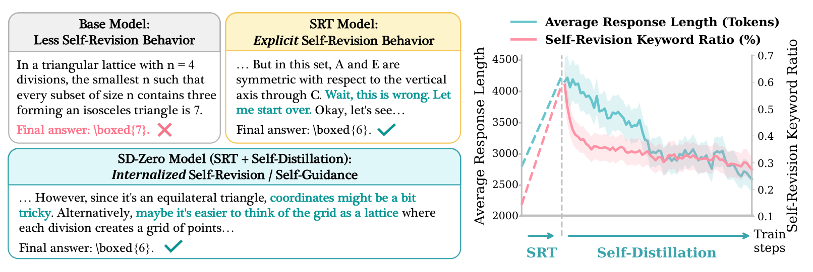

# Self-Distillation Zero: Self-Revision Turns Binary Rewards into Dense Supervision

[中文](./Self-Distillation-Zero.md) | English

- **Source**: [Self-Distillation Zero: Self-Revision Turns Binary Rewards into Dense Supervision](https://arxiv.org/abs/2604.12002v2)
- **Paper**: [arXiv:2604.12002](https://arxiv.org/abs/2604.12002)
- **Official resources**: [princeton-pli/Self-Distillation-Zero](https://github.com/princeton-pli/Self-Distillation-Zero)
- **Published**: 2026-04-13
- **Scope**: A plain-language explainer based on arXiv v2 (revised 2026-06-11), not a full translation. The authors are Yinghui He and others, 10 in all, from Princeton University, the University of Toronto and Carnegie Mellon University.

## In One Sentence

When large models are trained to solve math problems and write code, the usual reinforcement learning gives only two scores, "right" or "wrong" (1 point for a correct answer, 0 for a wrong one). The signal is coarse: a response to one problem can run to several thousand tokens, and in the end the model only learns that it was "wrong", not which step went wrong. This paper proposes SD-Zero (Self-Distillation Zero): one model plays two roles. The generator first writes a response. The reviser sees that response and whether it was right, rereads it token by token, and at each position gives "what I would write here instead". The generator is then trained to move toward the reviser's views. In a wrong response, the reviser's disagreements fall fairly heavily on the steps that went wrong. The original model is not good at revising responses, so it first gets one round of training on revisions it wrote itself whose final answer is correct; this step is called SRT (Self-Revision Training). The whole process needs no stronger teacher model and no reference solution, only a way to judge whether the final answer is right.

Results: on two models, Qwen3-4B-Instruct and Olmo-3-7B-Instruct, across 8 math and coding test sets, average accuracy rises from 49.8% to 60.3% and from 41.1% to 51.5% respectively, a gain of more than 10 percentage points each (called "points" below). By the paper's accounting, the baselines RFT, GRPO and SDFT each generate 60,000 responses and SD-Zero generates 49,000, with a comparable total number of generated tokens. Under this condition, SD-Zero scores higher than these three methods and SFT, leading by 4.8 to 10.3 points. On AIME24, the final model's responses are about as long as the original model's, and less than half as long as those of the model that went through only the first stage, SRT. A few numbers in the appendix do not add up; see Section 9.

---

## 1. Key Terms

| Term | In plain words |
| --- | --- |
| token | The basic unit a model reads and writes; think of it as a word or part of a word |
| Reinforcement learning (RL), RLVR | Reinforcement learning has the model answer on its own and adjusts it by score: ways of writing that score high get written more often. RLVR (reinforcement learning with verifiable rewards) means the score comes from a program that judges right or wrong automatically, for example by checking a math problem's final answer |
| Binary reward | A right/wrong score that takes only two values, 0 and 1 |
| GRPO | A reinforcement learning algorithm widely used on large models: write several responses to the same problem, compare them with each other by right/wrong, and update the model |
| SFT (supervised fine-tuning) | Have the model imitate ready-made answers word for word |
| RFT (rejection sampling fine-tuning) | The model writes several responses itself, and only the correct ones are kept for SFT |
| Distillation | At each position of the student's response, the teacher model gives a probability distribution over "what I would write here", and the student moves toward that distribution |
| On-policy | The responses used for practice are written fresh by the model itself, not written in advance by someone else |
| Self-distillation | The teacher is the model itself, only with some extra information in its prompt; it then guides, token by token, its own copy that sees only the problem |
| KL divergence | A number that measures how far apart two probability distributions are; the smaller it is, the closer they are |
| Generator, reviser | Two roles of the same model. The generator sees only the problem and writes a response; the reviser sees the problem, a response and whether it was right, then writes a better one. In the second stage, the generator is the student and the reviser is the teacher |
| SRT | The first stage of SD-Zero: fine-tune on revisions the model wrote itself whose final answer is correct, to teach it to revise responses |
| avg@8, pass@8 | The model attempts each problem 8 times. avg@8 is the average accuracy over the 8 attempts; pass@8 is the share of problems where at least 1 of the 8 attempts is correct |
| Token KL Reward | A number the paper computes for each token in its analysis: the student's log probability for this token minus the teacher's. A positive value means the teacher disagrees; a negative value means the teacher agrees more |

## 2. What Problem It Tackles

### The two current routes

To make a model stronger on tasks where "a program can judge right from wrong automatically", there are currently two main kinds of approach:

| Approach | How it learns | Strengths | Weaknesses |
| --- | --- | --- | --- |
| Reinforcement learning; this setting is called RLVR (reinforcement learning with verifiable rewards), and the common algorithm is GRPO | The model writes its own responses and a program scores them: 1 point if right, 0 if wrong | Works as long as right/wrong can be judged, so it applies widely | Each response gets only one score, with no word on which steps were good and which were wrong. The model can only feel its way by writing several responses to the same problem and comparing them, which costs many generations |
| Distillation | At each position of the student's response, the teacher model gives "what I would write here" | Every token gets guidance, so learning is fast | Needs a stronger teacher or high-quality demonstration solutions, which is costly and sometimes simply unavailable |

An analogy (the analogy is mine, not the paper's): reinforcement learning is like a teacher who grades a test with only ticks and crosses; distillation is like hiring a tutor to correct it line by line, but tutors are expensive and must also be better than the student.

### Self-distillation got halfway there

Several recent "self-distillation" papers, OPSD (arXiv 2601.18734), SDFT (arXiv 2601.19897) and SDPO (arXiv 2601.20802), removed the external teacher: the teacher is the model itself, only with some extra information in its prompt, and it guides, token by token, its own copy that sees only the problem. The remaining problem lies in that "extra information". OPSD and SDFT need a reference solution or an expert demonstration; SDPO needs detailed feedback from the environment (such as a program's error messages) or other correct responses to the same problem. These things either have to come from outside or have to be found by sampling repeatedly and filtering, which also has a cost.

The question the paper sets out to answer is (a close rendering of the original): **can a model give itself better per-token supervision by looking only at its own first attempts (which may be wrong) and whether those attempts were right?**



*Figure 1: On the left is RLVR: the model writes several responses and each gets only a tick or a cross, so the signal is sparse and costs many samples. On the right is the usual on-policy self-distillation: the teacher has seen a high-quality demonstration and guides the student token by token, so the signal is dense, but a demonstration is required. In the middle is SD-Zero: the reviser looks at a response the model itself got wrong and gives per-token guidance.*

## 3. The Core Idea: One Model, Two Roles

- **Generator**: sees only the problem and writes a response.
- **Reviser**: sees the problem, the generator's response and a prompt phrase chosen by whether that response was right, then writes a better response.
  - If it was right, the phrase "Let me rephrase the above solution." is appended.
  - If it was wrong, the phrase "Wait, this response is not correct, let me start over." is appended.

The two roles are **the same model**; the only difference is whether the input contains "the previous response + prompt phrase". The Zero in the name roughly means "zero external teachers"; in the comments of the paper's source code, the method was called Zero-Teacher Self-Distillation early on.

Why the reviser can act as the teacher: it reads the response after learning that "this response is wrong", so when it reaches the step with the error it disagrees and wants to write it another way; where nothing is wrong, it basically writes the same thing. Take the reviser's probability distribution over "which token to write next" at each position, and you have a set of per-token corrections. When the generator imitates this distribution, it in effect learns "don't make the mistake here in the first place". This is what the title means by "self-revision turns binary rewards into dense supervision".

There is a precondition here: the model must actually be able to revise responses. The paper finds that the original model is fine at solving problems but weak at revising responses (numbers in Section 6.3), so training has two stages: first teach it to revise, then use its revising skill to teach problem solving.



*Figure 2: The left half is the first stage, SRT. The original model can reason but is not good at self-revision (dashed circle). 1. Sample a first draft y_init for problem x; 2. check it to get r, and pick the prompt phrase P_r by r ("Rephrase" or "Start over"); 3. have the same model continue and write a revision y_revised; 4. keep only the correct revisions, giving data made of "problem, draft, prompt phrase, revision", and fine-tune with the loss L_SRT to get the SRT model. The right half is the second stage, self-distillation. The SRT model acts as both student and teacher: the student (generator) sees only the problem and writes a response, and the teacher (reviser) sees the problem, the student's response and the prompt phrase. The gap between them is measured by KL(π_S‖π_T), and only the student is updated. The text along the bottom reads "Binary Reward -> Dense Token-Level Self-Supervision". The caption says the teacher "generates a revision", but by the paper's formulas the teacher does not actually write a new response; it only gives a probability distribution at each position of the student's response.*

## 4. How the Training Works

The training problems are split into two non-overlapping sets: the first stage uses one, and the second stage uses the other.

### Stage 1: first teach the model to revise responses (SRT)

Where the data comes from (math as the example; coding works the same way):

1. Take the first 10,000 problems of OpenR1-Math and have the original model write 1 first draft for each. About 5000 drafts are right and 5000 are wrong.
2. Append the prompt phrase that matches each draft's result, and have the model write 3 revisions: 3 "rephrase" revisions for a correct draft, 3 "start over" revisions for a wrong one.
3. Keep only the records where **the revision's final answer is correct**; about 6000 remain in the end.

This step makes 40,000 generations in total (10,000 drafts + 30,000 revisions). The "keep only the correct revisions" step cannot be skipped: the paper tried skipping it on another task in Appendix G, and training on unfiltered data did worse than training directly on the model's own correct drafts (see Section 7.4).

These 6000 records are then used to practice two things at once:

- **Practice revising**: the input is "problem + draft + prompt phrase", and the model learns to write the correct revision.
- **Practice doing it all in one go**: the input is only the problem, and the model learns to write the whole sequence "draft + prompt phrase + revision". In other words, the model has to learn to judge for itself whether a finished version is right, then continue with "let me rephrase and write it again" or "wait, this is wrong, start over", and finally give the correct answer.

Both are ordinary supervised fine-tuning (raising the model's probability of writing the target text), and the two losses are simply added together.

A side effect is longer responses. The model has learned to "write it once, check, write it again" within one response: on AIME24, the SRT model's responses average 8458 tokens, 2.3× the original model's (3708).

### Stage 2: distill the "revising" skill back into "solving" (self-distillation)

1. Make two copies of the SRT model: one is frozen as the teacher (reviser), and the other keeps training as the student (generator).
2. Take problems from the other set (9000 problems); the student writes only 1 response per problem.
3. Judge whether this response is right and append the matching prompt phrase.
4. The teacher's input is "problem + the student's whole response + prompt phrase"; it then takes the student's response from the start and **reads it again exactly as written**, and at each position computes the probability distribution over "if I were writing the revision and had written up to here, which token would I write next". The teacher only reads and does not write: one pass of probability computation is enough, with no actual generation.
5. The student also has its own distribution at the same positions. Training pulls the student's distribution toward the teacher's, with the gap measured by KL divergence. The teacher's parameters are not updated; it is only a reference.

Why this teaches the model something:

- When the student is wrong, the teacher's prompt phrase is "this is wrong, let me start over". When the teacher rereads the steps with the error, it does not agree with the tokens the student wrote and puts the probability on other ways of writing them. The student gets pulled back at these positions and barely moves at the others.
- When the student is right, the teacher's prompt phrase is "rephrase". The paper observes that the model usually writes less when it rephrases, and suggests this may make second-stage responses more concise.

As a result, the student gradually learns to "get it right in one go" and no longer needs to write out "wait, start over". After the second stage, responses on AIME24 drop to an average of 3518 tokens, less than half the SRT model's and about the same as the original model's (3708).

### An extra trick: replace the teacher periodically

The second-stage teacher is always the frozen SRT model. Once the student has learned enough, the teacher has little left to teach, and scores plateau at some level. But the student that finishes the second stage has not lost its revising skill and has even improved it slightly (numbers in Section 6.3), so the student can be promoted to be the new teacher for another round of training. The paper calls this **iterative self-evolution**; the experiments are in Section 6.6.

### Optional: the formulas

You can skip this without losing the thread. Write the problem as $`x`$, the reference final answer as $`a`$ (only the final answer, no solution steps), the model as $`\pi_\theta`$, the model's response as $`y`$, and the right/wrong reward as $`r(y,a)\in\{0,1\}`$: it is 1 if the final answer extracted from $`y`$ matches $`a`$, and 0 otherwise.

The prompt phrase depends on right/wrong:

```math
P_r=\begin{cases}\text{Let me rephrase the above solution.} & r=1\\ \text{Wait, this response is not correct, let me start over.} & r=0\end{cases}
```

The two first-stage losses, where $`y_{\text{init}}`$ is the first draft and $`y_{\text{revised}}`$ is the correct revision (averaging over the dataset is omitted):

```math
\mathcal{L}_{\text{revision}}=-\sum_{t}\log \pi_\theta\big(y'_t \mid x,\,y_{\text{init}},\,P_r,\,y'_{<t}\big),\qquad y'=y_{\text{revised}}
```

```math
\mathcal{L}_{\text{generation}}=-\sum_{t}\log \pi_\theta\big(y'_t \mid x,\,y'_{<t}\big),\qquad y'=[\,y_{\text{init}},\,P_r,\,y_{\text{revised}}\,]
```

```math
\mathcal{L}_{\text{SRT}}=\mathcal{L}_{\text{revision}}+\mathcal{L}_{\text{generation}}
```

In the second stage, the student's parameters $`\theta`$ start from the SRT model's parameters $`\theta_{\text{SRT}}`$, and the teacher is fixed at $`\theta_{\text{SRT}}`$:

```math
\mathcal{L}_{\text{SD}}(\theta)=\mathbb{E}_{(x,a)}\,\mathbb{E}_{y\sim\pi_\theta(\cdot\mid x)}\sum_{t=1}^{|y|}\mathrm{KL}\Big(\pi_\theta(\cdot\mid x,\,y_{<t})\;\Big\|\;\pi_{\theta_{\text{SRT}}}(\cdot\mid x,\,y,\,P_r,\,y_{<t})\Big)
```

The left side of the KL is the student's "next-token distribution" when it sees only the problem and has written up to position $`t`$; the right side is the teacher's distribution when, after seeing the whole response $`y`$ and the prompt phrase $`P_r`$, it rereads up to the same position. At the start of training both sides have the same parameters; the only difference is that the teacher's input also contains $`y`$ and $`P_r`$. Appendix Table 6 shows that the implementation uses top-K distillation (K = 64), that is, at each position only the 64 candidate tokens with the highest probability are computed in detail.

For its analysis, the paper looks at each position separately and defines the Token KL Reward:

```math
\log \pi_\theta(y_t\mid x,y_{<t})-\log \pi_{\theta_{\text{SRT}}}(y_t\mid x,y,P_r,y_{<t})
```

A positive value means the student believes in the token it wrote more than the teacher does, that is, the teacher disagrees, and training will push the token down; a negative value means the teacher agrees more, and training will push it up. Although the name contains Reward, a larger value actually means the teacher disagrees more, so don't get it backwards when reading Figure 4.

## 5. How It Differs from Other Approaches

Appendix Table 2 of the paper puts several kinds of methods side by side:

| Method | Who wrote the responses it trains on | Signal granularity | Who the teacher is | Can the teacher see the student's wrong attempt |
| --- | --- | --- | --- | --- |
| SFT / distillation | Someone else, in advance | Fine, every token gets a signal | External | Not applicable |
| On-policy distillation | The model itself | Fine | An external, stronger model | Not applicable |
| RLVR (such as GRPO) | The model itself | Coarse, one score per response | No teacher | Not applicable |
| OPSD / SDFT / SDPO | The model itself | Fine | Itself | No |
| **SD-Zero** | The model itself | Fine | Itself | **Yes** |

The last column is the difference the paper stresses. As the paper sums it up, in the earlier self-distillation methods the teacher's extra input is reference material from outside the student's response (a reference solution, an expert demonstration, environment feedback, or correct responses from the same group), which it uses to judge the student; in SD-Zero, the teacher's extra input is the student's own whole response plus a right/wrong verdict, with no reference material at all, and it relies on the model's own ability to correct errors. (In every on-policy self-distillation method, the teacher rereads the student's response token by token; the difference is what goes into the prompt before the rereading.)

### How many generations it took

The paper stresses that the comparison is made under "comparable numbers of generations" (Appendix C.2, Table 3):

| Method | Problems used | Generations per problem | Total generations |
| --- | --- | --- | --- |
| RFT | 15,000 | 4 | 60,000 |
| GRPO | 15,000 | 4 | 60,000 |
| SDFT | 15,000 | 4 | 60,000 |
| SD-Zero first stage | Sampled from 10,000 problems, leaving 6000 training records | 1 draft + 3 revisions | 40,000 |
| SD-Zero second stage | 9000 | 1 | 9000 |
| **SD-Zero total** | | | **49,000** |

Counted in tokens: at about 3700 tokens per response, RFT and GRPO each generate about 222 million tokens. SD-Zero's first stage is about 148 million; for the second stage, the paper estimates at most 8500 tokens per response, an upper bound of about 76.5 million; the total is at most about 225 million, comparable to the baselines.

So SD-Zero's advantage is better scores at the same cost; the total cost itself is not much lower. Its savings come in the second stage: GRPO can only score responses by comparing several responses to the same problem, so it writes at least several per problem; SD-Zero's second stage writes only 1 per problem, and the scoring comes from the teacher's per-token feedback. Two points in this accounting are unclear; see Section 9.

## 6. Experimental Results

### 6.1 How the experiments were set up

- **Models**: Qwen3-4B-Instruct (version 2507) and Olmo-3-7B-Instruct, both with thinking mode off; their responses are fairly short.
- **Training problems**: math and coding are trained separately. For math, 15,000 problems at competition and olympiad difficulty are picked from OpenR1-Math; for coding, 7500 items each are taken from the C++ solution and Python solution subsets of the Codeforces dataset. Each domain is split as "about 6000 records for the first stage, 9000 problems for the second".
- **Tests**: 8 test sets. Competition math: AIME24, AIME25, HMMT25 and MATH; olympiad math: AMOBench and 500 problems held out from OpenR1-Math; coding: Codeforces (also 500 held-out problems) and LiveCodeBench (LCB below). Each problem is generated 8 times and the average accuracy is taken (avg@8); responses are capped at 32K tokens during evaluation.
- **Baselines**, all using the same 15,000 problems:
  - **SFT**: supervised fine-tuning on high-quality solutions written by DeepSeek-R1.
  - **RFT** (rejection sampling fine-tuning): the model writes 4 responses per problem itself, and only the correct ones are kept for fine-tuning.
  - **GRPO**: standard reinforcement learning, writing 4 responses per problem, scoring them by right/wrong, and training for 1 epoch; the version actually used is its improved variant DAPO.
  - **SDFT**: on-policy self-distillation in which the teacher sees a reference solution in its prompt.
- **Generations**: the methods are matched by total number of generations; the accounting is in Section 5.

### 6.2 Both models gain more than 10 points, mostly from the first stage

Table 1 of the paper, avg@8 accuracy (%), with the best in each column in bold. On Qwen3-4B-Instruct:

| Method | AIME24 | AIME25 | HMMT25 | AMOBench | OpenR1 | MATH | Codeforces | LCB | Average |
| --- | --- | --- | --- | --- | --- | --- | --- | --- | --- |
| Original model | 59.6 | 45.8 | 26.7 | 9.8 | 55.8 | 91.0 | 48.0 | 61.8 | 49.8 |
| SFT | 61.7 | 46.3 | 31.3 | 7.3 | 56.1 | 91.3 | 49.1 | 57.2 | 50.0 |
| RFT | 64.2 | 52.1 | 37.1 | 11.3 | 59.3 | 91.9 | 50.9 | 68.0 | 54.3 |
| GRPO | 62.5 | 50.0 | 30.4 | 11.0 | **62.9** | 93.5 | 52.2 | 62.6 | 53.1 |
| SDFT | 63.3 | 47.9 | 32.9 | 9.0 | 57.0 | 91.1 | 49.3 | 59.2 | 51.2 |
| SRT (first stage only) | 66.7 | 59.2 | 40.0 | **16.0** | 59.8 | 92.4 | 52.7 | 74.4 | 57.6 |
| **SD-Zero** | **68.3** | **60.0** | **45.4** | **16.0** | 60.4 | **93.6** | **56.1** | **82.6** | **60.3** |

On Olmo-3-7B-Instruct:

| Method | AIME24 | AIME25 | HMMT25 | AMOBench | OpenR1 | MATH | Codeforces | LCB | Average |
| --- | --- | --- | --- | --- | --- | --- | --- | --- | --- |
| Original model | 56.7 | 42.1 | 25.0 | 1.3 | 48.9 | 91.1 | 31.7 | 32.4 | 41.1 |
| SFT | 51.3 | 43.8 | 30.4 | 1.3 | 48.5 | 91.4 | 31.7 | 41.0 | 42.4 |
| RFT | 56.7 | 48.3 | 35.8 | 2.3 | 50.9 | 91.4 | 39.2 | 49.4 | 46.7 |
| GRPO | 54.6 | 43.8 | 25.8 | 4.8 | **56.9** | 91.8 | 37.1 | 43.6 | 44.8 |
| SDFT | 52.9 | 45.0 | 32.1 | 1.3 | 49.0 | 91.2 | 33.5 | 42.3 | 43.4 |
| SRT (first stage only) | 59.2 | 52.9 | 39.6 | 3.5 | 52.4 | 92.3 | 42.8 | **59.6** | 50.3 |
| **SD-Zero** | **61.7** | **53.8** | **40.4** | **5.5** | 55.3 | **94.0** | **43.5** | 57.8 | **51.5** |

How to read these two tables:

- **Both models gain more than 10 points.** Qwen goes from 49.8% to 60.3% (+10.5), and Olmo from 41.1% to 51.5% (+10.4).
- **Most of the gain comes from the first stage.** With only about 6000 revision records the model wrote itself, SRT raises the average score by 7.8 points (Qwen) and 9.2 points (Olmo), already above every baseline. The second stage adds another 2.7 and 1.2 points.
- **The biggest gains are on hard problems and coding.** Qwen's LCB goes from 61.8 to 82.6 (+20.8), HMMT25 from 26.7 to 45.4 (+18.7), and AIME25 from 45.8 to 60.0 (+14.2); Olmo's LCB goes from 32.4 to 57.8 (+25.4), and HMMT25 from 25.0 to 40.4 (+15.4). MATH was already above 91%, leaving little room to gain.
- **Copying a strong model's solutions barely helps.** SFT on DeepSeek-R1's solutions raises the average by only 0.2 points (Qwen) and 1.3 points (Olmo), and Qwen even loses points on AMOBench and LCB. RFT also gains very little on hard sets like AMOBench. The paper's explanation is that SRT trains "error correction": one record holds both a draft the model itself got wrong and the corrected version, so the model can learn from its own mistakes; RFT simply throws the wrong responses away.
- **It does not win every column.** On the OpenR1 test set, which comes from the same source as the training problems, GRPO is highest for both models (62.9, 56.9), while SD-Zero gets 60.4 and 55.3. Olmo's LCB even drops 1.8 points in the second stage (59.6 to 57.8).

**pass@8 rises too.** pass@8 is the share of problems where at least 1 of 8 attempts is correct; it measures whether the model "can solve it at all", rather than only "how reliably it solves it". Appendix Table 7 averages over 6 math test sets: Qwen goes from 66.7% to 72.5% and Olmo from 62.3% to 70.8%; GRPO gets 65.4% and 63.1%, and on Qwen it is even below the original model. In reinforcement learning it is common for average accuracy to rise while pass@k barely moves, because the model only becomes surer on problems it could already solve. On this basis the paper argues that SD-Zero does more than make the model more "confident": the model has actually learned to solve some additional problems.

### 6.3 After the first stage, the model really can revise responses

The paper ran an "answer first, then revise" test (Generate-then-Revise) with Qwen on AIME24: first the model answers once; then it is told its response and whether it was right, and asked to write a revision. The results are in Appendix Table 9 of the paper (accuracy and correction rate in %):

| Model | Draft tokens | Revision tokens | Draft accuracy | Accuracy after revision | Correction rate |
| --- | --- | --- | --- | --- | --- |
| Original model | 3708 | 5098 | 59.6 | 60.7 | 2.7 |
| GRPO | 4432 | 5499 | 65.2 | 66.9 | 4.9 |
| SDFT | 3630 | 5099 | 63.3 | 64.7 | 3.8 |
| SRT | 8458 | 8137 | 66.7 | 71.7 | 15.0 |
| SD-Zero | 3518 | 3314 | 68.3 | 73.6 | 16.7 |

Correction rate = (accuracy after revision − draft accuracy) ÷ (100 − draft accuracy), that is, the net share of the originally wrong problems that got fixed.



*Figure 3: The x-axis is the number of tokens spent per problem, and the y-axis is AIME24 accuracy. Dots are first attempts, stars are revisions written after seeing the right/wrong verdict, and the number in parentheses is how many points the revision adds to accuracy. The original model (gray) gains only 1.1 points from revising and writes even longer, and GRPO (yellow) and SDFT (orange) are about the same. SRT (pink) gains 5.0 points, but writes very long both times. SD-Zero (teal) gains 5.3 points and writes short both times.*

How to read this table:

- **The original model can barely use the "wrong" signal.** After being told "this is wrong, start over", it fixes a net 2.7% of the problems it got wrong. After SRT this is 15.0%, which shows the model has learned to use the "wrong" signal to revise.
- **Revisions got shorter.** The revisions of SRT and SD-Zero are both shorter than their own drafts, which the paper takes to mean that revising is more targeted; the original model's revisions are instead longer, possibly with a lot of repetition.
- **The second stage did not weaken the revising skill.** The correction rate even rises from 15.0% to 16.7%. This is the precondition for the later "replace the teacher" step to work.

### 6.4 Second stage: more accurate, with responses cut by more than half

Since most of the improvement is already obtained in the first stage, is the second stage still needed? The paper gives three reasons:

1. **A bit more gain.** Qwen +2.7 points, Olmo +1.2 points. Qwen gains mainly in coding and HMMT25 (LCB +8.2, Codeforces +3.4, HMMT25 +5.4); Olmo gains mainly in math (AIME24 +2.5, OpenR1 +2.9, AMOBench +2.0).
2. **Responses more than halved, so inference is cheaper.** On AIME24, SD-Zero's responses average 3518 tokens versus 8458 for SRT; they are also shorter than those of the original model (3708), GRPO (4432) and SDFT (3630).
3. **Fewer generations during training.** Building the first-stage data takes 1 draft plus 3 revisions per problem; the second stage writes only 1 response per problem.

Against the two main competitors, on the average score over the 8 test sets, SD-Zero beats GRPO by 7.2 points (Qwen) and 6.7 points (Olmo), and SDFT by 9.1 and 8.1 points. The appendix has two more sets of comparisons, both averaged only over Qwen's 6 math test sets.

The first gives GRPO more generations, Appendix Table 10 of the paper (average over 6 math test sets, %):

| Setting | Average over 6 math test sets |
| --- | --- |
| GRPO, 4 responses per problem, 1 epoch (the setting used in Table 1) | 51.7 |
| GRPO, 8 responses per problem, half an epoch (same total generations) | 50.6 |
| GRPO, 8 responses per problem, 1 epoch (twice the generations) | 52.3 |
| SD-Zero | 57.3 |

Doubling GRPO's generations adds only 0.6 points to the average, still 5 points behind SD-Zero. The paper argues that SD-Zero's advantage lies not in sampling more but in turning the right/wrong signal into more informative per-token supervision.

The second gives SDFT only the final answer (Appendix Table 8). SDFT's teacher normally sees a full reference solution. If, as in SD-Zero, it gets only the final answer, the average is 49.5%; with the full solution it is 49.7%; the original model is at 48.1%; SD-Zero is at 57.3%. On this basis the paper says that existing self-distillation methods cannot make use of "final answer only" supervision, while SD-Zero is designed for exactly this case. (These numbers can also be read another way; see Section 9.)

### 6.5 The reviser can point out which tokens went wrong

The teacher receives only a single 0 or 1, so does its feedback get spread evenly over every token? The paper measured this: for each response, compute the disagreement between teacher and student at every position, sort the tokens by disagreement from largest to smallest, split them into 20 equal segments, then average over 200 responses; correct and wrong responses are counted separately.



*Figure 4: In the left plot, the x-axis is the 20 sorted segments and the y-axis is each segment's average disagreement (in absolute value). The pink line is wrong responses (r = 0) and the teal line is correct responses (r = 1); the paper does not explain what the shading means. The right plot is a fragment of a wrong math solution, colored by each token's Token KL Reward. Pink means the teacher disagrees (positive value), and teal means the teacher agrees more than the student (negative value).*

Reading the left plot (values read off the plot):

- For wrong responses, the segment with the largest disagreement is at about 15.5 and the smallest at about 2.2, a gap of about 7×; computed from the plot's numbers, the 20% of tokens with the largest disagreement account for about 46% of all disagreement.
- For correct responses, the largest is about 4.8 and the smallest about 1.3, and the whole line is low and flat; the top 20% account for about 34%. (If disagreement were spread perfectly evenly, this share would be 20%.)

In other words, when the response is wrong, the teacher's feedback is concentrated on a subset of positions; when it is right, the teacher basically accepts the student's writing, with only scattered minor objections.

The right plot is a concrete example. The student plans to solve the problem "using symmetry and known geometric properties", and the later reasoning rests on a wrong symmetry argument. The deepest pink falls on the words "will", "symmetry", "known" and "constant", which the teacher clearly disagrees with; in the phrase "in terms of a particular coordinate setup" at the end of the fragment, words such as "terms" and "particular" are deep teal, meaning the teacher agrees with them more than the student does. The paper's reading is that the teacher does more than point out "this is wrong": it also pushes the probability in a better direction (the coordinate method), and in this way a single 0 becomes a per-token signal with both positive and negative values. The paper calls this **token-level self-localization**.

The paper also points out that this signal plays a role similar to a "process reward model" (PRM, a model that scores each reasoning step). The difference is cost: a PRM needs step-by-step human labels, or heavy sampling to estimate how good each step is, plus a separately trained scoring model; SD-Zero's signal comes only from "the same model + its own response + a right/wrong verdict".

### 6.6 Replacing the teacher keeps the gains coming

For SD-Zero in Table 1, the second-stage teacher is always the frozen SRT model. Separately, the paper tried replacing the teacher in only one setting (Qwen, math): after the first round of self-distillation, the teacher is replaced by the student at that point, and another round is trained.



*Figure 5: The x-axis is the number of second-stage training steps, and the y-axis is accuracy. The teal line is the first round of self-distillation (the teacher is the SRT model); at the gray dashed line the teacher is replaced by the student at that point, and the yellow line is the second round. The caption does not name the task or the model; the main text says these are results for Qwen3-4B-Instruct on OpenR1-Math.*

Reading the curves (values read off the plot): the first round rises from about 52.4% to about 55.2%, flattening more and more toward the end; after the teacher is replaced, the second round rises from about 55.3% to about 57.3%, fast at first, with the rise also slowing toward the end. The main text of the paper says the first round saturates at around 400 steps, and that the second round "gains at least another 3 percentage points, with no sign of saturation". By the plot's numbers, the second round's extra gain is about 2 points (see Section 9).

This trick works because of the finding in Section 6.3: the student that finishes the second stage has not lost its revising skill (correction rate 16.7%, versus 15.0% for SRT), so it is good enough to be the new teacher. The paper calls this loop iterative self-evolution: the revising skill is distilled into solving, solving gets stronger while revising does not get weaker, and so the teacher can be replaced round after round.

### 6.7 How the response style changes: from "revising out loud" to "getting it right inside"



*Figure 6: Qwen3-4B-Instruct trained on OpenR1-Math. Left: response fragments from the models at three stages on the same problem (choose points from the lattice points of an equilateral triangular grid; what is the minimum number of points that guarantees three of them form an isosceles triangle). The original model directly gives the wrong answer 7; the SRT model says "Wait, this is wrong. Let me start over." halfway through and finally gets the correct answer 6; the SD-Zero model does not scrap its work and start over, but realizes early that "using coordinates might be a bit messy; better to think of it as lattice points", and gets 6 directly. Right: the average response length during training (teal line, left axis, in tokens) and the share of self-revision keywords (pink line, right axis, in %). The dashed part on the left is the SRT stage, and the solid part on the right is the self-distillation stage.*

"Self-revision keywords" are a set of phrases listed in Appendix E.1 of the paper, such as wait, hold on, actually, let me recheck, my mistake, this is wrong, let me start over and oops. Reading the right plot (values read off the plot):

- **SRT stage**: response length rises from about 2800 to about 4200 tokens, and the keyword share from about 0.14% to about 0.59%. The model has learned to check itself within a response and to scrap everything and start over when it finds an error. This segment has only two numbers, a start point and an end point, joined by a dashed line.
- **Self-distillation stage**: both lines go down, with length falling to about 2600 and the keyword share to about 0.28%, while accuracy keeps rising.

In the example on the left, the SRT model uses almost exactly the prompt phrase from training, "this is wrong, let me start over". The paper's reading is that the second stage internalizes "revising out loud" into "avoiding the pitfall from the start", so responses are shorter and accuracy is higher, while the test in Section 6.3 shows the revising skill was not lost.

## 7. Taking It Apart: Which Design Choices Are Necessary

Everything below is done on Qwen3-4B-Instruct. The "average over 8 test sets" is measured the same way as in Table 1; "answer first, then revise" is measured the same way as in Section 6.3, on AIME24.

### 7.1 Both parts of the first stage are needed

Appendix Table 11 of the paper (%):

| How the first stage is trained | Average over 8 test sets | Draft accuracy | Accuracy after revision | Correction rate |
| --- | --- | --- | --- | --- |
| Original model (no training) | 49.8 | 59.6 | 60.7 | 2.7 |
| Both parts (full SRT) | 57.6 | 66.7 | 71.7 | 15.0 |
| Only "doing it all in one go" | 56.4 | 65.4 | 67.9 | 7.2 |
| Only "revising" | 52.2 | 62.1 | 66.7 | 12.1 |

Training only on "doing it all in one go" gives decent problem solving but weak revising (correction rate 7.2%); training only on "revising" teaches the model to revise (12.1%), but problem solving barely improves (52.2). The paper's reading is that the two complement each other: "revising" draws out the ability to correct errors, and "doing it all in one go" carries it into everyday problem solving. The paper mentions that SCoRe (arXiv 2409.12917), earlier work that used reinforcement learning to train models to self-correct, reached a similar conclusion.

### 7.2 The first stage cannot be skipped

Appendix Table 12 of the paper: running the second stage directly on the original model gives an average over 8 test sets of 51.4, only 1.6 points above the original model; the correction rate is 2.6%, almost the same as the original model's 2.7%. The full two-stage method gets 60.3 and 16.7%. The original model is not good at revising responses to begin with, so when it is told "this is wrong, start over", the per-token feedback it gives is not much use. The teacher has to have the skill before it can teach the student.

### 7.3 Give more of the data to the second stage

With the total number of training problems fixed and the split between the two stages varied, Appendix Table 13 of the paper (average over 8 test sets, %):

| First stage | Second stage | SRT model average | Final model average |
| --- | --- | --- | --- |
| 6K | 9K | 57.6 | **60.3** |
| 7.5K | 7.5K | 57.8 | 59.8 |
| 9K | 6K | 57.8 | 59.1 |

With the total fixed, giving more to the first stage barely raises the SRT model (57.6 to 57.8), and the final score is actually somewhat lower. The paper's reading is that the first stage only needs to draw out the revising skill, and extra data is better spent on the second stage. The groups differ by at most 1.2 points.

### 7.4 Checking the design on another task (Appendix G)

The authors ran a set of supplementary experiments on Countdown with Qwen2.5-7B. Countdown is a number puzzle: given a few numbers, reach a target number using addition, subtraction, multiplication and division. The model, task and pipeline of these experiments all differ from the main experiments; they serve only to support a few design principles:

- **Data the model wrote itself beats data from stronger models.** SFT on data written by "the same model after GRPO training" gives a pass@1 of about 0.88; data written by LLaMA-70B and GPT-4o (both filtered for correctness) gives only 0.605 and 0.617. The paper concludes that "distribution matching matters more than the teacher's level". (This is my view: the post-GRPO model already scores about 0.91 on this task by itself, and the data it writes is also of higher quality, so this comparison does not fully rule out "better data" as a factor.)
- **Revised responses beat first drafts.** Training on revisions filtered for correctness gives a pass@1 of 0.630, while drafts filtered for correctness give only 0.552. Both were written by the model itself; the only difference is the extra "revision" step.
- **Filtering for correctness is a must.** Training on unfiltered revisions gives only 0.529, lower even than training on filtered drafts (0.552); with filtering it is 0.630, 19% higher in relative terms. The paper's explanation is that revisions mixed with errors drag training down.
- **Revisions make a good base for reinforcement learning.** With SFT on revisions first and then GRPO (none of the data in this set of experiments was filtered for correctness), pass@128 (at least 1 correct in 128 attempts) on AIME24 and AIME25, which were not trained on, is 0.40 and 0.47; SFT on LLaMA-70B's responses first and then GRPO gives 0.23 and 0.40; GRPO alone gives 0.30 and 0.40. However, pass@1 for all three is only 0.06 to 0.08, so the improvement shows up only in the ceiling over many attempts.

## 8. Limitations the Authors Acknowledge

- **Only models with thinking mode off were tried.** The experiments used only two instruct models, at 4B and 7B, with fairly short responses. Extending this to "thinking models" that write very long reasoning is the next step, but not an easy one: long reasoning naturally contains trial and error and changes of mind midway, which are not necessarily mistakes, and it is hard to tell useful exploration from real errors. Appendix F gives preliminary evidence: when Qwen3-4B is trained with SDFT with thinking mode on (thinking mode is on in all evaluations), AIME24, AIME25 and HMMT25 drop by 9.8, 10.8 and 8.3 points respectively; when it is trained with thinking mode off, the drops are much smaller (AIME25 drops 3.1, and the other two stay about flat). Note that this experiment used SDFT, not SD-Zero.
- **It applies only to tasks where right/wrong can be judged automatically.** The experiments covered only math and coding. How to use it for tasks with no reference solution, such as writing and dialogue, is still unsolved. One direction the authors mention is defining rewards with "metacognitive" signals such as consistency and self-correction. Appendix G found that revisions not filtered for correctness also carry some useful information, which the authors think leaves some room for tasks where "there is no right or wrong to judge".

## 9. Points Worth Noticing While Reading

Below are points I noticed while reading the paper that it does not discuss at length, offered for reference.

### How strong the evidence is

- **The "comparable budget" accounting is unclear in two places.** The first is the number of problems: the first stage samples from 10,000 problems, and the second stage uses "another" 9000. If the two batches do not overlap, SD-Zero generated responses on about 19,000 problems in total, versus 15,000 for the baselines; the paper says it "uses the same problems" but does not make clear how these two batches relate to those 15,000. The second is the number of training steps: by Appendix Table 6, the second stage uses 128 problems per step, so one round (epoch) over 9000 problems is about 70 steps; in Figure 5, about 460 steps have already been trained before the teacher is replaced, yet the main text says the teacher was replaced after "finishing one round". At 128 problems per step, 460 steps correspond to about 59,000 generations, more than the 49,000 in SD-Zero's entire budget table. If the main experiment's second stage also trained this long, the actual number of generations would be far more than the 9000 in the budget table (to be confirmed).
- **Of the 6000 training records, perhaps few are real "error fixes".** The paper does not say how many of the 6000 are "fixing an error" and how many are "rephrasing", nor how it chose among the qualifying records. Working from the appendix's pipeline: each of the roughly 5000 correct drafts gets 3 rephrasings, and with the correct answer sitting right there in the context, rephrasings are almost always correct, so this category alone could leave more than ten thousand records after filtering; getting the 5000 wrong drafts fixed is much harder (the original model is very weak at fixing errors, with a correction rate of only 2.7% on AIME24). So among the final 6000 records, rephrasing samples very likely make up the majority (my estimate). The paper attributes SRT's effect mainly to "learning from its own mistakes"; to test that explanation, one would first need to know how many samples are real error fixes. Also, the "doing it all in one go" practice is applied to correct drafts as well, so the model learns "write it once, say I'll rephrase, then write it again". Part of the 2.3× growth in SRT's response length may come from this, not all of it from error correction.
- **"Replacing the teacher gains at least another 3 percentage points" does not match the plot's numbers.** By the curves in Figure 5, accuracy is about 55.2% when the teacher is replaced, about 57.3% at the end of the second round, and about 57.5% at its peak, an extra gain of about 2.1 to 2.2 points. As a relative gain this is about 4%, which may be what the "at least 3%" in the paper's introduction means, but Section 3.4 of the paper explicitly says "percentage points". Figure 5 starts at about 52.4%, which is not the same number as the SRT model's 59.8% on OpenR1 in Table 1; it is probably a different validation measure used during training (the paper does not explain). This set of experiments covers only one setting, Qwen + math. By the paper's description, SD-Zero in Table 1 did not replace the teacher, and the second round's scores are not reported separately in the tables.
- **The concentration "on a few tokens" is milder than the text suggests.** The main text says that for wrong responses "most of the disagreement is concentrated on a small fraction of tokens". By the readings from the left plot of Figure 4 (read off the plot), it takes the roughly 25% of tokens with the largest disagreement to account for about half of all disagreement (about 53%); for correct responses, the same 25% of tokens account for about 40% (perfectly even would be 25%). Disagreement is indeed more concentrated for wrong responses, and its total is also more than 2× that for correct responses, but "a small fraction" should be taken with a grain of salt. The right plot is a single hand-picked example.
- **The SDFT comparison can be read another way.** The main text says SDFT does "much worse" when given only the final answer. But in Appendix Table 8, SDFT with the full solution scores 49.7 and with only the final answer 49.5, a difference of just 0.2, and both are only a little above the original model (48.1). This looks more like evidence that SDFT barely works in this setting to begin with; it does not show that "final answer only" made it worse. The GRPO baseline is also set up fairly conservatively: only 4 samples per problem, only 1 epoch, and a learning rate of 1e-6. The paper itself admits that GRPO might do better with more epochs.
- **Few test problems, and no error bars.** AIME24, AIME25 and HMMT25 have only 30 problems each, so one problem is worth 3.3 points; the numbers in these columns of the pass@8 table are all multiples of 3.3, which confirms this. The paper reports the average over 8 attempts per problem, but gives no variation across training seeds. A difference of one or two points on a single test set is not necessarily reliable; the average gain over the 8 test sets (more than 10 points) is much more reliable.
- **The coding tests may overlap with the training problems.** LiveCodeBench problems come from three platforms, LeetCode, AtCoder and Codeforces, and the training problems also come from Codeforces. The paper does not say which time window of LCB it used, nor does it mention deduplication. The largest gains happen to be on LCB (Qwen +20.8, Olmo +25.4). All methods use the same training problems, so this issue affects every method, but the absolute gains should be read with caution.

### Where it applies

- **Few models, tasks and ablation experiments.** Only two instruct models, at 4B and 7B with thinking off, were tried, and only math and coding were covered. The ablation experiments, the answer-then-revise test and the teacher replacement were all done only on Qwen3-4B-Instruct, and the teacher was replaced only once.

### Small issues in the manuscript (none affect the main conclusions)

- SDFT's HMMT25 score is 32.9 in Table 1 and 29.9 in Appendix Table 8.
- GRPO's AIME24 draft accuracy is 62.5 in Table 1 and 65.2 in Appendix Table 9; for the other methods the two tables agree.
- The main text says training uses a sampling temperature of 0.7 and a length cap of 16K; Appendix Table 6 says temperature 1.0 and a cap of 8192.
- The main text says GRPO samples 4 responses per problem; Appendix Table 5 says 8.
- Appendix Table 3 says the first stage trains for 1 epoch; Appendix Table 4 says 3 epochs.
- Appendix D.1 calls the main table avg@16, while the main text and Table 1 say avg@8.

## 10. If You Want to Run It Yourself

- **Code**: the official repository is <https://github.com/princeton-pli/Self-Distillation-Zero>. According to the README, there is one script each for first-stage data collection, first-stage fine-tuning and second-stage distillation, and the second stage is adapted from NVIDIA's NeMo-RL training framework. The repository does not include trained models, and you have to prepare the data yourself from OpenR1-Math-220k and codeforces-cots.
- **Base model**: `Qwen/Qwen3-4B-Instruct-2507`, with thinking mode off.
- **First-stage fine-tuning** (Appendix Table 4): AdamW, learning rate 5e-6, cosine schedule, 5% warmup, 3 epochs, global batch size 4, bf16.
- **Second stage** (Appendix Table 6): AdamW, learning rate 5e-6, linear warmup for 20 steps and then constant; 128 problems per step, 1 response per problem; sampling temperature 1.0, at most 8192 new tokens; KL computed with a top-64 approximation (at each position only the 64 tokens with the highest probability are computed in detail); 4 GPUs.
- **Prompt phrases**: exactly the two English sentences from Section 3, appended after the student's response. A correct response gets the "rephrase" sentence, and a wrong one gets the "start over" sentence.
- **Note**: a few settings in the paper are inconsistent from one place to another (sampling temperature, length cap, how many responses GRPO samples per problem, how many epochs the first stage trains). Most of them do not affect the main conclusions, but watch for them when reproducing; see Section 9.

## 11. Summary

The idea of SD-Zero fits in one sentence: **after solving a problem, check the answer, review on your own where it went wrong, then turn the review's conclusions into intuition for the next problem.** First, about 6000 records that the model wrote and corrected itself teach it that "once it knows it was wrong, it can fix it"; then "the self that knows whether the response is right" corrects, token by token, "the self that does not know", distilling the revising skill back into the first attempt. The whole process only needs a way to judge whether the final answer is right; it needs no stronger teacher and no reference solution. Seen alongside OPSD, SDFT and SDPO, all of these papers make "a self that sees some extra information" the teacher; the difference is what the teacher's extra input is: OPSD sees a reference solution, SDFT an expert demonstration, SDPO environment feedback and correct responses from the same group, and SD-Zero only its own response and a right/wrong verdict.

The paper's results: on two models of 4B to 7B and 8 math and coding test sets, the average rises by more than 10 points, beating SFT, RFT, GRPO and SDFT at a comparable number of generations, and responses are less than half as long as after the first stage alone. Most of the improvement comes from the first stage; the second stage's main value is making responses shorter, adding a bit more gain, and making "replace the teacher and keep training" possible. The limitations are that it has been validated only on small and mid-sized models with thinking mode off and on tasks that can be scored automatically, and the authors still need to clarify the accounting of training volume in a few places.

---

## Where Things Are in the Paper

| In this note | In the paper |
| --- | --- |
| Problem and motivation, the core question | Section 1, Figure 1 |
| The two roles, two-stage training, formulas | Section 2 (2.1, 2.2), Equations (1) to (4), Figure 2, Appendix B.1 Algorithm 1 |
| Where the first-stage data comes from | Appendix C.1 |
| Comparison with other approaches | Appendix B.2 Table 2, Appendix A |
| Number of generations and token budget | Appendix C.2, Table 3 |
| Experimental setup | Section 3.1, Appendix C.3 Tables 4 to 6 |
| Main results | Sections 3.2 and 3.3, Table 1 |
| pass@8 | Appendix D.1 Table 7 |
| The answer-then-revise test | Section 3.2, Figure 3, Appendix D.3 Table 9 |
| What the second stage does, comparison with GRPO and SDFT | Section 3.3, Appendix D.2 Table 8, D.4 Table 10 |
| Per-token localization, Token KL Reward, relation to PRMs | Section 4.1, Figure 4, Appendix A |
| Replacing the teacher | Section 3.4, Figure 5 |
| Changes in response style, keyword list | Section 4.2, Figure 6, Appendix E.1 |
| Ablation experiments | Section 4.3, Appendix E.2 Tables 11 to 13 |
| Countdown supplementary experiments | Appendix G Tables 15 and 16 |
| Limitations, thinking-mode experiment | Section 5, Appendix F Table 14 |
| Hyperparameters | Appendix C.3 Tables 4 to 6 |
