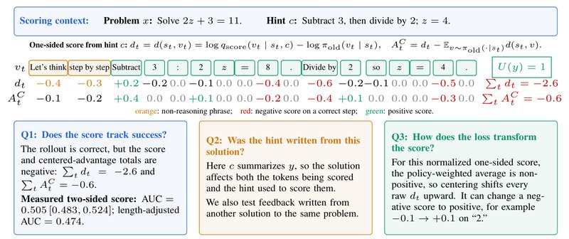
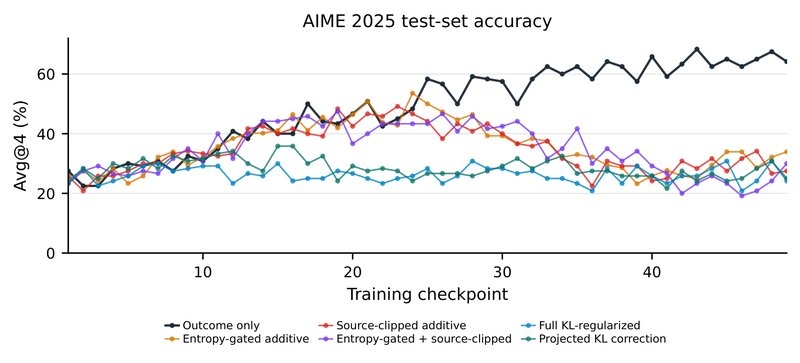
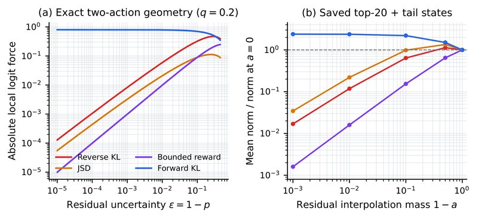
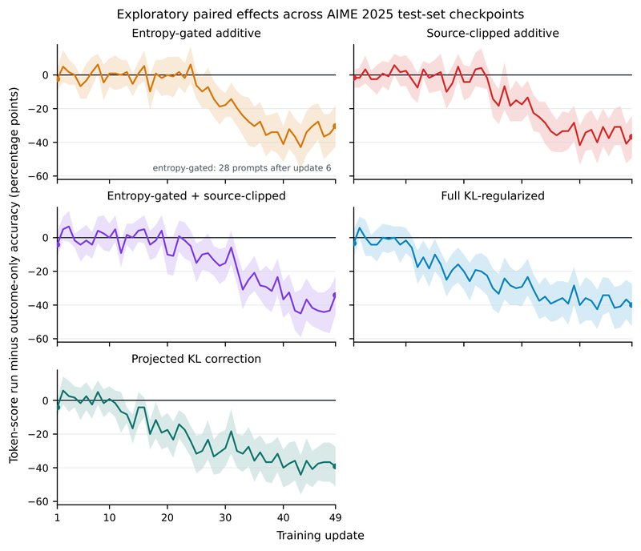

# Privileged Likelihood Is Not Automatically Value: Three Checks for Token Credit in On-Policy Self-Distillation（特权似然不自动等于价值：在线自蒸馏中 token 功劳分的三项检查）

中文 | [English](./Three-Checks-for-Token-Credit-in-OPSD_en.md)

- **原文链接**: [Privileged Likelihood Is Not Automatically Value: Three Checks for Token Credit in On-Policy Self-Distillation](https://arxiv.org/abs/2608.09263v2)
- **论文**: [arXiv:2608.09263](https://arxiv.org/abs/2608.09263)
- **发布日期**: 2026-08-10
- **范围**: 按 arXiv v2（2026-08-25 修订）写的通俗解读，不是全文翻译。作者是 Xuan-Phi Nguyen 等 7 人，来自 Salesforce AI Research。论文和 arXiv 页面都没有给出代码链接。

## 一句话版本

有一类训练方法叫 OPSD（On-Policy Self-Distillation，在线自蒸馏）：同一个模型多看一段只在训练时才有的提示（比如参考解答、评委写的评语），重读自己写的解答，给每个 token 打分，再把这个分当成"这个 token 对做对题贡献多大"来训练。作者指出，这个分数衡量的是"多给模型一段信息之后，它对这个 token 的看法变了多少"，而训练真正需要的是"写下这个 token 之后，最后做对的可能性变了多少"，两者没有必然联系，用之前要先检查。论文没有提出新的训练算法，给的是一份"使用前的体检清单"：分数能不能分清对错（Q1），打分用的提示是不是照着被打分的解答写的（Q2），训练目标最后把分数变成了怎样的参数更新（Q3）。每个问题都配了理论命题，再用一个失败场景和一个成功场景实测。

主要发现：在 gpt-oss-20b 做 AIME 2025 的主实验里，训练实际用的分数分辨对错的 AUC 是 0.505，和抛硬币差不多；改用同一题其他解答的评语打分，也没有稳定变好。把分数加进训练的五种做法，正确率（Avg@4）只有 24.2%～33.9%，比只看最终对错的 GRPO（64.2%）低 30.4～40.0 个百分点（下文简称"分"）。反过来，用 SDPO（这类方法中的一种）训练 Qwen3-8B 做 SciKnowEval 生物题时，分数分得清对错（AUC 0.813～0.924），训练 100 步后测试正确率提高 26.75 和 28.00 分。

---

## 1. 先认识几个词

| 词 | 大白话 |
| --- | --- |
| 解答（rollout） | 模型针对一道题自己写出的一份完整解答 |
| token | 模型每次生成的最小单位，可以理解成一个词或词的一部分 |
| 特权信息 | 只在训练时能拿到的额外材料，比如参考解答、标准答案、评委写的评语；考试时没有。下文也叫"提示" |
| 单边分数 $`d`$ | 看了提示的老师给某个 token 的对数概率，减去写这份解答时学生给它的对数概率 |
| 双边分数 $`d_\pm`$ | 同一个模型分别看"有帮助的提示"和"误导的提示"时，给同一个 token 的对数概率之差 |
| 动作价值 $`Q`$ | 在某个位置写下某个 token、再照常写完，最后做对的概率 |
| 功劳分（credit） | 训练时分给每个 token 的奖惩，本意是反映这个 token 对最终做对题贡献了多少 |
| AUC | 随机抽一份对的和一份错的解答，分数把对的排在前面的概率；0.5 等于瞎猜 |
| Avg@k | 每道题做 k 遍，取平均正确率 |
| 熵 | 模型在某个位置有多拿不准，越高越拿不准 |
| KL 散度 | 衡量两个概率分布差多少的一把尺子，不小于 0，两个分布相同时为 0。它不对称：KL（学生‖目标）叫反向 KL，KL（目标‖学生）叫正向 KL |
| JS 散度（JSD） | 另一把衡量分布差异的尺子，标准形式对两个分布是对称的；图 3 用的广义 JSD 多一个权重参数 |
| logit | 模型在换算成概率之前给每个候选词打的原始分，训练靠改 logit 来改概率 |
| 交叉拟合（cross-fitting） | 给一份解答打分时，改用同一道题另一份解答的评语 |
| 百分点（分） | 两个百分数直接相减的差。64.2% 降到 24.2% 是降了 40 分，相对下降 62% |

## 2. 它想解决什么问题

训练大模型做数学题，现在常用 RLVR（可验证奖励的强化学习）：模型写完一份解答，程序检查最终答案，对了 1 分，错了 0 分。常用的算法 GRPO 让模型把同一道题做好几遍，比同一题其他解答的平均水平好的，整段加分；差的，整段扣分。

毛病是信号太粗。一份几千个 token 的解答只换来一个分数，关键的一步推导和一个格式符号得到的奖惩完全一样。程序只说了"错了"，没说"错在哪一步"。

在线蒸馏（on-policy distillation）的思路是：学生先自己写一份解答，再让老师把这份解答逐个 token 重读一遍，给出每个位置"我会怎么写"的概率。这样每个位置都有反馈。在线自蒸馏（OPSD）是其中的特例：老师就是学生自己（一份冻结的副本），区别只在于老师多看了一段特权信息。特权信息只在训练时才有，比如参考解答、环境反馈、评委模型写的评语，考试时模型看不到。

| 路线 | 做法 | 问题 |
| --- | --- | --- |
| 只看对错的强化学习（RLVR，比如 GRPO） | 程序核对最终答案，整条解答的每个 token 共用一个分数 | 信号太粗，分不出哪一步立了功、哪一步出了错 |
| 在线自蒸馏（OPSD） | 看了特权信息的模型给学生写下的每个 token 打分，当作这个 token 的功劳分 | 默认这个分数近似于 token 的动作价值，但这一点没有保证；已有几篇论文报告它失效 |

老师对学生写下的 token $`v`$ 的看法被换算成一个分数，作者叫它特权似然分数（privileged-likelihood score）：

```math
d(s_t,v)=\log q_{\mathrm{score}}(v\mid s_t,c)-\log \pi_{\mathrm{old}}(v\mid s_t)
```

- $`s_t`$ 是题目加上已经写出的前文，$`c`$ 是特权信息；
- $`q_{\mathrm{score}}`$ 是看了 $`c`$ 的老师给 $`v`$ 的概率，$`\pi_{\mathrm{old}}`$ 是写这份解答时学生给 $`v`$ 的概率；
- 分数为正，说明看了提示之后模型更愿意写 $`v`$；为负，说明更不愿意。

另一种做法（RLCSD）准备两段提示：一段有帮助的 $`c^+`$，一段负面的 $`c^-`$（本文实验里是看似合理其实错误的说法），比较模型在两种提示下对 $`v`$ 的看法，叫双边分数：

```math
d_\pm(s_t,v)=\log q_{\mathrm{score}}(v\mid s_t,c^+)-\log q_{\mathrm{score}}(v\mid s_t,c^-)
```

这些方法默认这个分数近似于 token 的动作价值 $`Q^\pi(s_t,v)`$，也就是"在这个位置写下 $`v`$，然后按模型平时的习惯接着写完，最后做对的概率"。假设成立的话，把分数加进训练能让学习集中在真正关键的 token 上。假设不成立的话，模型会去追逐"让老师更认同"的写法，而这些写法不一定能把题做对。

作者的核心观点就在这里：**分数改变的是输入（多给一段信息，看模型的看法怎么变），价值改变的是输出（换一个 token，看最后结果怎么变）。** 这是两种不同的操作，结果是否一致只能实测。已有几篇论文报告过自蒸馏失效：老师更在意"像不像参考解答的写法"而不是对错；把参考解答换成别的题的、甚至错误的解答，训练效果差不多；老师会压制推理中拿不准位置的探索。

论文要回答的问题是：**把特权似然分数当成 token 的功劳分之前，要先查清哪几件事？**

## 3. 作者怎么查的：三个检查问题

作者认为，把特权似然分数当成 token 的功劳分之前，要分别回答三个问题。三个问题要分开查：分数可能在 Q1 就不合格；也可能 Q1 合格，却被训练目标（Q3）用坏。

- **Q1：分数能不能反映做题结果？** 在同一个位置上，分数是否偏向那些能带来更好结果的 token。
- **Q2：评语是不是照着被打分的这份解答写的？** 如果是，分数可能只是在量"解答和专门描述它的评语像不像"。换成别的解答的评语，结论还在不在？
- **Q3：训练目标拿分数做了什么？** 减去平均值、裁剪、按 token 加权，都会改变分数最后变成的参数更新。更新方向对不对？



*图 1：一份做对的解答，单边分数却是负的。最上面是题目和提示；中间那张表的第一行是学生写下的 token $`v_t`$，第二、三行分别是原始分数 $`d_t`$ 和减去平均值后的 $`A^C_t`$；橙色标的是和推理无关的套话，红色是正确步骤上的负分，绿色是正分；下面三个框分别对应 Q1、Q2、Q3。图中逐 token 的数值是示意用的，只有 Q1 框里的 AUC 是在 AIME 2025 上实测的。提示 $`c`$ 写明了正确步骤，但看了提示的模型给这份正确解答的总概率，反而比写它的学生自己给的还低。Q1 检查分数和做题结果的关系；Q2 检查提示是不是看过这份解答之后才写的；Q3 跟踪训练前"减去平均值"这一步怎样移动分数。*

**用图 1 的小例子把三个问题走一遍。** 题目是解方程 $`2z+3=11`$。学生写的"先减 3 得 $`2z=8`$，再除以 2 得 $`z=4`$"完全正确，图里记作 $`U(y)=1`$（$`U`$ 表示最后做没做对，对为 1、错为 0）。打分时给模型的提示 $`c`$ 是"先减 3，再除以 2；$`z=4`$"。

- **第二行 $`d_t`$ 是原始分数。** 多数 token 是 0 或负数，"8""Divide by""4"这些正确步骤反而拿到 −0.4、−0.6、−0.5，整条解答加起来是 −2.6。一份正确的解答被整体判成"不受欢迎"。这是 Q1 要查的事：分数和做没做对并不同步。
- **提示 $`c`$ 本身就是这份解答的摘要。** 如果提示是看过这份解答才写的，解答既决定了被打分的 token，又决定了打分用的提示。这是 Q2。
- **第三行 $`A^C_t`$ 才是训练真正用的数。** 它等于这个位置的分数减去"学生在这个位置所有候选词的加权平均分"。这一步会改变数值，甚至改变正负：token "2" 从 −0.1 变成了 +0.1。这是 Q3。

### 3.1 Q1：分数能不能分清好坏

**真正的功劳分要满足什么。** 作者给了一个严格条件（命题 1）：在同一个位置上，分数必须是动作价值的"正比例加平移"，即

```math
d(s,v)=\omega_0(s)+\omega_1(s)\,Q^\pi(s,v),\qquad \omega_1(s)>0
```

只有这样，不管训练把概率从哪些候选词挪到哪些候选词，分数和真实价值对"这次挪动值不值"的判断才成比例。

**只排对顺序不够。** 三个候选词的真实价值是 $`Q=(0,1,2)`$，分数是 $`d=(0,1,4)`$，顺序完全一样。现在给第一个和第三个词各加一小份概率，从第二个词拿走两小份。按真实价值算，得失是 $`0+2-2=0`$，不赚不赔；按分数算是 $`0+4-2=+2`$，像是赚了。训练会把这种并不划算的挪动当成有利可图。更一般地，分数夸大了最高分那个词的好处，训练就会把过多的概率堆到它身上。

**为什么大家相信"对数概率之差"能当功劳分。** 有一种情况它确实成立，这是"事后归因"（hindsight credit assignment）方法里的经典结论（附录命题 5）。设 $`q_1`$ 是"已知这份解答最后会做对"时模型写各个 token 的概率，$`q_0`$ 是"已知会做错"时的概率，贝叶斯公式给出

```math
\log\frac{q_1(v\mid s)}{q_0(v\mid s)}=\mathrm{logit}P(U=1\mid s,v)-\mathrm{logit}P(U=1\mid s)
```

右边随"写下 $`v`$ 之后做对的概率"单调上升，所以能排对顺序。举个数（我编的示意，不是论文里的）：某位置两个候选词各占一半概率，写 a 之后做对的概率是 0.8，写 b 之后是 0.2，总体做对率是 0.5。那么已知做对时写 a 的概率是 0.8，已知做错时是 0.2，a 的对数比是 $`\ln 4\approx1.39`$，b 是 $`-1.39`$。a 更好，分数也是 a 高。

双边分数 $`d_\pm`$ 的形式和上式一模一样，这是它看上去可信的原因。但上式要求 $`c^+`$、$`c^-`$ 下的模型恰好是"做对条件下"和"做错条件下"这两个真实分布。两段由评委自由撰写、分别标着"有帮助"和"误导"的文字，没有理由满足这个条件，它们还可能在格式、长度、透露了哪些数值上不同。附录还给了另一种成立的情况：老师恰好是某个奖励下的"最优软策略"（在"拿高奖励"和"别离参照模型太远"之间取得最优平衡的模型）时，逐 token 对数比等于这个奖励下的软优势（大致是"这个 token 比该位置的平均水平好多少"）。可那是"那个奖励"的优势，不是"做对题"的优势。

**所以只能实测。** 最容易做的测试在整条解答层面：把一条解答上所有 token 的分数取平均，看它能不能把对的解答排在错的前面，用 AUC 衡量。AUC 的意思是：随机抽一份对的、一份错的，分数把对的排在前面的概率。1 是完美，0.5 等于抛硬币，低于 0.5 说明反着来。作者的逻辑是，整条解答都分不清对错，逐 token 的分数不可能排对了每个位置的价值。作者把它当作必要条件（严格说还需要额外假设，见第 6 节"证据有多强"的最后一条），它也不是充分条件：AUC 高证明不了每个 token 都打对了分。

### 3.2 Q2：评语是不是照着这份解答写的

特权信息分两类。参考解答、固定的例题，只由题目决定，学生动笔前就存在。评委写的点评、环境反馈，通常是**读了学生的解答之后**才写的。

第二类会带来一个额外的变化来源：解答和"描述它的评语"之间的文字吻合程度。比如评语说"不要除以 4"，正因为学生除了 4，这句话才有用；但这也意味着解答同时影响了被打分的 token 和打分用的提示。分数高，可能只是因为解答和评语说的是同一件事，和解答对不对无关。

检验办法叫交叉拟合（cross-fitting）：给每份解答打分时，改用同一道题另一份解答的评语。这样被打分的解答就不再参与决定自己的打分提示。作者证明（命题 2），这样做确实切断了依赖：给定题目后，评语和被打分的解答相互独立。但独立不等于有用，附录用两个小例子说明：

- **自说自话，人人满分。** 每个动作给自己写一条评语，再按"和评语是否一致"打分，结果每个动作都拿满分。吻合度完美，却区分不了任何好坏。
- **独立，但方向错。** 评语来自别人的解答，和你无关；可如果这些评语多数指向错的做法，照着它练只会越练越差。

所以交叉拟合换来的是"另一种打分规则"，不是原分数的"去偏版本"。新规则有没有用，还得回到 Q1 去测。交叉拟合也只切断了"被打分的解答影响自己的评语"这一条路：提供评语的那份解答同样是模型写的，模型变了，评语也会跟着变。

还有一层：每份解答配一段专门的评语，等于每份解答用的是不同的打分规则，同一题内拿这些分数互相比较，本来就不在同一把尺子上。论文的贡献列表把 Q2 概括为"各份解答是否在受控的打分规则下比较"，指的就是这一层。

### 3.3 Q3：训练目标怎么使用分数

分数进入训练还要经过好几步：减去平均值、裁剪、按 token 加权，再和对错奖励合并，最后才变成参数更新。

**减去平均值会改变符号。** 训练用的是

```math
A^C(s,v)=d_\pm(s,v)-\sum_{v'}\pi_{\mathrm{old}}(v'\mid s)\,d_\pm(s,v')
```

即这个 token 的分数减去学生在该位置所有候选词的加权平均分。双边分数的平均值可正可负，所以正分可能变负，负分也可能变正。单边分数还有一个必然结论：按学生自己的概率加权，单边分数的平均值等于负的 KL 散度，一定不大于 0，所以减平均值总是把分数往上抬。图 1 第三行的每个数都不小于第二行，就是这个原因。

这一步还可以改写成 $`A^C=(1-p)\times(\ldots)`$，$`p`$ 是学生给这个 token 的概率。学生越有把握（$`p`$ 接近 1），这个 token 拿到的训练信号就越接近 0；只要分数有界，不管它说了什么都一样。

**模型越有把握，这两种用法越推不动它。** 作者比较了两种用法（命题 3）：把分数当有界奖励直接加；或用 KL 散度把模型拉向"按分数调整过的目标分布"。在只有两个候选词的简化情形里，设模型给次选词的概率是 $`\varepsilon`$：加法目标的推力（对 logit 的梯度大小）最多和 $`\varepsilon`$ 同阶，反向 KL 约为 $`\varepsilon\log(1/\varepsilon)`$，比加法强一些，但 $`\varepsilon\to0`$ 时两者都趋于 0。而且推力只朝分数指的方向，分数未必指向做对。

**总量和符号不变，更新方向也会变。** 设每个 token 的最终信号是"整条解答的对错分 × 权重"，权重都为正、平均为 1，看起来既没改符号也没改总量。作者举例（命题 4）：两个相互独立的 token，权重从 $`(1,1)`$ 改成 $`(2-\varepsilon,\varepsilon)`$，期望更新从 $`(1/8,1/8)`$ 变成 $`((2-\varepsilon)/8,\varepsilon/8)`$。原来两个 token 一起改，现在几乎只改第一个。不同 token 的梯度指向参数空间的不同方向，所以"符号和总量没变"保证不了训练方向没变。作者也强调，加权有用恰恰因为它改变了更新，问题在于光看符号和总量，证明不了它改得对。

### 3.4 附录里还证明了几件事

附录把本节的命题补全了证明，还有几条结果对实际使用有参考价值。

- **看不到提示的学生，最多只能学成"平均老师"**（命题 7）。如果用正向 KL 让学生模仿看了各种提示的老师，学生的最优解是把各种提示下的老师分布取平均，剩下学不到的部分正好是"token 和提示之间的互信息"（知道提示后，对下一个 token 的不确定性能减少多少），这部分损失永远降不下去。但这个数说明不了对错：提示只是换了一种说法、两种写法都对时，互信息大于 0 却毫无坏处；所有提示都给出同一个没用的目标时，互信息为 0，学生也学不到有用的东西。
- **只最大化一个固定的 token 分，最优解是把全部概率押在得分最高的那个词上**（命题 9）。不管那个词是不是对的。
- **加上 KL 正则，得到的是一个"有限"的目标，不是"正确"的目标**（命题 10）。KL 正则会把最优解从"全押一个词"变成"参考策略（一个固定不变的参照模型）按分数指数加权"的分布，避免走极端；可这个目标由参考策略和未经校准的分数共同决定，完全可能是对错误答案的一个温和偏好。
- **求和还是取平均，各有毛病**（命题 8）。把每个 token 的分加起来，一个小的固定偏差会随长度累积，解答越长偏差越大；取平均能压住偏差，但单个关键 token 的作用会被稀释成 $`1/T`$（$`T`$ 是解答的 token 数）。没有一种非负加权的线性汇总方法能同时避免这两个问题。
- **每个位置只按眼前这一个 token 的分数更新，等于忽略了它对后文的影响。** 一个 token 换了写法，后面各位置的分数通常也会跟着变。只有后文的分数和当前选择无关时，这种省略才不带来偏差；"每个位置都有一个分数"本身并不保证这一点。

## 4. 实验结果

### 4.1 实验怎么设计的

**主实验：gpt-oss-20b 做 AIME。**

- **模型和数据。** 用 gpt-oss-20b（推理强度设为 low）在 DeepScaleR 数学题上训练，在 AIME 2025（共 30 道题）上评测。每道题采样多份解答，程序检查最终答案是否和标准答案等价，对记 1，错记 0。
- **特权信息。** 一个外部评委模型（论文写作 gpt-5.6-luna）读题目、参考解答、判分结果和学生的完整推理，为每份解答写两段文字：有帮助的 $`c^+`$，和看似合理其实错误的 $`c^-`$。为了防止学生直接抄答案，$`c^+`$ 会遮住部分数值，还常常带格式要求；$`c^-`$ 则直接给出"差一点就对"的错误数值。设计本意是两段文字只在数学结论上不同，实际上措辞和格式也不同，分数对这些差别也可能有反应。
- **打分。** 冻结的 gpt-oss-20b 当老师，分别读 $`c^+`$ 和 $`c^-`$ 算出双边分数 $`d_\pm`$，再减平均值得到 $`A^C`$。在 AIME 实验里，单边分数 $`d`$ 只用在 4.2 节的一项分析里。
- **六种训练配置。** 起点、训练数据、优化器、采样批次、判分器都相同：

| 配置 | token 分怎么进入训练 |
| --- | --- |
| 只看对错的 GRPO（对照组） | 不用 token 分。每份解答的分数 = 它的对错（1/0）减去同一题其他解答的平均对错，整条解答每个 token 都一样 |
| 熵门控加法 | 对错分 + token 分。token 分先用 $`0.5\tanh(\cdot/0.5)`$ 压到 ±0.5 以内，再乘 $`\min(1,H/0.2)`$：模型越有把握（熵 $`H`$ 越低）的位置，token 分给得越轻 |
| 源头裁剪加法 | 对错分 + token 分。先把原始分数裁到 [−2, 2] 再减平均值，然后压到 ±0.5 以内 |
| 熵门控 + 源头裁剪 | 前两种处理都用上 |
| 完整 KL 正则 | 对错分 + "裁剪后的分数减去一项把模型拉回参考策略的修正"，用来限制模型被 token 分带得太远 |
| 投影 KL 修正 | 只保留上述修正里和分数方向一致的那部分，再整体乘 0.25 |

五种 token 分配置有几条共同的保护：一道题的所有解答对错都一样时（对错分为 0），token 分整个关掉；三种加法配置还禁止 token 分把对错分的符号翻过来；合并后的分数裁到 [−1, 1]，最后再做 PPO 式的比率裁剪（限制每次更新对概率的改动幅度）。

- **Q2 的交叉拟合。** 每份解答先配上照着它写的评语。然后在每道题内部随机分成两组，分组方式和内容无关；每份解答改用另一组某份解答的评语打分。
- **评测。** 每道题做 4 遍取平均正确率（Avg@4）。六种配置在"大家都有足够评测结果的最晚检查点"上比较，也就是第 49 次更新，不允许各自挑最好的检查点。差距的置信区间按题目重抽样（bootstrap）估计。

**正例对照：Qwen3-8B 做生物题。** 用 SDPO 训练 Qwen3-8B，分别开启和关闭思考模式，题目来自 SciKnowEval 的生物部分。老师唯一的特权信息是标准答案，写成一句 "The correct answer is [标准答案]"。在 50 道没参与训练的题上每题做 8 遍取平均（Avg@8），同时计算分数的 AUC。

### 4.2 Q1：在 AIME 上，分数分不清对错

**先看单边分数。** 作者在 DeepScaleR 上训练出的 18 个检查点上，统计每条解答单边分数的平均值。如果它是好的功劳分，做对的解答应该得正分（老师认同学生的写法），做错的应该得负分。实际上两类都是负的：做对的平均 −0.0334，做错的 −0.0502。差距 +0.017，方向是对的，说明提示里残留了一点对错信息，但很小。附录表 4 在另外两组实验的解答上复查：对的解答有 99.3%～99.5%、错的有 99.5%～99.9%，整条的单边分数都是负的。

**为什么两类都是负的？** 一部分原因来自数学。在同一个位置上，按学生自己的概率给所有候选词的单边分数取加权平均，结果等于负的 KL 散度（学生分布对老师分布），一定不大于 0。也就是说，只要老师的分布和学生的不完全一样（不管是因为多看了提示，还是因为打分用的是冻结的或更早的检查点），按学生自己的采样来看，单边分数平均就是负的，这和解答对不对无关。只看做对的、或只看做错的解答时，这个结论不再严格成立：附录 A.10.1 把"正确解答整条单边分数的平均值"拆成两项，一项是"老师和学生给全部正确解答的总概率之比"取对数，另一项是减去的 KL 散度，所以即使老师整体上更偏向正确答案，平均分也可能是负的。有信息量的是两类之间的差距，而它只有 0.017。（这段解释是我加的，依据是论文图 1 的说明和附录 A.10.1 的拆分。）

**再看训练实际用的双边分数。** 把一条解答上各 token 减过平均值、压缩过范围的分数取平均，得到一个数，再用 AUC 看它能否把对的排在错的前面。三种比法：全体解答一起比；先去掉分数和解答长度之间的线性关系再比；只在同一道题的解答之间比（排除题目难易的影响）。

论文表 1 是 AIME 2025 上分数区分对错的能力（数值是 AUC，方括号里是按题目重抽样得到的 95% 置信区间）：

| 分数怎么构造 | 全体一起比 | 去掉长度影响后 | 只在同一题内比 |
| --- | --- | --- | --- |
| 训练实际用的双边分数 | 0.505 [0.483, 0.524] | 0.474 [0.452, 0.494] | 0.499 [0.469, 0.533] |
| 用这份解答自己的评语 | 0.588 [0.500, 0.673] | 0.551 [0.463, 0.625] | 0.609 [0.542, 0.670] |
| 换用另一份解答的评语（遮数值版） | 0.512 [0.440, 0.579] | 0.485 [0.423, 0.548] | 0.516 [0.450, 0.574] |
| 换用另一份解答的评语（正误事实版） | 0.416 [0.347, 0.484] | 0.446 [0.382, 0.513] | 0.587 [0.525, 0.646] |

*每一行使用各自预先设定的统计窗口。*

第一行就是 Q1 的答案。训练实际用的分数，全体一起比是 0.505，等于抛硬币；去掉长度影响后是 0.474，置信区间整个落在 0.5 以下，即稳定地略微偏向错的解答；同一题内比是 0.499。附录表 7 还有一个更直观的对照：只看完整作答、框出了答案的解答时，这个分数的 AUC 是 0.506，而把 $`c^+`$ 和 $`c^-`$ 设成完全相同的文字、理应毫无信息的空白对照是 0.503。训练用的分数和空白对照几乎没有区别。

信息本身并不缺。作者做过一个小测试：把同样的材料交给外部评委模型，让它直接判断哪份解答更好，有效的 54 次判断里对了 51 次（94.4%）。材料里有足够的信息，只是"看提示前后的概率差"没有把它提取出来。

### 4.3 正例：生物题上分数分得清，训练也涨分

论文表 2 是 SciKnowEval 生物题上、以标准答案为提示的单边 SDPO（Avg@8 是 50 道未参与训练的题上的正确率，%）：

| 配置 | 第 0 步 → 第 100 步（Avg@8） | 提高（分） | 原始分数 AUC | 减平均值后 AUC | 同一题内 AUC |
| --- | --- | --- | --- | --- | --- |
| 关闭思考 | 31.50 → 58.25 | +26.75 | 0.924 | 0.751 | 0.833 |
| 开启思考 | 26.25 → 54.25 | +28.00 | 0.813 | 0.626 | 0.709 |

*"同一题内 AUC"用未减平均值的原始分数计算。*

这里分数分辨对错的能力很强（AUC 0.81～0.92），训练 100 步后测试正确率提高约 27 分。减去平均值之后（第 3.3 节说的那一步）分辨力变弱，0.924 降到 0.751，0.813 降到 0.626，但离 0.5 还远。作者据此认为：分数分得清对错的场景训练成功了，分不清的场景训练失败了，所以"整条解答的 AUC"可以当作正式训练前的第一道筛查。

### 4.4 Q2：换用别的解答的评语，分数也没变好

表 1 第二行"用这份解答自己的评语"的 AUC 是 0.588，看上去比训练用的分数好。但评委写这段评语时读过整份解答，还知道它的判分结果，等于解答参与决定了给自己打分用的提示。所以这个 0.588 不能当作"分数会打分"的证据。反过来看，写评语的评委明明知道这份解答的对错，分数也只做到 0.588，说明"看提示前后的概率差"从评语里提取到的对错信息很少（这是我的读法）。

交叉拟合后的两行：遮数值版是 0.512，就是瞎猜；正误事实版全体一起比是 0.416（偏向错的），只在同一题内比却是 0.587（偏向对的），换一种比法方向就反过来。论文没有解释这种翻转。一种可能的读法（我的猜测）是：跨题目一起比时，题和题之间的差异（比如难度、解答风格）盖过了对错信息。附录还有两个对照，都在 0.5 附近：用别的题的正误事实当评语（0.475，附录表 6），以及上面提到的空白对照（0.503）。

作者对 Q2 的结论：切断"解答影响自己的评语"这条路，在机制上是对的，但救不回这个分数。这和 Ichihara 等人的发现一致：把目标题的参考解答换成另一道题的解答，训练效果差不多。可见提示传递给学生的东西，并不是"这道题该怎么做"的具体功劳信息。

### 4.5 Q3：五种用法全部输给只看对错的 GRPO

论文表 3 是 AIME 2025 上的配对比较（第 49 次更新，Avg@4，%）：

| 配置 | 正确率（Avg@4，%） | 与 GRPO 的差距（分）[95% 置信区间] |
| --- | --- | --- |
| 只看对错的 GRPO | **64.2** | （对照） |
| 熵门控加法 | 33.9 | −30.4 [−42.9, −17.9] |
| 源头裁剪加法 | 27.5 | −36.7 [−49.2, −24.2] |
| 熵门控 + 源头裁剪 | 30.0 | −34.2 [−45.8, −23.3] |
| 完整 KL 正则 | 24.2 | −40.0 [−52.5, −27.5] |
| 投影 KL 修正 | 25.0 | −39.2 [−50.8, −27.5] |

*差距 = 该配置减去只看对错的 GRPO，用四舍五入前的数计算；方括号是按题目配对重抽样的 95% 置信区间，负数表示 GRPO 更好。*

五种做法全部明显落后：差 30.4～40.0 分，每个置信区间都整个落在 0 以下，精确符号翻转检验的 p 值也都低于 0.005（一共做了 10 次比较，作者按 Bonferroni 方法把显著性门槛从 0.05 收紧到 0.005）。最好的熵门控加法（33.9%）只有 GRPO 的一半左右。两种 KL 做法最差（24.2%、25.0%），基本停在训练开始时的水平。



*图 2：AIME 2025 测试正确率随训练的变化。横轴是训练检查点（第几次更新），纵轴是 Avg@4（%）；深色线是只看对错的 GRPO，橙、红、紫三条是三种加法做法，蓝、青绿两条是两种 KL 做法。各配置起点相近。只看对错的 GRPO 持续提升，五种 token 分配置最终都低于它。表 3 的固定比较点是第 49 次更新。*

从曲线上看（读图估计）：六条线开始都在约 21%～28%。三种加法做法在前 24 次更新左右和 GRPO 基本同步，最高到约 47%～53%，之后掉回约 20%～35%；GRPO 继续升到约 57%～68%。两种 KL 做法从头到尾在约 20%～36% 之间徘徊，几乎没涨过。

**不是因为答不完题。** 第 49 次更新时，GRPO 的解答 76.7% 完整写完并框出了答案，23.3% 因超长被截断；五种 token 分做法框出答案的比例是 94.2%～98.3%，写完的比例是 95.8%～100%，截断只有 0%～4.2%。它们更常交出完整答案，却更常答错。

### 4.6 token 分是怎样影响训练的

论文给了几条线索，说明 token 分在训练里把力气花在了哪里。

- **权重集中在模型最拿不准的位置。** 在一个单独分析的加法配置里（这个配置没有"对错分为 0 时关掉 token 分"的保护），把所有位置按模型的不确定程度（熵）排序，最不确定的 10% 位置拿走了全部 token 分绝对值的 57%～71%。如果均匀分布，这个比例应该是 10%。
- **加法做法让模型越练越"拿不准"。** 在配对的训练里（统计到第 25 次更新），三种加法做法的熵变大，和参考策略（一个固定不变的模型，通常就是训练起点）的 KL 距离也变大，即模型越练离起点越远。两种 KL 做法把这两个量都控制在 GRPO 附近，但正确率一点没涨。
- **减平均值会翻转符号。** 见第 3.3 节和图 1。训练用的是减平均值之后的数，再和对错分合并。



*图 3：冻结目标下各种目标函数对 logit 的推力。左图：只有两个候选词时的精确推力，横轴是学生给次选词的概率 $`\varepsilon=1-p`$，越往左学生越有把握，目标分布保留一部分概率给另一个词；原图注说标题里的 $`q=0.2`$ 是目标给另一个词的概率（和曲线对不上，见第 6 节"稿件里的小问题"）。右图：在三种 token 分配置保存的 74,653 个真实分布上重复这个实验（保留前 20 个候选词，其余合成一个"尾部"），$`a`$ 是把分布往最可能的那个词推的程度，横轴是 $`1-a`$，纵轴是推力和 $`a=0`$ 时之比。两图都是对数坐标，红线是反向 KL，橙线是广义 JSD，紫线是有界奖励，蓝线是正向 KL。当 $`a=0.999`$ 时，四种目标的推力比值依次是：反向 KL 0.0169，广义 JSD 0.0345，有界奖励 0.0016，正向 KL 2.384。把目标整体乘一个常数，只会改变推力的绝对大小。*

图 3 对应第 3.3 节的命题 3。权重集中在不确定的位置，一个直接的原因是第 3.3 节说的 $`(1-p)`$ 因子：学生越有把握，减平均值后的 token 分越小（这是我的理解，论文没有把两者直接联系起来）。图 3 说的是另一层：就算给了信号，学生有把握的位置也几乎推不动。右图里，把真实分布推到最可能的词占 99.9% 以上时（$`a=0.999`$），和原分布相比，"加有界奖励"的推力只剩约 1/600，反向 KL 约 1/60，JSD 约 1/30，只有正向 KL 的推力不减反增。论文的三种加法配置对应"有界奖励"，完整 KL 配置对应反向 KL。所以在模型有把握的位置，token 分基本推不动它，不管分数说了什么；token 分真正起作用的，是模型还没拿定主意的位置。如果分数本身分不清好坏（4.2 节），训练就是在这些分叉口上被一个和对错无关的信号牵着走。

这几条是作者给出的机制线索。论文没有做把它们逐一隔离开的对照实验（见第 6 节）。

### 4.7 换别的检查点比，结论不变



*图 4：每个可比检查点上的配对差距（探索性分析）。五个小图各对应一种 token 分配置，纵轴是它的正确率减去只看对错的 GRPO（分），横轴是第几次更新；每次更新都在两边共有的题目上重新计算。阴影是逐点的 95% 置信区间（按题目重抽样 20,000 次）。所有比较都用同一个 AIME 2025 评测集，第 49 次更新是表 3 的固定比较点。图中注明：熵门控加法第 6 次更新以后只有 28 道题可比。*

五条线开始都在 0 附近，说明起点相同。从图上看（读图估计）：三种加法做法在前 20～24 次更新和 GRPO 没有明显差别，之后一路下滑；两种 KL 做法从第 12 次更新左右就开始落后。第 35 次更新以后，五条线都在 −20～−45 分之间，阴影也都在 0 以下。换后期任何一个检查点比较，结论都一样。

## 5. 作者自己承认的局限

论文没有单独的"局限"一节，下面几条散在正文和附录里：

- **整条解答的 AUC 只是粗筛。** 作者的说法是：分不清对错，说明逐 token 的分数不可能都打对；分得清，也证明不了每个 token 都打对了。论文没有在 token 层面直接和动作价值比较。
- **AIME 的六个配置各只跑了一个随机种子。** 不同检查点是同一次训练的重复测量。置信区间反映的是"抽到哪些题"的不确定性，不包括"重跑一次训练"的波动。
- **各配置之间改动的不止一处。** 附录表 8 说明，两种 KL 配置的几处选择（例如不用 tanh 压缩，计算平均分的方式也不同）是一起定的。所以表 3 比较的是整套配方，差距不能归到某一个组件上。
- **$`c^+`$ 和 $`c^-`$ 的模板除了数学内容，措辞和格式也不同。** 分数可能有一部分是在对模板措辞的差异做出反应，而不只是数学内容。
- **判分器本身有误差。** 作者抽查了"多份解答给出同一个答案、却和标准答案不一致"的情况：49 个可判定的案例里有 18 个（36.7%）其实和标准答案等价，是判分器判错了。作者强调这个比例只针对抽查的这类案例，不是整体误判率。重新判分后，配对评测里有 7 份解答的标签被改正。
- **推力分析用的是简化坐标。** 第 3.3 节的推力分析是在"单个位置、各 logit 相互独立"的简化坐标下算的，不一定适用于真实神经网络的参数化、优化器的预处理和跨位置的参数共享。
- **成功和失败各只有一个场景。** 失败的是 gpt-oss-20b 做 AIME，成功的是 Qwen3-8B 做生物题（含开、关思考两种设置）。

## 6. 读的时候值得留意的地方

以下是我读原文时注意到、论文没有重点讨论的点，供参考。

### 证据有多强

- **成功和失败两个场景之间，差的不止一个变量。** AIME 场景是 gpt-oss-20b、评委写的双边评语、在 GRPO 上叠加 token 分；生物场景是 Qwen3-8B、一句话的标准答案、单边分数、SDPO 蒸馏。模型、任务、提示、分数形式、训练方式全都不同。"AUC 高的训练成功、AUC 低的训练失败"目前只有这两个场景支撑，是相关，还谈不上因果。论文的措辞（"accompanies""supporting … as a practical screen"）也比较克制。
- **生物题的正例没有和 GRPO 比。** 表 2 只说明 SDPO 比训练前强。在 SDPO 原论文里（[arXiv:2601.20802](https://arxiv.org/abs/2601.20802)），Qwen3-8B 做生物题训练 5 小时，GRPO 是 59.9%，SDPO 是 56.8%，生物恰好是 GRPO 赢的少数任务之一。两篇的评测设置不同（本文是 50 道题、每题做 8 遍、训练 100 步；SDPO 原论文取 5 小时训练内的最好成绩，每题做 16 遍），数字不能直接比，但至少说明"AUC 高、训练涨分"不等于"比只看对错的强化学习更好"。另外，SDPO 原论文给这批题用的是四选一的提示模板，Qwen3-8B 的起点 30.8% 也和本文的 31.50% 接近。如果本文沿用了同样的题，老师已经知道正确选项，分数能分清"最后选没选对"并不意外。四选一时瞎猜也有 25%，本文两个起点 26.25% 和 31.50% 只比瞎猜高一点。关闭思考时原始分数的 AUC 更高（0.924 对 0.813），也和这个猜测吻合：回答越短，最后那个选项在平均分里占的分量越重。本文没有说明题型，这几点都是推测。
- **AIME 的评测集很小。** AIME 2025 只有 30 道题，Avg@4 相当于每个配置 120 份解答。表 3 的数字都能还原成"答对份数 / 120"：64.2% = 77/120，27.5% = 33/120，30.0% = 36/120，24.2% = 29/120，25.0% = 30/120。熵门控加法的 33.9% 对应 38/112，即只用了 28 道题（图 4 里的标注也写了），按差距 −30.4 反推，GRPO 在这 28 道题上是 72/112 = 64.3%。置信区间的半宽约 11～12.5 分，但差距有 30～40 分，"更差"这个结论站得住；不确定的是具体差多少，以及换一个随机种子会怎样。另外，表 1 每一行用的是"各自预先设定的统计窗口"，不是同一批解答，行与行之间的比较要打点折扣。
- **加了 token 分的模型更会"交卷"，却更常答错。** 它们框出答案的比例是 94%～98%，GRPO 只有 77%。粗算一下，GRPO 完整作答的 92 份解答里有 77 份是对的（约 84%）；token 分模型框出的答案里，只有约 25%～36% 是对的。论文只用这一点排除"答不完题"的解释，没有往下分析。我的猜测是：$`c^+`$ 模板常带格式要求，token 分可能更多是在教模型"按格式收尾"，而不是"把题做对"。这和 DAPD 论文（[arXiv:2608.01735](https://arxiv.org/abs/2608.01735)）指出的"推不下去就直接报一个答案"的现象相似。反过来，GRPO 有 23% 的解答超长被截断，正确率却最高，也许是它的推理写得更长，有时超出了长度上限（论文没有报告各配置的解答长度）。
- **缺一个能区分"分数方向错"和"叠加任何稠密信号都会坏"的对照。** 论文的主线是"分数过不了 Q1，所以训练失败"。能直接检验这一点的对照有两个：把 token 分在位置之间随机打乱（保留大小分布、破坏对应关系），以及调小 token 分的权重。如果打乱后的分数也让成绩掉 30～40 分，问题就在于"往对错奖励上叠加稠密信号"这件事本身，而不是这个分数特有的缺陷。论文 LaTeX 源码里被注释掉的早期版本列过这两类对照，还计划在 500 个推理状态上用蒙特卡洛估计 Q 值、逐 token 直接比较，这些都没有出现在正文里。
- **"高熵位置分数最没信息量"这句话缺数据。** 摘要说权重集中的高熵位置恰恰是分数最难反映推理质量的地方，但正文没有按熵分段检验分数的好坏。权重集中在高熵位置本身也不一定是坏事：Wang 等人（[arXiv:2506.01939](https://arxiv.org/abs/2506.01939)）发现，强化学习只更新熵最高的约 20% token，效果和更新全部 token 相当，在更大的模型上还更好，因为这些位置是推理的"分叉口"。更准确的说法也许是：分叉口最重要，在那里施加一个分不清对错的信号，代价也最大。还要注意，57%～71% 来自一个没有"对错分为 0 时关掉 token 分"保护的单独配置，不是表 3 里比较的五个配置。论文同一段还说加法做法的熵和 KL 变大，但正文和附录都没有给出这两个量的数值或曲线。
- **"外部评委能挑出好解答"这个对照交代得不清楚。** 论文用"评委 94.4% 选对"来说明材料里的信息是够的，但没有说明评委这次看到的"同样的材料"是否包含判分结果。如果包含判分结果，甚至只要有参考解答，对一下最终答案就能挑出对的那份，那这个对照只能说明材料里有对错信息。有效样本也只有 54 次。
- **"整条解答分不清对错，逐 token 就一定打错了"，严格说要加条件。** 这一条是我自己推的，论文没有讨论。假设每个位置的分数都恰好是动作价值乘一个正数再加一个常数（命题 1 的条件），而且这个正数在所有位置都一样。那么减平均值后，每一步的分数正好是"写下这个 token 后的做对率"减去"写之前的做对率"再乘这个正数，沿一条解答加起来中间各项依次抵消，只剩"最终对错减去这道题一开始的做对率"。对的解答一定排在错的前面，取平均也一样。但命题 1 允许这个正数随位置变化，训练用的分数还经过了 tanh 压缩，这时抵消不成立。比如分数在一些无关紧要的位置被放大了很多倍，整条解答的平均分就主要由这些位置决定，AUC 可能接近 0.5，而每个位置内部对候选词的相对评价其实是对的。所以 AUC 接近 0.5 是很强的警告信号，但不能严格证明逐 token 打分全错。

### 稿件里的小问题（不影响主要结论）

- **百分比和百分点混用。** 摘要写"提高 26.8%～28.0%"，引言写"下降 30～40%"，其实都是百分点。按相对比例算，生物题提高了 85%～107%（31.50→58.25，26.25→54.25），AIME 下降了 47%～62%（64.2→33.9，64.2→24.2）。
- **图 3 左图的图注和曲线对不上。** 图注说 $`q=0.2`$ 指目标给"另一个词"的概率。我按附录公式重算，曲线对应的是目标给学生首选词 0.2、给另一个词 0.8。比如正向 KL 的推力在 $`\varepsilon\to0`$ 时趋于 0.8（图上的蓝线），按图注的读法应该趋于 0.2。这不影响结论：两种读法下，其余三条曲线都随 $`\varepsilon\to0`$ 趋于 0。

## 7. 如果想自己跑

论文没有公开代码，也没有报告训练用的硬件、学习率、最大生成长度，以及每道题采样几份解答（只说多于一份）。想复现只能按 4.1 节和论文附录 A.10 的描述自己搭：六种配置的公式和执行顺序在附录 A.10.4 和表 8，各个分数由谁写评语、用哪个检查点打分在附录表 5。

如果要在自己的项目里用这类方法，可以照论文的检查顺序做（下面是我按论文内容整理的步骤）：

1. 训练前取一批解答，按训练时的方式（减平均值、压缩范围）把 token 分汇总成每条解答一个数，算 AUC，同时看去掉长度影响和只在同一题内比的结果。接近 0.5 就先别用。
2. 如果提示是读过解答之后写的，换成同一题其他解答的提示再算一遍，再加一个"正负提示完全相同"的空白对照。
3. 训练时跟踪 token 分的权重在不同熵区间的分布，以及减平均值后被翻转符号的 token 比例；和只看对错的对照方法在固定检查点上配对比较，不要各自挑最好的检查点。
4. （论文没做，我建议补上）加一组把 token 分在位置之间随机打乱的对照，看掉分是这个分数特有的问题，还是"往对错奖励上叠加稠密信号"本身的问题（理由见第 6 节）。

## 8. 和相关工作的关系

作者把现有方法按"分数怎么用"分成三类（论文第 2.1 节）：

| 用法 | 怎么做 | 例子 |
| --- | --- | --- |
| 当蒸馏目标 | 让学生的分布直接模仿看了提示的老师，不用对错奖励 | OPSD、SDPO、CriPO、VPD |
| 当附加奖励 | 在对错奖励之上加 token 分；把 token 分设成 0 就退回普通 GRPO，作者称为"锚定在奖励上"（reward-anchored） | RLSD、RLCSD、OPPO、SC-GRPO |
| 当 KL 正则 | 加一项 KL 惩罚，把学生拉向老师 | VPD 的推导 |

作者 AIME 实验里的五种配置都属于第二类，都在对错奖励上叠加 token 分，其中两种另外加了把模型拉回参考策略的 KL 项。这一点很关键：对错奖励一直都在，加上 token 分后成绩反而从 64.2% 降到 24.2%～33.9%。作者也提醒，有噪声的分数单独用可能有害、少量加在对错奖励上可能有益，而方向系统性错误的分数两种用法都会有害，所以 Q3 必须和 Q1 分开查。

同期已有好几篇失败报告，各自从不同角度找到了问题：

- **Harne 等**（[arXiv:2608.04794](https://arxiv.org/abs/2608.04794)）：老师更在意"像不像参考解答的写法"而不是对错，大量监督落在虚词和标点上，对的和错的解答上逐 token 的损失分不出差别。
- **Ichihara 等**（[arXiv:2608.09228](https://arxiv.org/abs/2608.09228)）：把参考解答换成别的题的解答，甚至故意改错的解答，大部分涨分还在。
- **Kaur 等**（[arXiv:2607.05184](https://arxiv.org/abs/2607.05184)）：看了提示的老师会压制推理中拿不准位置的探索性 token。
- **Zhu 等**（[arXiv:2605.11182](https://arxiv.org/abs/2605.11182)）：提示是所有题共用的规则时效果更好，是每道题专属的解答时效果更差。

另一方面也有成功报告，通常是把分数锚定在对错奖励上，或者换了一种构造提示的方式，比如 OPPO、Purified OPSD、SC-GRPO、CAST、VPD、PMD。作者的总结是：自蒸馏好不好用，既取决于给老师看什么信息，也取决于老师的概率怎样进入训练目标。三个检查问题就是为了把这几处分开查。

这份解读提到的论文：

| 主题 | 论文 | 链接 |
| --- | --- | --- |
| 被检查的方法 | Zhao 等，Self-Distilled Reasoner: On-Policy Self-Distillation for Large Language Models（OPSD），2026 | [arXiv:2601.18734](https://arxiv.org/abs/2601.18734) |
| 被检查的方法 | Hübotter 等，Reinforcement Learning via Self-Distillation（SDPO），2026 | [arXiv:2601.20802](https://arxiv.org/abs/2601.20802) |
| 被检查的方法 | Yang 等，Self-Distilled RLVR（RLSD），2026 | [arXiv:2604.03128](https://arxiv.org/abs/2604.03128) |
| 被检查的方法 | Pan 等，RLCSD: Reinforcement Learning with Contrastive On-Policy Self-Distillation，2026 | [arXiv:2606.11709](https://arxiv.org/abs/2606.11709) |
| 同期失败报告 | Harne 等，Privileged, but Biased: How PI-Conditioned Teachers Break Self-Distillation，2026 | [arXiv:2608.04794](https://arxiv.org/abs/2608.04794) |
| 同期失败报告 | Ichihara 等，Privileged Solutions or Context-Induced Teacher Behavior? Dissecting On-Policy Self-Distillation，2026 | [arXiv:2608.09228](https://arxiv.org/abs/2608.09228) |
| 同期失败报告 | Kaur 等，Rethinking On-Policy Self-Distillation for Thinking Models，2026 | [arXiv:2607.05184](https://arxiv.org/abs/2607.05184) |
| 同期失败报告 | Zhu 等，The Many Faces of On-Policy Distillation: Pitfalls, Mechanisms, and Fixes，2026 | [arXiv:2605.11182](https://arxiv.org/abs/2605.11182) |
| 锚定在奖励上的成功报告 | Li 等，OPPO: Bayesian Value Recursion for Token-Level Credit Assignment in LLM Reasoning，2026 | [arXiv:2605.21851](https://arxiv.org/abs/2605.21851) |
| 理论来源 | Harutyunyan 等，Hindsight Credit Assignment，NeurIPS 2019 | [arXiv:1912.02503](https://arxiv.org/abs/1912.02503) |
| 对照方法 | Shao 等，DeepSeekMath（提出 GRPO），2024 | [arXiv:2402.03300](https://arxiv.org/abs/2402.03300) |
| 读后补充（论文未引用） | Wang 等，Beyond the 80/20 Rule: High-Entropy Minority Tokens Drive Effective Reinforcement Learning for LLM Reasoning，2025 | [arXiv:2506.01939](https://arxiv.org/abs/2506.01939) |

## 9. 总结

这篇论文的核心提醒是：**看过提示的模型"更想写哪个词"，和"写哪个词更可能做对"，是两回事。** 自蒸馏给每个 token 的分数，量的是"多给一段信息后，模型的看法变了多少"；功劳分要的是"换一个 token 后，做对的概率变了多少"。两者是否一致要实测：先量一下两者对不对得上，再拿它当奖励。作者给的测法分三步：整条解答的 AUC 能否分清对错（Q1）；评语是否照着被打分的解答写，换成别的解答的评语后信号是否还在（Q2）；进入训练后权重落在哪、符号有没有被翻转，并和只看对错的对照方法配对比较（Q3）。

在 AIME 上，分数的 AUC 约等于 0.5，换评语来源也救不回来；加进训练后，五种用法都比只看对错的 GRPO 低 30～40 分。生物题上分数的 AUC 是 0.81～0.92，训练涨了约 27 分，所以自蒸馏还能用，前提是先验证分数。这些证据的范围有限：成功和失败各只有一个场景，两者的模型、任务、提示和分数形式都不一样；AIME 只有 30 道题，每个配置只跑了一个随机种子；论文也没有在 token 层面直接拿分数和动作价值比较。

---

## 原文位置对照

| 本文内容 | 论文位置 |
| --- | --- |
| 问题和动机、主要发现 | 摘要，第 1 节 |
| 单边分数、双边分数的定义 | 第 1 节式 (1)(2)，第 4 节式 (7)(8) |
| 三个检查问题、图 1 的小例子 | 第 1、3 节，图 1 |
| Q1：正比例加平移的条件、事后归因的对数比 | 第 3.1 节，命题 1，式 (3)(4)；附录 A.2（命题 5）、A.3.1（命题 6） |
| Q2：交叉拟合 | 第 3.2 节，命题 2；附录 A.4 |
| Q3：减平均值、推力、加权 | 第 3.3 节，式 (5)(6)，命题 3、4；附录 A.5、A.6、A.9 |
| 附录里的其他结论 | 附录 A.3.2（命题 7）、A.4、A.7（命题 8、9）、A.8（命题 10） |
| 实验设置、六种训练配置 | 第 4 节，第 5.3 节表 3；附录 A.10.2 表 5，A.10.4 表 8 |
| Q1 结果：单边分数、表 1 | 第 5.1 节，表 1；附录 A.10.1 表 4，A.10.2 表 7 和外部评委小测试 |
| 生物题正例 | 第 5.1 节，表 2 |
| Q2 结果 | 第 5.2 节，表 1；附录 A.10.2 表 6、表 7 |
| Q3 结果、完成率 | 第 5.3 节，表 3，图 2；附录 A.10.5 |
| token 分怎样影响训练 | 第 5.3 节；附录 A.10.4，A.5 图 3 |
| 各检查点的配对差距 | 附录 A.10.6，图 4 |
| 作者自己承认的局限 | 第 3.1、4 节；附录 A.1、A.10.2、A.10.4、A.10.5、A.10.7 |
| 复现所需的设置 | 第 4 节；附录 A.10.2、A.10.4 |
| 相关工作 | 第 2 节 |
| 总结 | 第 6 节 |
