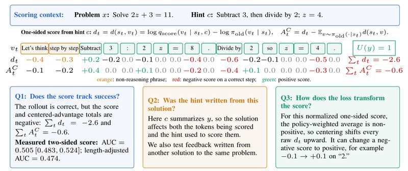
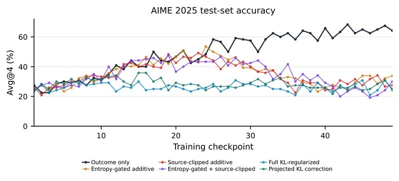
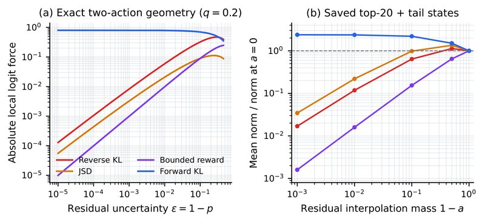
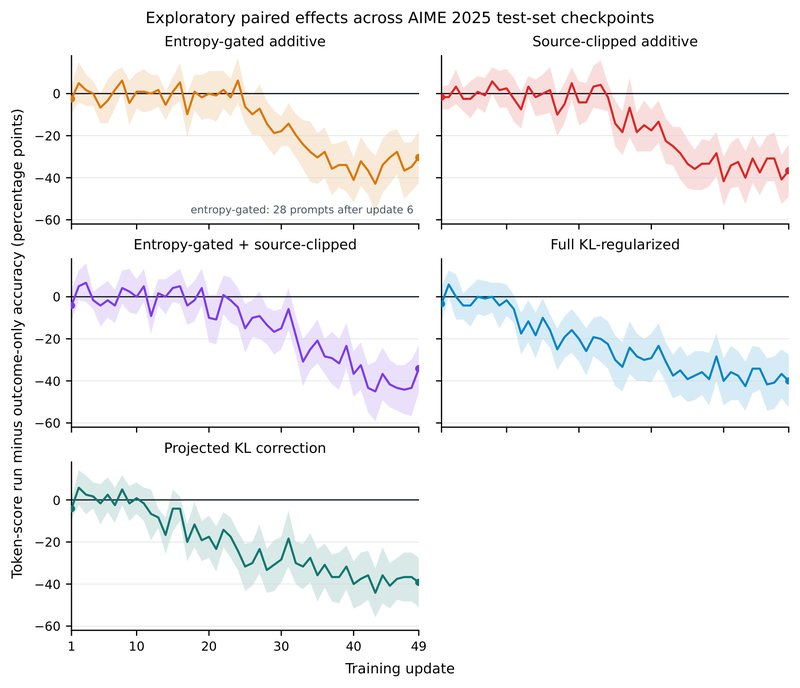

# Privileged Likelihood Is Not Automatically Value: Three Checks for Token Credit in On-Policy Self-Distillation

[中文](./Three-Checks-for-Token-Credit-in-OPSD.md) | English

- **Source**: [Privileged Likelihood Is Not Automatically Value: Three Checks for Token Credit in On-Policy Self-Distillation](https://arxiv.org/abs/2608.09263v2)
- **Paper**: [arXiv:2608.09263](https://arxiv.org/abs/2608.09263)
- **Published**: 2026-08-10
- **Scope**: A plain-language explainer based on arXiv v2 (revised 2026-08-25), not a full translation. The authors are Xuan-Phi Nguyen and others, 7 in all, from Salesforce AI Research. Neither the paper nor the arXiv page gives a code link.

## In One Sentence

There is a family of training methods called OPSD (On-Policy Self-Distillation): the same model is shown an extra hint that exists only during training (for example a reference solution, or feedback written by a judge), rereads the solution it wrote itself, scores every token, and then trains on that score as if it said "how much this token contributed to solving the problem". The authors point out that this score measures "how much the model's view of this token changes once it is given an extra piece of information", while what training really needs is "how much the chance of finally getting it right changes once this token is written". The two are not necessarily linked, so the score should be checked before it is used. The paper proposes no new training algorithm. Instead it gives a "checkup list before use": can the score tell right from wrong (Q1), was the hint used for scoring written by looking at the very solution being scored (Q2), and what kind of parameter update does the training objective finally turn the score into (Q3). Each question is backed by theoretical propositions and then tested in one failure setting and one success setting.

Main findings: In the main experiment with gpt-oss-20b on AIME 2025, the score actually used in training separates right from wrong with an AUC of 0.505, about as good as a coin flip; scoring with the feedback from other solutions to the same problem does not reliably help either. The five ways of adding the score to training reach an accuracy (Avg@4) of only 24.2% to 33.9%, 30.4 to 40.0 percentage points (called "points" below) lower than GRPO (64.2%), which only checks whether the final answer is right. Conversely, when SDPO (one of these methods) trains Qwen3-8B on SciKnowEval biology problems, the score does tell right from wrong (AUC 0.813 to 0.924), and after 100 training steps test accuracy rises by 26.75 and 28.00 points.

---

## 1. Key Terms

| Term | In plain words |
| --- | --- |
| Solution (rollout) | One complete solution the model writes by itself for a problem |
| token | The smallest unit the model generates each time; think of it as a word or part of a word |
| Privileged information | Extra material available only during training, such as a reference solution, the ground-truth answer, or feedback written by a judge; it is not available at test time. Also called the "hint" below |
| One-sided score $`d`$ | The log probability that the teacher, having seen the hint, gives a token, minus the log probability the student gave it while writing the solution |
| Two-sided score $`d_\pm`$ | The difference between the log probabilities the same model gives the same token when it sees a "helpful hint" and when it sees a "misleading hint" |
| Action value $`Q`$ | The probability of finally getting the problem right if a given token is written at a given position and the rest is written as usual |
| Credit | The reward or penalty each token gets during training; it is meant to reflect how much the token contributed to finally getting the problem right |
| AUC | The probability that, for one right and one wrong solution drawn at random, the score ranks the right one higher; 0.5 equals random guessing |
| Avg@k | Solve each problem k times and take the average accuracy |
| Entropy | How unsure the model is at a position; the higher it is, the less sure the model is |
| KL divergence | A ruler for how different two probability distributions are; it is never below 0, and it is 0 when the two distributions are the same. It is not symmetric: KL(student‖target) is called reverse KL and KL(target‖student) forward KL |
| JS divergence (JSD) | Another ruler for how different two distributions are; its standard form is symmetric in the two distributions. The generalized JSD used in Figure 3 has one extra weight parameter |
| logit | The raw score the model gives each candidate word before it is turned into a probability; training changes probabilities by changing logits |
| Cross-fitting | When scoring a solution, use the feedback written for another solution to the same problem instead |
| Percentage points (points) | The plain difference between two percentages. A drop from 64.2% to 24.2% is a drop of 40 points, a relative drop of 62% |

## 2. What Problem It Tackles

To train large models on math problems, a common choice today is RLVR (reinforcement learning with verifiable rewards): once the model finishes a solution, a program checks the final answer and gives 1 point if it is right and 0 if it is wrong. The common algorithm GRPO has the model solve the same problem several times; a solution that beats the average of the other solutions to that problem is rewarded as a whole, and a worse one is penalized as a whole.

The flaw is that the signal is too coarse. A solution of several thousand tokens earns a single score, so a key derivation step and a formatting symbol receive exactly the same reward or penalty. The program only says "wrong", not "which step went wrong".

On-policy distillation works like this: the student first writes a solution on its own, then the teacher rereads that solution token by token and gives, at each position, the probabilities for "how I would write it". This way every position gets feedback. On-policy self-distillation (OPSD) is a special case: the teacher is the student itself (a frozen copy), and the only difference is that the teacher also sees a piece of privileged information. Privileged information is only available during training, such as a reference solution, environment feedback or feedback written by a judge model, and the model cannot see it at test time.

| Approach | How it works | Problem |
| --- | --- | --- |
| RL that only checks right or wrong (RLVR, e.g. GRPO) | A program checks the final answer, and every token in the solution shares one score | The signal is too coarse to tell which step earned the credit and which step went wrong |
| On-policy self-distillation (OPSD) | A model that has seen privileged information scores every token the student wrote, and that score becomes the token's credit | It assumes the score approximates the token's action value, but nothing guarantees this; several papers have already reported it failing |

The teacher's view of a token $`v`$ that the student wrote is turned into a score, which the authors call the privileged-likelihood score:

```math
d(s_t,v)=\log q_{\mathrm{score}}(v\mid s_t,c)-\log \pi_{\mathrm{old}}(v\mid s_t)
```

- $`s_t`$ is the problem plus the text written so far, and $`c`$ is the privileged information;
- $`q_{\mathrm{score}}`$ is the probability that the teacher, having seen $`c`$, gives $`v`$, and $`\pi_{\mathrm{old}}`$ is the probability the student gave $`v`$ when writing this solution;
- a positive score means that after seeing the hint the model is more willing to write $`v`$; a negative one means it is less willing.

Another approach (RLCSD) prepares two hints, a helpful one $`c^+`$ and a negative one $`c^-`$ (in this paper's experiments, a claim that looks reasonable but is actually wrong), and compares the model's view of $`v`$ under the two hints. This is called the two-sided score:

```math
d_\pm(s_t,v)=\log q_{\mathrm{score}}(v\mid s_t,c^+)-\log q_{\mathrm{score}}(v\mid s_t,c^-)
```

These methods assume the score approximates the token's action value $`Q^\pi(s_t,v)`$, that is, "the probability of finally getting it right if $`v`$ is written at this position and the model then finishes the way it usually does". If the assumption holds, adding the score to training focuses learning on the tokens that really matter. If it does not hold, the model will chase ways of writing that "the teacher agrees with more", and those ways of writing do not necessarily solve the problem.

This is the authors' core point: **the score changes the input (give the model one more piece of information and see how its view changes), while value changes the output (swap one token and see how the final result changes).** These are two different operations, and only measurement can tell whether their results agree. Several papers have already reported self-distillation failing: the teacher cares more about "does it look like the way the reference solution is written" than about right or wrong; replacing the reference solution with a solution to a different problem, or even a wrong one, gives about the same training results; and the teacher suppresses exploration at the uncertain positions in the reasoning.

The question the paper sets out to answer is: **before the privileged-likelihood score is used as token credit, what must be checked first?**

## 3. How the Authors Check: Three Questions

The authors argue that before the privileged-likelihood score is used as token credit, three questions must each be answered. The three must be checked separately: a score may already fail at Q1, or it may pass Q1 and still be misused by the training objective (Q3).

- **Q1: Does the score reflect the outcome?** At the same position, does the score favor the tokens that lead to better results?
- **Q2: Was the feedback written by looking at the very solution being scored?** If so, the score may only measure "how much the solution resembles feedback written specifically about it". Does the conclusion still hold with feedback written for other solutions?
- **Q3: What does the training objective do with the score?** Subtracting the mean, clipping and per-token weighting all change the parameter update that the score finally becomes. Does the update point in the right direction?



*Figure 1: A correct solution, yet its one-sided score is negative. At the top are the problem and the hint; in the middle table, the first row is the tokens $`v_t`$ the student wrote, and the second and third rows are the raw score $`d_t`$ and the mean-subtracted $`A^C_t`$; orange marks boilerplate unrelated to the reasoning, red marks negative scores on correct steps, and green marks positive scores; the three boxes below correspond to Q1, Q2 and Q3. The per-token values in the figure are illustrative; only the AUC in the Q1 box was measured, on AIME 2025. The hint $`c`$ spells out the correct steps, yet the model that saw the hint gives this correct solution a lower total probability than the student who wrote it did. Q1 checks how the score relates to the outcome; Q2 checks whether the hint was written after seeing this solution; Q3 tracks how the "subtract the mean" step before training moves the score.*

**Let us walk through the three questions with the small example in Figure 1.** The problem is to solve the equation $`2z+3=11`$. The student's "subtract 3 first to get $`2z=8`$, then divide by 2 to get $`z=4`$" is entirely correct, which the figure records as $`U(y)=1`$ ($`U`$ says whether the final answer is right: 1 if right, 0 if wrong). The hint $`c`$ given to the model for scoring is "subtract 3 first, then divide by 2; $`z=4`$".

- **The second row, $`d_t`$, is the raw score.** Most tokens get 0 or a negative number, and correct steps such as "8", "Divide by" and "4" actually get −0.4, −0.6 and −0.5; the whole solution adds up to −2.6. A correct solution is judged "unwelcome" as a whole. This is what Q1 checks: the score does not move in step with whether the answer is right.
- **The hint $`c`$ is itself a summary of this solution.** If the hint was written after seeing this solution, the solution determines both the tokens being scored and the hint used to score them. This is Q2.
- **The third row, $`A^C_t`$, is the number training actually uses.** It equals the score at this position minus "the weighted average score of all the student's candidate words at this position". This step changes the values and can even flip the sign: token "2" goes from −0.1 to +0.1. This is Q3.

### 3.1 Q1: Can the score tell good from bad

**What true credit has to satisfy.** The authors give a strict condition (Proposition 1): at the same position, the score must be a "positive scaling plus a shift" of the action value, that is

```math
d(s,v)=\omega_0(s)+\omega_1(s)\,Q^\pi(s,v),\qquad \omega_1(s)>0
```

Only then, no matter which candidate words training moves probability from and to, do the score and the true value judge "whether this move is worth it" in proportion.

**Getting the order right is not enough.** Three candidate words have true values $`Q=(0,1,2)`$ and scores $`d=(0,1,4)`$, in exactly the same order. Now add a small share of probability to the first and the third word each, and take two small shares away from the second word. By true value, the net result is $`0+2-2=0`$, neither a gain nor a loss; by the score it is $`0+4-2=+2`$, which looks like a gain. Training will treat this move, which does not actually pay off, as profitable. More generally, if the score exaggerates how good the top-scoring word is, training piles too much probability onto it.

**Why people believe a "difference of log probabilities" can serve as credit.** There is one case where it really holds, a classic result from hindsight credit assignment methods (Proposition 5 in the appendix). Let $`q_1`$ be the model's probability of writing each token "given that this solution will end up right", and $`q_0`$ the probability "given that it will end up wrong". Bayes' rule gives

```math
\log\frac{q_1(v\mid s)}{q_0(v\mid s)}=\mathrm{logit}P(U=1\mid s,v)-\mathrm{logit}P(U=1\mid s)
```

The right-hand side rises monotonically with "the probability of getting it right after writing $`v`$", so it gets the order right. A worked example (my own illustration, not from the paper): at some position, two candidate words each hold half the probability; after writing a, the probability of getting it right is 0.8, after writing b it is 0.2, and the overall success rate is 0.5. Then, given success, the probability of having written a is 0.8, and given failure it is 0.2, so the log ratio for a is $`\ln 4\approx1.39`$ and for b it is $`-1.39`$. a is better, and a also gets the higher score.

The two-sided score $`d_\pm`$ has exactly the same form as the formula above, which is why it looks credible. But the formula requires the model under $`c^+`$ and $`c^-`$ to be exactly the two true distributions "conditioned on success" and "conditioned on failure". Two pieces of text written freely by a judge and labeled "helpful" and "misleading" have no reason to meet this condition, and they may also differ in format, in length and in which values they reveal. The appendix gives one more case where it holds: when the teacher happens to be the "optimal soft policy" under some reward (the model with the best balance between "getting a high reward" and "not drifting too far from a reference model"), the per-token log ratio equals the soft advantage under that reward (roughly "how much better this token is than the average at this position"). But that is the advantage for "that reward", not for "solving the problem".

**So it can only be measured.** The easiest test works on whole solutions: average the scores of all tokens in a solution and see whether that ranks right solutions above wrong ones, measured by AUC. AUC means: draw one right and one wrong solution at random, and take the probability that the score ranks the right one higher. 1 is perfect, 0.5 equals a coin flip, and below 0.5 means the score points the opposite way. The authors' logic is that if the score cannot even tell right from wrong for whole solutions, the per-token scores cannot have ranked the value at every position correctly. The authors treat this as a necessary condition (strictly speaking it needs extra assumptions; see the last item of "How strong the evidence is" in Section 6), and it is not a sufficient condition either: a high AUC does not prove that every token was scored correctly.

### 3.2 Q2: Was the feedback written by looking at this solution

Privileged information comes in two kinds. Reference solutions and fixed worked examples depend only on the problem and exist before the student starts writing. Feedback written by a judge and environment feedback are usually produced **after reading the student's solution**.

The second kind brings an extra source of variation: how closely the text of the solution matches "the feedback describing it". For example, if the feedback says "do not divide by 4", the sentence is useful precisely because the student divided by 4; but this also means the solution affects both the tokens being scored and the hint used for scoring. A high score may come only from the solution and the feedback talking about the same thing, whether or not the solution is right.

The test is called cross-fitting: when scoring each solution, use the feedback written for another solution to the same problem instead. This way the solution being scored no longer helps decide its own scoring hint. The authors prove (Proposition 2) that this does cut the dependence: given the problem, the feedback and the scored solution are independent. But independent does not mean useful, as the appendix shows with two small examples:

- **Talking to itself, everyone gets full marks.** Each action writes a piece of feedback for itself and is then scored by "whether it agrees with the feedback", so every action gets full marks. The match is perfect, yet it cannot tell good from bad at all.
- **Independent, but pointing the wrong way.** The feedback comes from other solutions and has nothing to do with yours; but if most of it points toward wrong approaches, training by it only makes things worse and worse.

So what cross-fitting buys is "a different scoring rule", not a "debiased version" of the original score. Whether the new rule is useful still has to be measured back at Q1. Cross-fitting also cuts only one path, "the scored solution influencing its own feedback": the solution that supplies the feedback was also written by the model, so when the model changes, the feedback changes with it.

There is one more layer: giving each solution its own feedback amounts to scoring each solution by a different rule, so comparing these scores among solutions to the same problem never used the same ruler in the first place. The paper's list of contributions sums up Q2 as "whether the solutions are compared under a controlled scoring rule", and this is the layer it means.

### 3.3 Q3: How the training objective uses the score

Before the score enters training it still goes through several steps: subtracting the mean, clipping, per-token weighting, and merging with the right-or-wrong reward; only then does it become a parameter update.

**Subtracting the mean can change the sign.** Training uses

```math
A^C(s,v)=d_\pm(s,v)-\sum_{v'}\pi_{\mathrm{old}}(v'\mid s)\,d_\pm(s,v')
```

that is, this token's score minus the weighted average score of all the student's candidate words at this position. The average of the two-sided score can be positive or negative, so a positive score can turn negative and a negative one can turn positive. For the one-sided score there is also a necessary consequence: weighted by the student's own probabilities, the average one-sided score equals minus a KL divergence, which is never greater than 0, so subtracting the mean always raises the score. This is why every number in the third row of Figure 1 is no smaller than the one in the second row.

This step can also be rewritten as $`A^C=(1-p)\times(\ldots)`$, where $`p`$ is the probability the student gives this token. The surer the student is ($`p`$ close to 1), the closer to 0 the training signal this token gets; as long as the score is bounded, this holds no matter what the score says.

**The surer the model is, the less either of these two uses can move it.** The authors compare two uses (Proposition 3): adding the score directly as a bounded reward, or using a KL divergence to pull the model toward "a target distribution adjusted by the score". In a simplified case with only two candidate words, let the model's probability for the second-choice word be $`\varepsilon`$: the push of the additive objective (the size of the gradient on the logit) is at most of the same order as $`\varepsilon`$, and that of reverse KL is about $`\varepsilon\log(1/\varepsilon)`$, somewhat stronger than the additive one, but both go to 0 as $`\varepsilon\to0`$. Moreover, the push only goes in the direction the score points, and the score does not necessarily point toward getting it right.

**Even with the total and the sign unchanged, the update direction can change.** Let each token's final signal be "the whole solution's right-or-wrong score × a weight", with all weights positive and averaging 1; this seems to change neither the sign nor the total. The authors give an example (Proposition 4): for two independent tokens, changing the weights from $`(1,1)`$ to $`(2-\varepsilon,\varepsilon)`$ changes the expected update from $`(1/8,1/8)`$ to $`((2-\varepsilon)/8,\varepsilon/8)`$. Where the two tokens used to be updated together, now almost only the first one is. The gradients of different tokens point in different directions in parameter space, so "the sign and the total are unchanged" cannot guarantee that the training direction is unchanged. The authors also stress that weighting is useful precisely because it changes the update; the problem is that looking only at the sign and the total cannot prove the change is right.

### 3.4 What else the appendix proves

The appendix completes the proofs of this section's propositions, and several more of its results are useful in practice.

- **A student that cannot see the hint can at best become an "average teacher"** (Proposition 7). If forward KL is used to make the student imitate teachers that saw various hints, the student's optimum is the average of the teacher distributions under the different hints, and the part it cannot learn is exactly "the mutual information between the token and the hint" (how much knowing the hint reduces the uncertainty about the next token); this part of the loss can never be driven down. But this number says nothing about right or wrong: when a hint only phrases things differently and both ways of writing are right, the mutual information is above 0 yet does no harm at all; when every hint gives the same useless target, the mutual information is 0, and the student still learns nothing useful.
- **When only a fixed token score is maximized, the optimum puts all the probability on the highest-scoring word** (Proposition 9). This is true whether or not that word is right.
- **Adding KL regularization gives a "finite" target, not a "correct" one** (Proposition 10). KL regularization changes the optimum from "betting everything on one word" to a distribution in which "the reference policy (a fixed reference model that never changes) is reweighted exponentially by the score", which avoids going to extremes; but this target is set jointly by the reference policy and the uncalibrated score, and it may well be a mild preference for a wrong answer.
- **Summing and averaging each have their own flaw** (Proposition 8). If the scores of all tokens are added up, a small fixed bias accumulates with length, so the longer the solution, the bigger the bias; averaging holds the bias down, but the effect of a single key token is diluted to $`1/T`$ ($`T`$ is the number of tokens in the solution). No linear aggregation with nonnegative weights can avoid both problems at once.
- **Updating each position only by the score of the token right there amounts to ignoring its effect on what follows.** When a token is written differently, the scores at later positions usually change too. Only when the later scores do not depend on the current choice does this omission introduce no bias; "every position has a score" does not by itself guarantee that.

## 4. Experimental Results

### 4.1 How the experiments were set up

**Main experiment: gpt-oss-20b on AIME.**

- **Model and data.** gpt-oss-20b (with reasoning effort set to low) is trained on DeepScaleR math problems and evaluated on AIME 2025 (30 problems in total). Several solutions are sampled per problem, and a program checks whether the final answer is equivalent to the ground-truth answer, recording 1 if right and 0 if wrong.
- **Privileged information.** An external judge model (written as gpt-5.6-luna in the paper) reads the problem, the reference solution, the grading result and the student's full reasoning, and writes two pieces of text for each solution: a helpful $`c^+`$, and a $`c^-`$ that looks reasonable but is actually wrong. To keep the student from simply copying the answer, $`c^+`$ masks some of the values and often carries formatting requirements; $`c^-`$, by contrast, directly gives a wrong value that is "almost right". The design intends the two texts to differ only in their mathematical conclusion, but in practice their wording and format differ too, and the score may also react to these differences.
- **Scoring.** A frozen gpt-oss-20b serves as the teacher. It reads $`c^+`$ and $`c^-`$ separately to compute the two-sided score $`d_\pm`$, and subtracting the mean gives $`A^C`$. In the AIME experiments, the one-sided score $`d`$ is used only in one analysis in Section 4.2.
- **Six training configurations.** The starting point, training data, optimizer, sampling batches and grader are all the same:

| Configuration | How the token score enters training |
| --- | --- |
| GRPO with right-or-wrong only (control) | No token score. Each solution's score = its right-or-wrong value (1/0) minus the average right-or-wrong value of the other solutions to the same problem, the same for every token in the solution |
| Entropy-gated additive | Right-or-wrong score + token score. The token score is first squashed into ±0.5 with $`0.5\tanh(\cdot/0.5)`$, then multiplied by $`\min(1,H/0.2)`$: the surer the model is at a position (the lower the entropy $`H`$), the lighter the token score given there |
| Source-clipped additive | Right-or-wrong score + token score. The raw score is first clipped to [−2, 2] before the mean is subtracted, then squashed into ±0.5 |
| Entropy gating + source clipping | Uses both of the treatments above |
| Full KL regularization | Right-or-wrong score + "the clipped score minus a correction term that pulls the model back toward the reference policy", which keeps the token score from carrying the model too far |
| Projected KL correction | Keeps only the part of the correction above that agrees in direction with the score, then multiplies the whole by 0.25 |

The five token-score configurations share several safeguards: when all solutions to a problem are equally right or wrong (the right-or-wrong score is 0), the token score is switched off entirely; the three additive configurations also forbid the token score from flipping the sign of the right-or-wrong score; the combined score is clipped to [−1, 1], and finally a PPO-style ratio clipping is applied (limiting how much each update can change the probabilities).

- **Cross-fitting for Q2.** Each solution is first paired with the feedback written by looking at it. Then the solutions to each problem are randomly split into two groups, in a way unrelated to their content; each solution is instead scored with the feedback of some solution in the other group.
- **Evaluation.** Each problem is solved 4 times and the accuracy averaged (Avg@4). The six configurations are compared at "the latest checkpoint for which every configuration has enough evaluation results", which is update 49, and none of them may pick its own best checkpoint. Confidence intervals for the gaps are estimated by resampling problems (bootstrap).

**Positive control: Qwen3-8B on biology problems.** Qwen3-8B is trained with SDPO, with thinking mode on and off, on problems from the biology part of SciKnowEval. The teacher's only privileged information is the ground-truth answer, written as one sentence, "The correct answer is [ground-truth answer]". Each of 50 problems not used in training is solved 8 times and the results averaged (Avg@8), and the AUC of the score is computed as well.

### 4.2 Q1: On AIME, the score cannot tell right from wrong

**First, the one-sided score.** On 18 checkpoints trained on DeepScaleR, the authors compute the average one-sided score of each solution. If it were good credit, right solutions should get positive scores (the teacher agrees with how the student wrote them) and wrong ones negative scores. In fact both kinds are negative: right ones average −0.0334 and wrong ones −0.0502. The gap is +0.017 and points the right way, which shows that a little right-or-wrong information is left in the hint, but very little. Table 4 in the appendix rechecks this on the solutions from two other sets of experiments: 99.3% to 99.5% of the right solutions and 99.5% to 99.9% of the wrong ones have a negative one-sided score over the whole solution.

**Why are both kinds negative?** Part of the reason is mathematical. At a given position, weighting the one-sided scores of all candidate words by the student's own probabilities gives minus a KL divergence (student distribution against teacher distribution), which is never greater than 0. In other words, as long as the teacher's distribution is not exactly the same as the student's (whether because it saw the hint, or because scoring uses a frozen or earlier checkpoint), the average one-sided score over the student's own samples is negative, regardless of whether a solution is right. When looking only at right solutions, or only at wrong ones, this conclusion no longer holds strictly: Appendix A.10.1 splits "the average whole-solution one-sided score of right solutions" into two terms, one the log of "the ratio of the total probability the teacher and the student give to all right solutions", the other the subtracted KL divergence, so even if the teacher favors right answers overall, the average score can still be negative. What carries information is the gap between the two kinds, and it is only 0.017. (This explanation is my addition, based on the caption of Figure 1 in the paper and the split in Appendix A.10.1.)

**Next, the two-sided score that training actually uses.** Average the mean-subtracted, range-squashed scores of the tokens in a solution to get one number, then use AUC to see whether it ranks right solutions above wrong ones. There are three ways to compare: across all solutions together; after first removing the linear relation between the score and solution length; and only among solutions to the same problem (which removes the effect of problem difficulty).

Table 1 of the paper shows how well the scores tell right from wrong on AIME 2025 (the values are AUC; the brackets give 95% confidence intervals from resampling problems):

| How the score is built | All together | After removing length effects | Within the same problem only |
| --- | --- | --- | --- |
| Two-sided score actually used in training | 0.505 [0.483, 0.524] | 0.474 [0.452, 0.494] | 0.499 [0.469, 0.533] |
| With this solution's own feedback | 0.588 [0.500, 0.673] | 0.551 [0.463, 0.625] | 0.609 [0.542, 0.670] |
| With another solution's feedback (masked-values version) | 0.512 [0.440, 0.579] | 0.485 [0.423, 0.548] | 0.516 [0.450, 0.574] |
| With another solution's feedback (true-vs-false-facts version) | 0.416 [0.347, 0.484] | 0.446 [0.382, 0.513] | 0.587 [0.525, 0.646] |

*Each row uses its own statistics window, set in advance.*

The first row is the answer to Q1. The score actually used in training gets 0.505 when all solutions are compared together, the same as a coin flip; after removing length effects it is 0.474, with the whole confidence interval below 0.5, meaning it consistently leans slightly toward the wrong solutions; within the same problem it is 0.499. Table 7 in the appendix has a more direct comparison: looking only at solutions that were fully written out and boxed an answer, this score's AUC is 0.506, while a blank control that sets $`c^+`$ and $`c^-`$ to exactly the same text, and so should carry no information at all, gets 0.503. The score used in training is almost indistinguishable from the blank control.

The information itself is not missing. The authors ran a small test: they gave the same material to the external judge model and asked it to judge directly which solution is better, and it was right in 51 of 54 valid judgments (94.4%). The material holds enough information; the "probability difference before and after seeing the hint" just fails to extract it.

### 4.3 Positive case: on biology problems the score tells right from wrong, and training raises scores

Table 2 of the paper is one-sided SDPO on SciKnowEval biology problems with the ground-truth answer as the hint (Avg@8 is accuracy on 50 problems not used in training, in %):

| Configuration | Step 0 → step 100 (Avg@8) | Gain (points) | Raw-score AUC | Mean-subtracted AUC | Within-problem AUC |
| --- | --- | --- | --- | --- | --- |
| Thinking off | 31.50 → 58.25 | +26.75 | 0.924 | 0.751 | 0.833 |
| Thinking on | 26.25 → 54.25 | +28.00 | 0.813 | 0.626 | 0.709 |

*"Within-problem AUC" is computed from the raw scores, before the mean is subtracted.*

Here the score tells right from wrong very well (AUC 0.81 to 0.92), and after 100 training steps test accuracy rises by about 27 points. After the mean is subtracted (the step described in Section 3.3), the separation weakens, from 0.924 to 0.751 and from 0.813 to 0.626, but it is still far from 0.5. From this the authors conclude that training succeeded where the score could tell right from wrong and failed where it could not, so "whole-solution AUC" can serve as the first screening before real training.

### 4.4 Q2: Switching to other solutions' feedback does not make the score better

In the second row of Table 1, "with this solution's own feedback", the AUC is 0.588, which looks better than the score used in training. But the judge read the entire solution when writing this feedback and also knew its grading result, so the solution in effect helped decide the hint used to score itself. That is why this 0.588 cannot count as evidence that "the score can score". Seen the other way, the judge writing the feedback clearly knew whether this solution was right, and the score still only reached 0.588, which suggests that the "probability difference before and after seeing the hint" extracts very little right-or-wrong information from the feedback (this is my reading).

The two rows after cross-fitting: the masked-values version gets 0.512, which is guessing; the true-vs-false-facts version gets 0.416 when all solutions are compared together (leaning toward the wrong ones) but 0.587 within the same problem (leaning toward the right ones), so changing the way of comparing flips the direction. The paper does not explain this flip. One possible reading (my guess) is that when solutions from different problems are compared together, the differences between problems (such as difficulty or solution style) outweigh the right-or-wrong information. The appendix has two more controls, both near 0.5: using the true-vs-false facts of a different problem as the feedback (0.475, Appendix Table 6), and the blank control mentioned above (0.503).

The authors' conclusion on Q2: cutting the path "the solution influences its own feedback" is right as a mechanism, but it cannot rescue this score. This agrees with the finding of Ichihara et al.: replacing the target problem's reference solution with a solution to another problem gives about the same training results. So what the hint passes to the student is not specific credit information about "how to solve this problem".

### 4.5 Q3: All five uses lose to GRPO with right-or-wrong only

Table 3 of the paper is the paired comparison on AIME 2025 (update 49, Avg@4, %):

| Configuration | Accuracy (Avg@4, %) | Gap to GRPO (points) [95% confidence interval] |
| --- | --- | --- |
| GRPO with right-or-wrong only | **64.2** | (control) |
| Entropy-gated additive | 33.9 | −30.4 [−42.9, −17.9] |
| Source-clipped additive | 27.5 | −36.7 [−49.2, −24.2] |
| Entropy gating + source clipping | 30.0 | −34.2 [−45.8, −23.3] |
| Full KL regularization | 24.2 | −40.0 [−52.5, −27.5] |
| Projected KL correction | 25.0 | −39.2 [−50.8, −27.5] |

*Gap = this configuration minus GRPO with right-or-wrong only, computed from the numbers before rounding; the brackets are 95% confidence intervals from paired resampling of problems, and a negative number means GRPO is better.*

All five approaches fall clearly behind: by 30.4 to 40.0 points, with every confidence interval entirely below 0, and the p-values of the exact sign-flip test all below 0.005 (10 comparisons were made in total, and the authors used the Bonferroni method to tighten the significance threshold from 0.05 to 0.005). The best one, entropy-gated additive (33.9%), reaches only about half of GRPO. The two KL approaches are the worst (24.2% and 25.0%), staying roughly at the level where training started.



*Figure 2: AIME 2025 test accuracy over training. The horizontal axis is the training checkpoint (the update number), and the vertical axis is Avg@4 (%); the dark line is GRPO with right-or-wrong only, the orange, red and purple lines are the three additive approaches, and the blue and teal lines are the two KL approaches. All configurations start at similar levels. GRPO with right-or-wrong only keeps improving, and all five token-score configurations end up below it. The fixed comparison point of Table 3 is update 49.*

From the curves (read off the plot): all six lines start at about 21% to 28%. For roughly the first 24 updates, the three additive approaches move almost in step with GRPO, peaking at about 47% to 53%, then fall back to about 20% to 35%; GRPO keeps rising to about 57% to 68%. The two KL approaches hover between about 20% and 36% from start to finish and barely rise at all.

**It is not because they fail to finish.** At update 49, 76.7% of GRPO's solutions were fully written out with a boxed answer, and 23.3% were cut off for being too long; for the five token-score approaches, 94.2% to 98.3% boxed an answer, 95.8% to 100% were finished, and only 0% to 4.2% were cut off. They hand in complete answers more often, yet get them wrong more often.

### 4.6 How the token score affects training

The paper gives several clues about where the token score spends its force during training.

- **The weight concentrates at the positions where the model is least sure.** In an additive configuration analyzed separately (this configuration lacks the safeguard "switch off the token score when the right-or-wrong score is 0"), sorting all positions by the model's uncertainty (entropy) shows that the most uncertain 10% of positions take 57% to 71% of the total absolute token score. With an even spread, this share would be 10%.
- **The additive approaches make the model more and more "unsure" as training goes on.** In the paired training runs (counted up to update 25), the three additive approaches show rising entropy and a growing KL distance to the reference policy (a fixed model that never changes, usually the training starting point), meaning the longer the model trains, the further it drifts from its starting point. The two KL approaches keep both quantities near GRPO's, but their accuracy does not rise at all.
- **Subtracting the mean flips signs.** See Section 3.3 and Figure 1. Training uses the numbers after the mean is subtracted, which are then merged with the right-or-wrong score.



*Figure 3: The push of various objectives on the logit under a frozen target. Left: the exact push with only two candidate words; the horizontal axis is the probability the student gives the second-choice word, $`\varepsilon=1-p`$, so the further left, the surer the student, and the target distribution keeps some probability for the other word; the original caption says the $`q=0.2`$ in the title is the probability the target gives the other word (this does not match the curves; see "Small issues in the manuscript" in Section 6). Right: the same experiment repeated on 74,653 real distributions saved from three token-score configurations (keeping the top 20 candidate words and merging the rest into one "tail"); $`a`$ is how far the distribution is pushed toward its most likely word, the horizontal axis is $`1-a`$, and the vertical axis is the push relative to that at $`a=0`$. Both plots use log scales; the red line is reverse KL, the orange line generalized JSD, the purple line bounded reward, and the blue line forward KL. At $`a=0.999`$, the push ratios of the four objectives are, in order: reverse KL 0.0169, generalized JSD 0.0345, bounded reward 0.0016, forward KL 2.384. Multiplying an objective by a constant only changes the absolute size of the push.*

Figure 3 corresponds to Proposition 3 in Section 3.3. One direct reason the weight concentrates at uncertain positions is the $`(1-p)`$ factor from Section 3.3: the surer the student, the smaller the mean-subtracted token score (this is my understanding; the paper does not link the two directly). Figure 3 is about another layer: even when a signal is given, positions where the student is sure barely move. In the right plot, when the real distributions are pushed until the most likely word holds more than 99.9% ($`a=0.999`$), the push of "adding a bounded reward", compared with the original distributions, falls to only about 1/600, reverse KL to about 1/60 and JSD to about 1/30; only forward KL's push grows instead of shrinking. The paper's three additive configurations correspond to "bounded reward", and the full KL configuration to reverse KL. So at positions where the model is sure, the token score basically cannot move it, whatever the score says; the token score really acts at the positions where the model has not yet made up its mind. If the score itself cannot tell good from bad (Section 4.2), then at these forks training is being led by a signal unrelated to right or wrong.

These are the mechanism clues the authors give. The paper runs no controlled experiments that isolate them one by one (see Section 6).

### 4.7 Comparing at other checkpoints does not change the conclusion



*Figure 4: Paired gaps at each comparable checkpoint (exploratory analysis). Each of the five small plots corresponds to one token-score configuration; the vertical axis is its accuracy minus that of GRPO with right-or-wrong only (points), and the horizontal axis is the update number; each update is recomputed on the problems both sides share. The shading is the pointwise 95% confidence interval (20,000 resamples of problems). All comparisons use the same AIME 2025 evaluation set, and update 49 is the fixed comparison point of Table 3. The figure notes that after update 6, only 28 problems are comparable for entropy-gated additive.*

All five lines start near 0, which shows the starting points are the same. From the plot (read off the plot): for the first 20 to 24 updates, the three additive approaches show no clear difference from GRPO, then slide all the way down; the two KL approaches start falling behind from around update 12. After update 35, all five lines are between −20 and −45 points, and the shading is also entirely below 0. Comparing at any later checkpoint gives the same conclusion.

## 5. Limitations the Authors Acknowledge

The paper has no separate "Limitations" section; the points below are scattered through the main text and the appendix:

- **Whole-solution AUC is only a coarse screen.** As the authors put it: failing to tell right from wrong shows that the per-token scores cannot all be right; telling them apart does not prove that every token was scored right either. The paper does not compare against action values directly at the token level.
- **Each of the six AIME configurations was run with only one random seed.** Different checkpoints are repeated measurements of the same training run. The confidence intervals reflect the uncertainty of "which problems were drawn", not the variation from "rerunning the training".
- **The configurations differ in more than one place.** Table 8 in the appendix explains that several choices in the two KL configurations (for example, no tanh squashing, and a different way of computing the average score) were set together. So Table 3 compares whole recipes, and the gaps cannot be attributed to any single component.
- **Besides their mathematical content, the templates of $`c^+`$ and $`c^-`$ also differ in wording and format.** Part of the score may be a reaction to differences in template wording, not only to the mathematical content.
- **The grader itself makes errors.** The authors spot-checked cases where "several solutions give the same answer, but it disagrees with the ground-truth answer": out of 49 decidable cases, 18 (36.7%) were in fact equivalent to the ground-truth answer, and the grader had got them wrong. The authors stress that this rate applies only to the kind of cases they spot-checked, not to the overall error rate. After regrading, the labels of 7 solutions in the paired evaluation were corrected.
- **The push analysis uses simplified coordinates.** The push analysis in Section 3.3 is computed in simplified coordinates, "a single position, with the logits independent of each other", and may not carry over to the parameterization of real neural networks, optimizer preconditioning, or parameter sharing across positions.
- **There is only one failure setting and one success setting.** The failure is gpt-oss-20b on AIME, and the success is Qwen3-8B on biology problems (with both thinking-on and thinking-off settings).

## 6. Points Worth Noticing While Reading

Below are points I noticed while reading the paper that it does not discuss at length, offered for reference.

### How strong the evidence is

- **The success setting and the failure setting differ in more than one variable.** The AIME setting is gpt-oss-20b, two-sided feedback written by a judge, and a token score added on top of GRPO; the biology setting is Qwen3-8B, a one-sentence ground-truth answer, a one-sided score and SDPO distillation. The model, task, hint, form of the score and training method all differ. "High AUC, training succeeds; low AUC, training fails" is so far supported only by these two settings; it is a correlation, not yet causation. The paper's wording ("accompanies", "supporting ... as a practical screen") is also fairly restrained.
- **The biology positive case is not compared with GRPO.** Table 2 only shows that SDPO is stronger than before training. In the original SDPO paper ([arXiv:2601.20802](https://arxiv.org/abs/2601.20802)), with Qwen3-8B trained on biology problems for 5 hours, GRPO reaches 59.9% and SDPO 56.8%; biology happens to be one of the few tasks where GRPO wins. The two papers' evaluation setups differ (this paper uses 50 problems, 8 attempts per problem and 100 training steps; the original SDPO paper takes the best result within 5 hours of training, with 16 attempts per problem), so the numbers cannot be compared directly, but this at least shows that "high AUC, and training raises scores" does not mean "better than RL that only checks right or wrong". Also, the original SDPO paper uses a four-choice prompt template for these problems, and its Qwen3-8B starting point of 30.8% is close to this paper's 31.50%. If this paper reused the same problems, the teacher already knows the correct option, and it is no surprise that the score can tell "whether the final choice was right". With four choices, random guessing already gets 25%, and this paper's two starting points, 26.25% and 31.50%, are only slightly above guessing. The raw-score AUC is higher with thinking off (0.924 against 0.813), which also fits this guess: the shorter the response, the more weight the final choice carries in the average score. This paper does not state the question format, so these points are all speculation.
- **The AIME evaluation set is small.** AIME 2025 has only 30 problems, so Avg@4 amounts to 120 solutions per configuration. All the numbers in Table 3 can be turned back into "solutions right / 120": 64.2% = 77/120, 27.5% = 33/120, 30.0% = 36/120, 24.2% = 29/120, 25.0% = 30/120. The 33.9% of entropy-gated additive corresponds to 38/112, that is, only 28 problems were used (the label in Figure 4 says so too), and working back from the gap of −30.4, on these 28 problems GRPO gets 72/112 = 64.3%. The confidence intervals have half-widths of about 11 to 12.5 points, but the gaps are 30 to 40 points, so the conclusion "worse" holds up; what is uncertain is the exact size of the gap, and what would happen with a different random seed. Also, each row of Table 1 uses "its own statistics window, set in advance" rather than the same batch of solutions, so comparisons between rows should be read with some caution.
- **The models with token scores are better at "handing in" a response, yet get it wrong more often.** They box an answer 94% to 98% of the time, while GRPO does so only 77% of the time. A rough calculation: of GRPO's 92 fully written solutions, 77 are right (about 84%); of the answers the token-score models box, only about 25% to 36% are right. The paper uses this point only to rule out the "fails to finish" explanation and does not analyze it further. My guess is that since the $`c^+`$ template often carries formatting requirements, the token score may be teaching the model more to "finish in the required format" than to "solve the problem". This resembles the behavior the DAPD paper ([arXiv:2608.01735](https://arxiv.org/abs/2608.01735)) points out, "when the reasoning gets stuck, just report an answer". Conversely, 23% of GRPO's solutions are cut off for being too long, yet its accuracy is the highest; perhaps its reasoning is written out at greater length and sometimes runs past the length limit (the paper does not report the solution length of each configuration).
- **A control that separates "the score points the wrong way" from "adding any dense signal breaks training" is missing.** The paper's main line is "the score fails Q1, so training fails". Two controls could test this directly: randomly shuffling the token scores across positions (keeping the distribution of their sizes but breaking the correspondence), and turning down the weight of the token score. If the shuffled scores also cost 30 to 40 points, the problem lies in "adding a dense signal on top of the right-or-wrong reward" itself, not in a flaw specific to this score. An earlier version, commented out in the paper's LaTeX source, listed both kinds of control, and also planned to estimate Q values by Monte Carlo on 500 reasoning states and compare them directly per token; none of this appears in the main text.
- **The claim "the score is least informative at high-entropy positions" lacks data.** The abstract says the high-entropy positions where the weight concentrates are exactly where the score has the most trouble reflecting reasoning quality, but the main text does not test the score's quality by entropy band. Weight concentrating at high-entropy positions is not necessarily bad in itself: Wang et al. ([arXiv:2506.01939](https://arxiv.org/abs/2506.01939)) found that RL that updates only the roughly 20% of tokens with the highest entropy works as well as updating all tokens, and even better on larger models, because these positions are the "forks" of reasoning. A more accurate statement might be: the forks matter most, so applying a signal there that cannot tell right from wrong also costs the most. Note too that the 57% to 71% comes from a separate configuration without the safeguard "switch off the token score when the right-or-wrong score is 0", not from the five configurations compared in Table 3. The same paragraph of the paper also says entropy and KL grow under the additive approaches, but neither the main text nor the appendix gives numbers or curves for these two quantities.
- **The control "an external judge can pick out the good solution" is not clearly described.** The paper uses "the judge picks right 94.4% of the time" to show that the material holds enough information, but does not say whether the "same material" the judge saw this time included the grading result. If it included the grading result, or even just the reference solution, checking the final answer would be enough to pick out the right solution, and then this control only shows that the material contains right-or-wrong information. There are also only 54 valid samples.
- **"If whole solutions cannot be told apart, the per-token scores must be wrong" needs conditions, strictly speaking.** This item is my own derivation; the paper does not discuss it. Suppose the score at every position is exactly the action value times a positive number plus a constant (the condition of Proposition 1), and that this positive number is the same at every position. Then after the mean is subtracted, each step's score is exactly "the success rate after writing this token" minus "the success rate before writing it", times that positive number; summed along a solution, the middle terms cancel one after another, leaving only "the final right-or-wrong value minus the problem's initial success rate". A right solution then always ranks above a wrong one, and the same holds for the average. But Proposition 1 allows this positive number to vary with position, and the score used in training also goes through tanh squashing, in which case the cancellation fails. For example, if the score is magnified many times at some unimportant positions, the whole-solution average is dominated by those positions, and the AUC may be close to 0.5 even though the relative ranking of candidate words within each position is in fact right. So an AUC close to 0.5 is a strong warning sign, but it does not strictly prove that the per-token scores are all wrong.

### Small issues in the manuscript (none affect the main conclusions)

- **Percentages and percentage points are mixed up.** The abstract says "an increase of 26.8% to 28.0%" and the introduction says "a drop of 30 to 40%", but both are actually percentage points. In relative terms, the biology problems improve by 85% to 107% (31.50→58.25, 26.25→54.25), and AIME drops by 47% to 62% (64.2→33.9, 64.2→24.2).
- **The caption of the left plot in Figure 3 does not match the curves.** The caption says $`q=0.2`$ is the probability the target gives "the other word". Recomputing with the formulas in the appendix, I find that the curves correspond to the target giving 0.2 to the student's first-choice word and 0.8 to the other word. For example, forward KL's push goes to 0.8 as $`\varepsilon\to0`$ (the blue line in the figure), whereas under the caption's reading it should go to 0.2. This does not affect the conclusion: under both readings, the other three curves go to 0 as $`\varepsilon\to0`$.

## 7. If You Want to Run It Yourself

The paper releases no code, and it does not report the training hardware, learning rate, maximum generation length, or how many solutions are sampled per problem (it only says more than one). To reproduce it, you have to build it yourself from the descriptions in Section 4.1 and in Appendix A.10 of the paper: the formulas and execution order of the six configurations are in Appendix A.10.4 and Table 8, and who writes the feedback for each score and which checkpoint scores it are in Appendix Table 5.

If you want to use this kind of method in your own project, you can follow the paper's order of checks (the steps below are my summary of the paper's content):

1. Before training, take a batch of solutions, aggregate the token scores into one number per solution the way training does (subtract the mean, squash the range), and compute the AUC, also looking at the results after removing length effects and within the same problem only. If it is close to 0.5, hold off on using it.
2. If the hint is written after reading the solution, compute it again with hints from other solutions to the same problem, and add a blank control in which "the positive and negative hints are exactly the same".
3. During training, track how the token-score weight is spread across entropy bands, and the share of tokens whose sign is flipped after the mean is subtracted; compare in pairs against a control method that only checks right or wrong, at fixed checkpoints, rather than letting each pick its own best checkpoint.
4. (Not done in the paper; I suggest adding it) Add a control that randomly shuffles the token scores across positions, to see whether the lost points are a problem specific to this score or a problem with "adding a dense signal on top of the right-or-wrong reward" itself (see Section 6 for why).

## 8. Relation to Related Work

The authors sort existing methods into three kinds by "how the score is used" (Section 2.1 of the paper):

| Use | How it works | Examples |
| --- | --- | --- |
| As a distillation target | Make the student's distribution directly imitate the teacher that saw the hint, with no right-or-wrong reward | OPSD, SDPO, CriPO, VPD |
| As an extra reward | Add the token score on top of the right-or-wrong reward; setting the token score to 0 falls back to plain GRPO, which the authors call "reward-anchored" | RLSD, RLCSD, OPPO, SC-GRPO |
| As KL regularization | Add a KL penalty that pulls the student toward the teacher | The derivation in VPD |

All five configurations in the authors' AIME experiments belong to the second kind: they all add a token score on top of the right-or-wrong reward, and two of them additionally add a KL term that pulls the model back toward the reference policy. This point is key: the right-or-wrong reward is always there, yet adding the token score drops performance from 64.2% to 24.2% to 33.9%. The authors also caution that a noisy score may be harmful on its own and helpful when added in small amounts to the right-or-wrong reward, while a score that points systematically the wrong way is harmful either way, so Q3 must be checked separately from Q1.

Several failure reports have already appeared around the same time, each finding the problem from a different angle:

- **Harne et al.** ([arXiv:2608.04794](https://arxiv.org/abs/2608.04794)): the teacher cares more about "does it look like the way the reference solution is written" than about right or wrong; much of the supervision falls on function words and punctuation, and the per-token loss shows no difference between right and wrong solutions.
- **Ichihara et al.** ([arXiv:2608.09228](https://arxiv.org/abs/2608.09228)): replacing the reference solution with a solution to another problem, or even with a deliberately corrupted solution, keeps most of the gains.
- **Kaur et al.** ([arXiv:2607.05184](https://arxiv.org/abs/2607.05184)): a teacher that has seen the hint suppresses exploratory tokens at the uncertain positions in the reasoning.
- **Zhu et al.** ([arXiv:2605.11182](https://arxiv.org/abs/2605.11182)): it works better when the hint is a rule shared by all problems, and worse when it is a solution specific to each problem.

On the other hand there are also success reports, usually ones that anchor the score on the right-or-wrong reward or change the way the hint is built, such as OPPO, Purified OPSD, SC-GRPO, CAST, VPD and PMD. The authors' summary: whether self-distillation works depends both on what information the teacher is shown and on how the teacher's probabilities enter the training objective. The three check questions exist to check these places separately.

Papers mentioned in this explainer:

| Topic | Paper | Link |
| --- | --- | --- |
| Method under examination | Zhao et al., Self-Distilled Reasoner: On-Policy Self-Distillation for Large Language Models (OPSD), 2026 | [arXiv:2601.18734](https://arxiv.org/abs/2601.18734) |
| Method under examination | Hübotter et al., Reinforcement Learning via Self-Distillation (SDPO), 2026 | [arXiv:2601.20802](https://arxiv.org/abs/2601.20802) |
| Method under examination | Yang et al., Self-Distilled RLVR (RLSD), 2026 | [arXiv:2604.03128](https://arxiv.org/abs/2604.03128) |
| Method under examination | Pan et al., RLCSD: Reinforcement Learning with Contrastive On-Policy Self-Distillation, 2026 | [arXiv:2606.11709](https://arxiv.org/abs/2606.11709) |
| Concurrent failure report | Harne et al., Privileged, but Biased: How PI-Conditioned Teachers Break Self-Distillation, 2026 | [arXiv:2608.04794](https://arxiv.org/abs/2608.04794) |
| Concurrent failure report | Ichihara et al., Privileged Solutions or Context-Induced Teacher Behavior? Dissecting On-Policy Self-Distillation, 2026 | [arXiv:2608.09228](https://arxiv.org/abs/2608.09228) |
| Concurrent failure report | Kaur et al., Rethinking On-Policy Self-Distillation for Thinking Models, 2026 | [arXiv:2607.05184](https://arxiv.org/abs/2607.05184) |
| Concurrent failure report | Zhu et al., The Many Faces of On-Policy Distillation: Pitfalls, Mechanisms, and Fixes, 2026 | [arXiv:2605.11182](https://arxiv.org/abs/2605.11182) |
| Reward-anchored success report | Li et al., OPPO: Bayesian Value Recursion for Token-Level Credit Assignment in LLM Reasoning, 2026 | [arXiv:2605.21851](https://arxiv.org/abs/2605.21851) |
| Theoretical source | Harutyunyan et al., Hindsight Credit Assignment, NeurIPS 2019 | [arXiv:1912.02503](https://arxiv.org/abs/1912.02503) |
| Control method | Shao et al., DeepSeekMath (introduced GRPO), 2024 | [arXiv:2402.03300](https://arxiv.org/abs/2402.03300) |
| Added after reading (not cited by the paper) | Wang et al., Beyond the 80/20 Rule: High-Entropy Minority Tokens Drive Effective Reinforcement Learning for LLM Reasoning, 2025 | [arXiv:2506.01939](https://arxiv.org/abs/2506.01939) |

## 9. Summary

The paper's core reminder is: **which word a model that has seen the hint "would rather write" and which word "is more likely to lead to the right answer" are two different things.** The score self-distillation gives each token measures "how much the model's view changes once it is given an extra piece of information"; credit needs "how much the probability of getting it right changes when one token is swapped". Whether the two agree has to be measured: first measure whether they line up, and only then use the score as a reward. The authors' test has three steps: whether the whole-solution AUC can tell right from wrong (Q1); whether the feedback was written by looking at the solution being scored, and whether the signal survives with feedback from other solutions instead (Q2); and, once the score enters training, where the weight lands and whether signs get flipped, with a paired comparison against a control method that only checks right or wrong (Q3).

On AIME, the score's AUC is about 0.5, and changing the source of the feedback cannot rescue it; once added to training, all five uses score 30 to 40 points below GRPO with right-or-wrong only. On the biology problems the score's AUC is 0.81 to 0.92 and training gains about 27 points, so self-distillation can still be used, provided the score is verified first. The scope of this evidence is limited: there is only one success setting and one failure setting, and the two differ in model, task, hint and form of the score; AIME has only 30 problems, and each configuration was run with only one random seed; the paper also does not compare the score directly against action values at the token level.

---

## Where Things Are in the Paper

| In this note | In the paper |
| --- | --- |
| Problem and motivation, main findings | Abstract, Section 1 |
| Definitions of the one-sided and two-sided scores | Section 1, Eqs. (1)(2); Section 4, Eqs. (7)(8) |
| The three check questions, the small example in Figure 1 | Sections 1 and 3, Figure 1 |
| Q1: the positive-scaling-plus-shift condition, the log ratio from hindsight credit assignment | Section 3.1, Proposition 1, Eqs. (3)(4); Appendix A.2 (Proposition 5), A.3.1 (Proposition 6) |
| Q2: cross-fitting | Section 3.2, Proposition 2; Appendix A.4 |
| Q3: subtracting the mean, push, weighting | Section 3.3, Eqs. (5)(6), Propositions 3 and 4; Appendix A.5, A.6, A.9 |
| Other results in the appendix | Appendix A.3.2 (Proposition 7), A.4, A.7 (Propositions 8 and 9), A.8 (Proposition 10) |
| Experimental setup, the six training configurations | Section 4; Section 5.3, Table 3; Appendix A.10.2, Table 5; A.10.4, Table 8 |
| Q1 results: the one-sided score, Table 1 | Section 5.1, Table 1; Appendix A.10.1, Table 4; A.10.2, Table 7 and the small external-judge test |
| The biology positive case | Section 5.1, Table 2 |
| Q2 results | Section 5.2, Table 1; Appendix A.10.2, Tables 6 and 7 |
| Q3 results, completion rates | Section 5.3, Table 3, Figure 2; Appendix A.10.5 |
| How the token score affects training | Section 5.3; Appendix A.10.4; A.5, Figure 3 |
| Paired gaps at each checkpoint | Appendix A.10.6, Figure 4 |
| Limitations the authors acknowledge | Sections 3.1 and 4; Appendix A.1, A.10.2, A.10.4, A.10.5, A.10.7 |
| Settings needed for reproduction | Section 4; Appendix A.10.2, A.10.4 |
| Related work | Section 2 |
| Summary | Section 6 |
