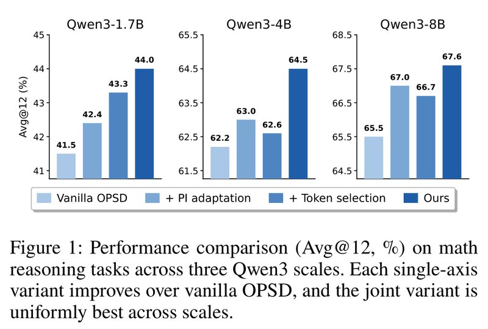
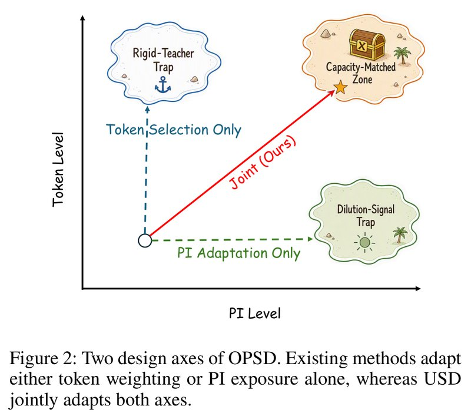
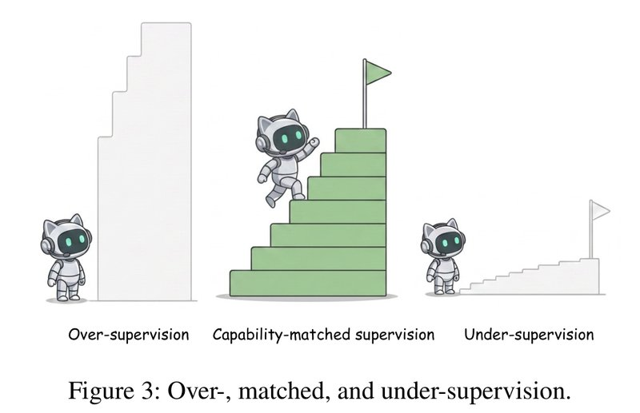
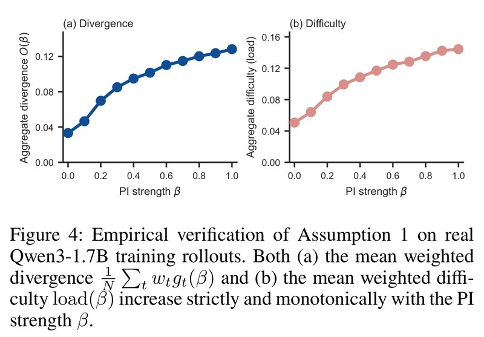
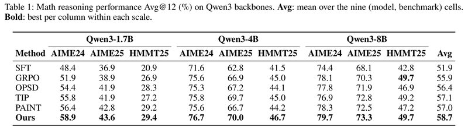
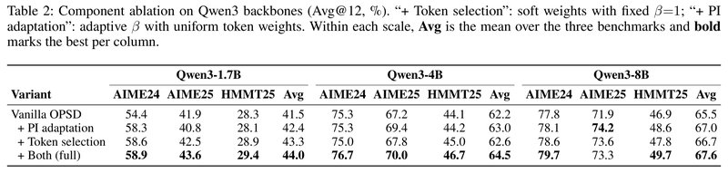
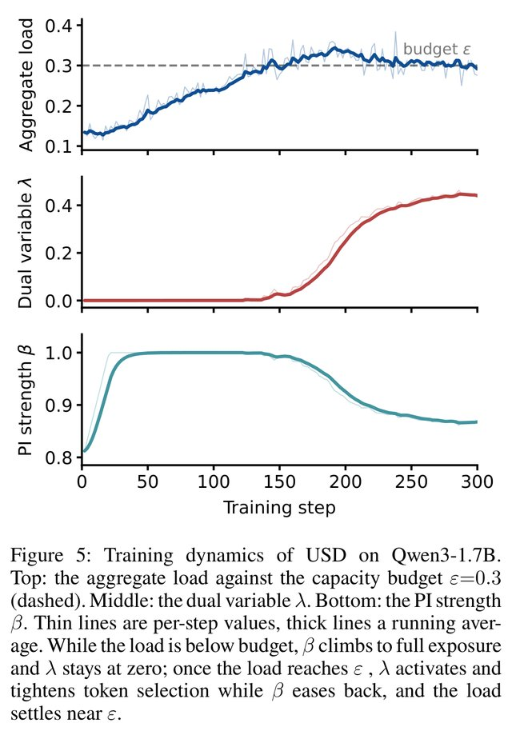
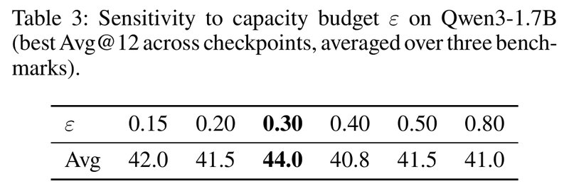

# Matching Supervision to the Student's Learning Capacity: A Unified Framework for On-Policy Self-Distillation（让监督匹配学生的学习能力：在线自蒸馏的统一框架）

中文 | [English](./USD-Unified-On-Policy-Self-Distillation_en.md)

- **原文链接**: [Matching Supervision to the Student's Learning Capacity: A Unified Framework for On-Policy Self-Distillation](https://arxiv.org/abs/2608.08176v1)
- **论文**: [arXiv:2608.08176](https://arxiv.org/abs/2608.08176)
- **官方资料**: [lauvlalala/USD](https://github.com/lauvlalala/USD)
- **发布日期**: 2026-08-08
- **范围**: 按 arXiv v1（2026-08-08 提交，目前只有这一版）写的通俗解读，不是全文翻译。作者是 Yongkang Yang 等 11 人，来自腾讯 Workbuddy 团队和浙江大学，另有一位独立研究者。

## 一句话版本

在线自蒸馏（OPSD）让同一个模型分饰两角：看过参考解答的"老师"逐个 token 批改没看过的"学生"写出的回答。已有的两条改进路线各管一个旋钮：一条挑学生重点学哪些 token，另一条控制给老师看多少参考解答。这篇论文指出，两个旋钮在争用学生同一份"消化能力"，应该放进同一个带预算的优化问题里一起调。作者由此推出一个"难度价格" λ，用它同时调两个旋钮，提出 USD（Unified on-policy Self-Distillation，统一的在线自蒸馏）。训练时每个批次测一次学生要消化的平均难度，高于预算就收紧 token 筛选、少给老师看答案，低于预算就反过来。

效果：在 Qwen3-1.7B、4B、8B 上，用 AIME 2024、AIME 2025、HMMT 2025 三个数学竞赛测试集评测，指标是每题采样 12 次的平均正确率（Avg@12）。按三个测试集的平均分算，USD 比普通 OPSD 分别高 2.5、2.3、2.1 个百分点（下文简称"分"）；三个尺寸、三个测试集共九个分数的总平均从 56.4 升到 58.7。只调一个旋钮的两个变体也比普通 OPSD 好，但只高 0.4～1.8 分，而且哪个旋钮更管用随尺寸变化。和普通 OPSD 相比，USD 每个批次只多一次求和和两个标量的更新。



*图 1：三个 Qwen3 尺寸上的数学推理成绩（Avg@12，%）。每组四根柱子颜色由浅到深，依次是普通 OPSD、只调"给老师看多少答案"（+ PI adaptation）、只调"学哪些 token"（+ Token selection）、两个一起调（Ours，即 USD）。只调一个旋钮的两个变体都比普通 OPSD 好，两个一起调在三个尺寸上都最好。以 4B 为例是 62.2、63.0、62.6、64.5：只调一个最多涨 0.8 分，两个一起调涨 2.3 分。柱子上的数就是表 2 里各尺寸三个测试集的平均，论文图注没写这一点。三个子图的纵轴都不从 0 开始（分别从 41、61.5、64.5 起）。*

---

## 1. 先认识几个词

| 词 | 大白话 |
| --- | --- |
| on-policy | 学生在自己写出的回答上学习，不是照抄别人写好的解答。"在线自蒸馏""在线蒸馏"里的"在线"指的就是它；下文"在线调节""在线估计"里的"在线"则是"训练过程中边训边调"的意思 |
| 自蒸馏（self-distillation） | 老师和学生是同一个模型，只是看到的输入不同 |
| 特权信息（privileged information，PI） | 训练时老师能看、考试时没有的信息，这里是参考解答，下文也叫"小抄" |
| PI 强度 β | 老师能看到参考解答的比例，0 是不看解题过程，1 是全看 |
| token 权重 $`w_t`$ | 学生回答里每个位置的损失乘上的系数，在 0～1 之间，决定这个位置学多少 |
| KL 散度 | 衡量两个概率分布差多远的一个数，越小越接近。下文的"KL 距离"说的也是它 |
| 收获 $`g_t`$（divergence） | 某个位置上老师和学生分布的 KL 距离，代表这里可能学到多少 |
| 难度 $`d_t`$（learning difficulty） | 老师最看好的 token 让学生有多意外，代表消化这个纠正有多费劲 |
| 能力预算 ε（capacity budget） | 每个批次允许的平均难度上限 |
| load | 当前批次实际的平均加权难度 |
| 对偶变量 λ（dual variable） | 难度的"价格"，同时决定 token 的筛选门槛和 β 往哪边调 |
| 可学性前沿（Learnability Frontier） | 把每个预算下能拿到的最大平均收获连起来，得到的那条边界 |
| Avg@12 | 每道题采样 12 次，算平均正确率 |
| LoRA | 只训练少量附加参数的高效微调方法 |

## 2. 它想解决什么问题

想让大模型的数学推理变强，常见做法有这几种：

| 路线 | 做法 | 问题 |
| --- | --- | --- |
| SFT（监督微调） | 让模型照抄参考解答 | 训练时抄别人的，考试时要自己写，两者对不上 |
| GRPO 等强化学习 | 一道题做很多遍，按最终答案对错给奖励 | 采样量大，成本高；只知道整体对错，不知道错在哪一步 |
| 在线蒸馏（OPD） | 学生自己写，一个更强的大模型逐 token 指导 | 要另外准备一个更大的老师模型，大小模型之间还有能力差距 |

OPSD（On-Policy Self-Distillation，在线自蒸馏）让同一个模型分饰两角：

- **学生**：只看题目，自己写一份回答。
- **老师**：还是这个模型，但额外看到一份参考解答。这种"训练时有、考试时没有"的信息，论文叫特权信息（PI），可以理解成"小抄"。

老师逐个位置读学生写的内容，给出"看过小抄的我在这个位置会怎么写"的概率分布，学生朝这个分布靠拢。这样小抄里的信息就被"内化"进模型参数，学生以后不看小抄也能写得更好。学生是在自己写的内容上被纠正，老师和学生又是同一个模型，所以没有大小模型之间的能力差距问题。OPSD 用很少的算力就能在数学竞赛题上超过强化学习（arXiv 2601.18734）。

普通 OPSD 有两个"一刀切"的默认设定，最近的研究分别指出了它们的问题。

**问题一：所有 token 一视同仁。** 学生的回答里，大部分位置老师和学生的看法差不多，梯度信号集中在少数位置：前 20% 的位置占了约 80% 的信号量。另外，分歧最大的位置里有很多是学生"够不着"的：老师推荐的 token 落在学生几乎不会考虑的范围里，硬学也得不到有用的梯度。

**问题二：老师看完整的参考解答。** 小抄给得越全，老师的分布离学生越远，一步梯度更新补不上这么大的差距。如果小抄里直接写着最终答案，全部给老师看还会把答案"泄露"进监督信号。

针对这两个问题，已有两条改进路线：

| 路线 | 做法 | 本文对比的代表方法 |
| --- | --- | --- |
| 挑 token（token selection） | 给每个位置打分，重新分配损失权重，重点学有用的位置 | TIP：按熵和分歧的综合分数，只保留前 20% 的 token |
| 控制特权信息（PI control） | 调整老师能看到多少参考解答 | PAINT：按重叠程度自适应地遮住参考解答的后一段，并对老师和学生的输出分数（logits）做稀疏插值 |

论文要回答的问题是：**两个旋钮该怎么一起调，才能让老师给的监督正好匹配学生当前能消化的程度？**

## 3. 核心观点：两个旋钮是联动的



*图 2：OPSD 的两个设计维度（示意图）。横轴是给老师看多少特权信息（PI Level），纵轴是 token 层面怎么分配权重（Token Level）。只挑 token（蓝色竖虚线）会停在左上角的"老师僵化"陷阱（Rigid-Teacher Trap），只调 PI（绿色横虚线）会停在右下角的"信号稀释"陷阱（Dilution-Signal Trap），两个一起调（红色实线，即本文方法）才能走到右上角"与能力匹配"的区域（Capacity-Matched Zone）。*

"老师僵化"指老师固定不变（比如始终看全部答案），没法变温和；"信号稀释"指所有 token 一视同仁，有用的信号被大量没什么收获的位置稀释。

两个旋钮管的事情不一样：

- **β（PI 强度，0～1）**：老师看多少参考解答。β = 0 不给看解题过程，β = 1 全给看（实现中最终答案始终给老师看）。它改变的是老师本身，会同时影响所有 token 上的监督。论文的说法是 β 决定"生成什么样的监督"。
- **w（每个 token 的权重，0～1）**：老师不变，只决定把监督用在学生回答的哪些位置，也就是"哪些监督真正传给学生"。

普通 OPSD 相当于 β = 1、所有 w = 1。

作者的关键判断是：**这两个旋钮互相影响。** 用家教讲作业打个比方（类比是我加的，不是论文原文）：

- 讲得浅一点（β 调小），原本学生听不懂的地方变得能听懂了，值得改的地方就变多了。
- 只挑学生够得着的地方改（把最难的 token 过滤掉），就可以讲得深一点，学生也不至于消化不了。

所以一个旋钮的最佳位置取决于另一个旋钮在哪。固定一个去调另一个，只能找到"另一个固定时的最好点"（条件最优），找不到两个一起调时的最好点。TIP 固定 β = 1 去挑 token，PAINT 调 β 但所有 token 一视同仁，都属于这种情况。

## 4. 把问题写成"预算内收获最大化"



*图 3：过度监督、匹配的监督和监督不足（示意图）。左边台阶太高（过度监督），学生爬不上去；右边台阶太矮（监督不足），爬了也没什么长进；中间高度合适，学生才能一级一级往上走。*

这张图是整篇论文的直觉：好的监督应该和学生当前的消化能力匹配。

为了量化"台阶高度"，作者给每个 token 位置 t 定义了两个量。

**（1）收获 $`g_t`$：这个位置学生能学到多少。** 它是老师分布 $`p_T^\beta`$ 和学生分布 $`p_S`$ 在这个位置的 KL 距离。差得越多，这个位置可能的改动越大。

```math
g_t(\beta) = D_{\mathrm{KL}}\big(p_T^{\beta} \,\|\, p_S\big)_t
```

**（2）难度 $`d_t`$：学生消化这个纠正有多费劲。**

```math
d_t(\beta) = \left(\log \frac{p_T^{\beta}(a_t^\star)}{p_S(a_t^\star)}\right)_+
```

$`a_t^\star`$ 是老师在这个位置最看好的 token，$`(\cdot)_+`$ 表示负数按 0 算。直观理解是"老师最想写的那个 token，学生有多意外"。举几个数字（老师给 $`a_t^\star`$ 的概率都是 0.8）：

| 学生给 $`a_t^\star`$ 的概率 | 难度 $`d_t`$ | 含义 |
| --- | --- | --- |
| 0.2 | $`\ln 4 \approx 1.39`$ | 学生很意外，纠正幅度大，难消化 |
| 0.7 | $`\ln(0.8/0.7) \approx 0.13`$ | 小幅调整，容易 |
| 0.9 | 0 | 学生本来就更倾向这个 token，没有负担 |

两个量都随 β 变化：给老师看的答案越多，老师越"笃定"，收获和难度通常一起变大。好的监督要两头兼顾，纠正要足够有力，又不能超出学生的消化能力。

**把两个量放进一个优化问题。** 在"平均难度不超过预算 ε"的前提下，让"平均收获"最大（两个平均都按 token 权重加权）：

- ε 叫能力预算（capacity budget）：学生在当前阶段每个批次能消化的平均难度上限。
- 多选 token、多给老师看答案，都会让平均难度变大，所以两个旋钮在抢同一份预算。
- 把每个预算 ε 下能拿到的最大收获连起来，就是论文说的可学性前沿（Learnability Frontier）。已有的两条路线都只是在这个问题里固定了一个变量：挑 token 的方法固定 β，控制特权信息的方法固定 w。这相当于只沿一条线找，碰巧才能落到这条前沿上。

**选读：优化问题的公式。** 不看也不影响理解。$`\frac{1}{N}\sum_t`$ 表示对这一批的 token 取平均，s.t. 读作"满足"，后面是约束条件：

```math
\max_{\mathbf{w}\in[0,1]^T,\ \beta\in[0,1]}\ \frac{1}{N}\sum_t w_t\, g_t(\beta) \quad \text{s.t.}\quad \frac{1}{N}\sum_t w_t\, d_t(\beta) \le \varepsilon
```

## 5. 一个"价格" λ 同时管两个旋钮

作者用拉格朗日乘子法（处理带约束优化问题的标准办法）把预算约束并进目标里，引入一个变量 λ ≥ 0，可以把它理解成难度的价格。每个 token 的"净价值" $`v_t = g_t - \lambda d_t`$，就是"收获减去难度乘以价格"。由此推出两条规则。

**规则一（管 token）：净价值为正才学。** 收获大于 λ 倍难度的 token 权重取 1，否则取 0。比如 λ = 0.4：收获 0.5、难度 1.0 的 token，净价值 0.1，学；收获 0.3、难度 1.0 的 token，净价值 −0.1，不学。对难度大于 0 的 token，这条规则等价于"收获除以难度大于 λ"，所以被筛掉的是收获相对难度太少的 token，难度很高但收获更高的 token 仍会保留。

**规则二（管 β）：预算用满（λ > 0）且最优 β 落在 0 和 1 之间时，多给答案带来的收获刚好等于 λ 乘以多出来的难度。** β 每加一点，被选中 token 的收获和难度都会增加。只要多出来的收获超过 λ 倍的多出来的难度，就值得继续加 β。

**同一个 λ 既是 token 的筛选门槛，又是 β 的换算比例**，这就是"统一"的含义。这个联系是从"两个旋钮共享同一份预算"直接推出来的，作者没有另外设计。

**选读：拉格朗日函数和两条规则的公式。** 不看也不影响理解。拉格朗日函数是：

```math
\mathcal{L}(\mathbf{w},\beta,\lambda) = \frac{1}{N}\sum_t w_t \underbrace{\big[g_t(\beta) - \lambda\, d_t(\beta)\big]}_{v_t} + \lambda\varepsilon
```

它对每个 $`w_t`$ 是线性的，所以在 0 到 1 之间取值时，最优权重就是一个 0/1 开关（规则一）：

```math
w_t^\star = \mathbf{1}\big[g_t(\beta) > \lambda\, d_t(\beta)\big]
```

规则二来自"对 β 求导等于 0"这个条件，求和只在被选中的 token 上进行：

```math
\lambda = \frac{\sum_{t:\,w_t^\star=1} \partial g_t/\partial\beta}{\sum_{t:\,w_t^\star=1} \partial d_t/\partial\beta}
```

**β 没法求导，怎么调？** β 的实际含义是"参考解答截取多长给老师看"，截断文本这个操作不可导，规则二没法直接算。作者换了个简单办法：当前的平均难度（论文叫 load）低于预算，就多给老师看一点；高于预算，就少给一点。

这个办法成立需要一个假设（论文的假设 1）：在选中的 token 上，平均收获和平均难度都随 β 严格递增。也就是答案给得越多，老师纠正得越多，学生也越难消化。



*图 4：在 Qwen3-1.7B 真实训练回答上验证假设 1，两张图的横轴都是 PI 强度 β。(a) 平均加权收获，从 β = 0 时约 0.03 升到 β = 1 时约 0.13；(b) 平均加权难度 load，从约 0.05 升到约 0.145，β = 0.8 时约 0.135（读图估计）。论文没写这是在训练的哪个阶段测的。*

两条曲线都往上走、越往后越平，说明假设成立，多给答案的边际效果也在递减。在这个假设下，论文证明了命题 1：如果存在某个 $`\beta^\star`$ 让 load 正好等于预算，这个 $`\beta^\star`$ 就是最优解，而"低于预算加 β、高于预算减 β"的规则会从任意一侧单调地收敛到它。

## 6. USD 算法：像一个恒温器

上面的最优规则还不能直接用：规则一里的 λ 依赖当前的学生，训练中一直在变；0/1 的硬开关也没法求导。所以 USD 把 λ、w、β 都放到训练过程中在线估计。每个批次做这几件事：

1. **学生做题**：每道题生成一个回答（训练时最长 1024 个 token）。
2. **老师打分**：老师是冻结的原始模型，看"题目 + 参考解答的前 β 部分 + 最终答案"，对学生回答的每个位置给出概率分布。
3. **算两个量**：每个 token 的收获 $`g_t`$ 和难度 $`d_t`$。
4. **算软权重**：把 0/1 开关换成 0～1 之间的平滑值 $`w_t = \sigma\big((g_t - \lambda d_t)/\tau\big)`$，σ 是 sigmoid 函数，τ = 0.1 控制它有多接近硬开关。这个形式是在拉格朗日函数里加一个熵正则项 $`\tau H(\mathbf{w})`$ 推出来的。
5. **更新学生**：损失是按权重加权的 KL 平均 $`\mathcal{L}_{\text{train}} = \sum_t w_t\, D_{\mathrm{KL}}(p_T^\beta \,\|\, p_S)_t \,/\, \sum_t w_t`$，学生只训练 LoRA 参数。除以总权重是为了让筛选只改变各 token 的相对重要性，不改变整体的更新步长。
6. **测当前难度**：$`\text{load} = \frac{1}{N}\sum_t w_t\, d_t`$。
7. **调两个标量**：λ 按"load 减预算"调，β 按"预算减 load"调。$`\eta_\lambda`$ 和 $`\eta_\beta`$ 是两个步长，clip 表示把 β 限制在 $`\beta_{\min}`$ 和 1 之间：

```math
\lambda \leftarrow \max\big(0,\ \lambda + \eta_\lambda(\text{load} - \varepsilon)\big), \qquad \beta \leftarrow \mathrm{clip}\big(\beta + \eta_\beta(\varepsilon - \text{load}),\ \beta_{\min},\ 1\big)
```

第 7 步可以类比空调的恒温器（类比是我加的，不是论文原文）：设定温度是 ε，当前温度是 load。

- **太热（load > ε）**：λ 变大，筛掉更多"性价比低"的 token；β 变小，老师少看点答案。两个动作都让 load 降下来。
- **太冷（load < ε）**：λ 变小（最低到 0），筛得更松；β 变大（最高到 1），老师多看点答案。两个动作都让 load 升上去。

最后 load 稳定在 ε 附近。和普通 OPSD 相比，USD 每个批次只多一次对所有 token 的求和和两个标量的更新，不需要额外的模型，也不需要额外的前向计算。

和普通 OPSD 的区别（这张表是我根据论文内容整理的）：

| 维度 | 普通 OPSD | USD |
| --- | --- | --- |
| 老师看多少参考解答（β） | 全部（β = 1） | 按难度预算在线调整，范围 0.1～1 |
| 每个 token 的权重（w） | 全部为 1 | 由收获、难度和 λ 算出的 0～1 之间的软权重 |
| 额外开销 | （基准） | 每个批次多一次求和和两个标量更新 |

具体的超参数见第 10 节。

## 7. 实验结果

### 7.1 实验怎么设计的

- **模型**：Qwen3 的 1.7B、4B、8B 三个尺寸，都用非思考模式（non-thinking mode）。
- **训练数据**：OpenThoughts 的数学推理子集，最多 3 万对"题目 + 带推理过程的参考解答"。参考解答就是老师的小抄。
- **测试集**：AIME 2024、AIME 2025、HMMT 2025 三个数学竞赛（各 30 道题）。每道题采样 12 次算平均正确率（Avg@12）。每 50 步存一个检查点，每个测试集各自取成绩最好的那个检查点报告。
- **训练**：老师是冻结的初始模型，学生只训练 LoRA（rank 64），共 300 步。学生每道题只生成 1 个回答，最长 1024 个 token。
- **对比方法**（都用同样的初始模型和训练数据，除 GRPO 外都训练 300 步）：
  - SFT：照抄参考解答。
  - GRPO：强化学习，每道题 8 个回答、每个最长 16k token，训练 500 步，取成绩最好的检查点。
  - 普通 OPSD：老师看完整参考解答，所有 token 权重相同。
  - TIP（只挑 token）：用原作者的开源代码，保留前 20% 的 token。
  - PAINT（只控制 PI）：按原论文的默认设置。

### 7.2 主要结果：九格里八格第一，比普通 OPSD 高 2 分多



*表 1：Qwen3 各尺寸上的数学推理成绩（Avg@12，%）。Avg 是九个（模型，测试集）格子的平均值；加粗为每个尺寸内每列的最好成绩。*

按尺寸看三个测试集的平均（论文表 1 只给了九格总平均，各尺寸的平均由表中数字算出）：

| 方法 | 1.7B | 4B | 8B | 九格总平均 |
| --- | --- | --- | --- | --- |
| SFT | 35.4 | 58.6 | 61.8 | 51.9 |
| GRPO | 39.2 | 62.5 | 66.0 | 55.9 |
| 普通 OPSD | 41.5 | 62.2 | 65.5 | 56.4 |
| TIP（只挑 token） | 41.6 | 63.5 | 66.3 | 57.1 |
| PAINT（只控制 PI） | 42.8 | 62.2 | 66.0 | 57.0 |
| **USD** | **44.0** | **64.5** | **67.6** | **58.7** |

怎么读这张表：

- **USD 在 9 个格子里 8 个第一**，剩下一个（8B 的 HMMT25）和 GRPO 并列，都是 49.7。
- **比普通 OPSD 高**：三个尺寸分别高 2.5、2.3、2.1 分，总平均从 56.4 升到 58.7（+2.3）。论文强调，提升不是靠某一个尺寸或某一个测试集撑起来的。
- **TIP 和 PAINT 在多数尺寸上比普通 OPSD 好，但幅度不稳**：TIP 在 1.7B 上只高 0.1，PAINT 在 4B 上持平。论文对它们为什么不如 USD 的解释是：TIP 固定 β = 1，它挑的 token 是按"最强的老师"挑的，老师温和一点，该挑的 token 就会变；PAINT 调了 β，但所有 token 一视同仁，学习信号里混了大量几乎没有收获的位置。USD 的 λ 能同时做两件事：老师变温和后放宽筛选，把变得能学的位置纳进来；筛选省下来的预算拿去多给老师看答案。只调一个维度做不到这种配合。
- **比 GRPO 高**：1.7B 上高 4.8 分，4B 和 8B 上分别高 2.0 和 1.6 分。论文正文写的是 +4.7、+2.0、+1.5，用的是没有四舍五入的平均；这里用表中一位小数直接相减，差别来自四舍五入。USD 每道题 1 个回答、最长 1024 个 token、训练 300 步；GRPO 每道题 8 个回答、最长 16k token、训练 500 步。按长度上限算，每道题的采样量相差一百多倍（实际生成长度论文没有报告）。
- **SFT 最差**，总平均只有 51.9。

### 7.3 消融实验：两个旋钮单独用都有效，一起调最好



*表 2：在 Qwen3 上逐个加组件的消融实验（Avg@12，%）。"+ Token selection"是用软权重、β 固定为 1；"+ PI adaptation"是 β 自适应、所有 token 权重相同；"+ Both (full)"就是完整的 USD。每个尺寸内的 Avg 是三个测试集的平均，加粗为每列最好。*

只看三个测试集的平均（括号里是比普通 OPSD 多出的分数）：

| 变体 | 1.7B | 4B | 8B |
| --- | --- | --- | --- |
| 普通 OPSD | 41.5 | 62.2 | 65.5 |
| + 只调 PI | 42.4（+0.9） | 63.0（+0.8） | 67.0（+1.5） |
| + 只挑 token | 43.3（+1.8） | 62.6（+0.4） | 66.7（+1.2） |
| + 两个都调（USD） | **44.0（+2.5）** | **64.5（+2.3）** | **67.6（+2.1）** |

论文从这张表得出三点：

1. **每个旋钮单独用都有效**：两个单项变体在三个尺寸上都比普通 OPSD 好。
2. **两个一起调在每个尺寸上都最好**，提升稳定在 2 分出头；只调一个旋钮时，提升幅度随尺寸忽高忽低。
3. **没有哪个旋钮总是更重要**：1.7B 上挑 token 贡献更大，4B 和 8B 上调 PI 略占上风。如果人工固定"两边各占多少"，总会在某个尺寸上配错；USD 从同一个预算推出两个动作，不需要人工定比例。

表里还能看出一点论文没有展开的情况（我的观察）：两个旋钮的效果不能简单相加。1.7B 上单项提升之和是 0.9 + 1.8 = 2.7，联合只有 2.5；8B 上单项之和是 2.7，联合只有 2.1；只有 4B 上联合（2.3）明显超过单项之和（1.2）。两个旋钮有互补，也有一部分作用重叠。另外，8B 的 AIME25 上"只调 PI"拿到 74.2，比完整 USD 的 73.3 还高。

### 7.4 训练过程：load 先爬到预算线，λ 和 β 再一起把它稳住



*图 5：USD 在 Qwen3-1.7B 上的训练过程，横轴是训练步数（0～300）。上：平均难度 load 与能力预算 ε = 0.3（虚线）；中：对偶变量 λ；下：PI 强度 β。细线是每一步的值，粗线是滑动平均。论文图注的描述是：load 低于预算时，β 升到完全暴露、λ 保持为 0；load 到达 ε 后，λ 开始起作用、收紧 token 筛选，β 回落，load 稳定在 ε 附近。各阶段的读数见下文。*

按时间顺序看（数值是从图上读的近似值，读图估计）：

1. **前 40 步左右**：β 从 0.8 起步，老师还比较温和，load 只有 0.13 左右，远低于预算。λ 保持 0，几乎不筛 token；β 很快升到上限 1.0，老师看完整答案。
2. **约 40～150 步**：β 停在 1.0，λ 仍是 0，load 从 0.15 左右慢慢涨到 0.3。
3. **约 150 步以后**：load 碰到预算线。λ 开始变大，筛掉性价比低的 token（论文说主要是难度最高的那些）；β 同时往回降，老师少看一点答案。load 一度冲到 0.34 左右，然后被拉回来。
4. **最后**：load 稳定在 0.3 附近，λ 停在约 0.44，β 停在约 0.87。

论文的解释是：β 变大让老师更笃定、难度变高，把 load 推到预算线。

**图上还能看出一点论文没分析的情况**（我的观察）：β 在第 40 步左右就到了 1.0，load 却在第 40～150 步之间继续上涨。这段时间老师（冻结的初始模型）和它看到的答案都没变，λ 也一直是 0，load 的上涨更可能来自学生自己在训练中的变化（它的概率分布和写出的回答都在变）。和图 4 对照也是这个结论：图 4 中 β = 0.8 时 load 约 0.135，和图 5 起点（β 约 0.81）的 load 几乎一样，图 4 很可能是在训练初期测的（论文没写）。按图 4，β 从 0.8 加到 1.0 只让 load 多了约 0.01，而图 5 中 load 从约 0.135 涨到了 0.3，大部分涨幅发生在 β 到顶之后。

这个现象有两层含义：

- 它支持在线调节的思路：老师不变，学生在变，同样的小抄对不同阶段的学生难度不一样。
- 按论文自己的说法（λ 约为 0 时权重接近均匀），1.7B 上第 40 步到第 150 步左右，USD 和普通 OPSD 的设置基本一样：老师看完整答案，token 权重接近均匀。两个旋钮的联动主要发生在后半程。

### 7.5 能力预算 ε：0.3 最好，其他取值和普通 OPSD 差不多



*表 3：Qwen3-1.7B 上对能力预算 ε 的敏感性（各检查点中最好的 Avg@12，三个测试集平均）。ε 取 0.15、0.20、0.30、0.40、0.50、0.80 时，成绩分别是 42.0、41.5、44.0、40.8、41.5、41.0。*

ε = 0.3 时最好（44.0），往两边都变差。论文的解释：预算太紧，筛掉太多 token，学生没东西可学；预算太松，约束几乎不起作用，方法退化成接近"所有 token 一视同仁"的普通 OPSD。最好的点在中间，说明提升来自"让监督匹配学生能消化的量"，不是筛得越狠越好。

需要注意（这是我的看法）：这个最优点很尖。普通 OPSD 在 1.7B 上是 41.5，除了 ε = 0.3，其他取值都在 40.8～42.0 之间，和普通 OPSD 差不多，ε = 0.4 和 0.8 还略低。ε 不是 0.3 时，完整 USD 的成绩（最高 42.0）还不如表 2 里只调一个旋钮的两个版本（42.4 和 43.3）。曲线也不平滑：0.15 比 0.20 好，0.50 比 0.40 好。论文没有说 0.3 是怎么选出来的，这张表用的就是测试集，而且只在 1.7B 上扫过，4B 和 8B 直接沿用 0.3。

## 8. 作者自己承认的局限

论文没有专门讨论局限，只在结论里提到，希望这个视角能为以后研究"学生该接受多少监督、什么时候接受"打下基础。方法部分交代过两个前提：

- **最优的 β 没法直接算。** 论文第 3.3 节说明，β 是通过截断老师上下文这种不可导的操作起作用的，规则二没法直接求值，只能用"load 低于预算就加 β、高于预算就减 β"的规则代替。
- **这个替代规则依赖假设 1。** 平均收获和平均难度都要随 β 严格递增。论文只在 Qwen3-1.7B 的训练回答上验证过（图 4）。

## 9. 读的时候值得留意的地方

以下是我读原文时注意到、论文没有重点讨论的点，供参考。

### 证据有多强

- **缺一个关键对照。** 没有和"两个旋钮都用固定值一起调"（比如网格搜索一个固定的 β 和固定的筛选比例），或"TIP 和 PAINT 直接叠加"做比较。缺了这个对照，就分不清提升来自"两个维度都调了"，还是来自"用 λ 在线联动"。
- **ε 敏感，且没说怎么选。** 只有 ε = 0.3 明显好于普通 OPSD；这个值是在测试集上、只在 1.7B 上扫出来的，4B 和 8B 直接沿用（见 7.5 节）。
- **评测方式偏乐观。** 每个测试集各自挑最好的检查点。所有方法都这么做，相对比较是公平的，但绝对分数会偏高。论文没有报告多次运行的方差；三个测试集各只有 30 道题，单个测试集上 1 道题从全错变成全对就是 3.3 分。
- **没有列未训练的原始模型。** 看不出各方法相对起点涨了多少。另外，本文复现的普通 OPSD 在 1.7B 和 4B 上比 OPSD 原论文（arXiv 2601.18734）报告的低（1.7B：41.5 对 43.4；4B：62.2 对 63.6），8B 上则更高（65.5 对 64.8）。两篇论文的训练步数和评测设置不同，不能直接比，但相对普通 OPSD 的提升幅度会受基线复现结果影响。比如 USD 在 1.7B 上的 44.0，只比 OPSD 原论文自己报告的 43.4 高 0.6。
- **"两个旋钮互补"只部分成立。** 论文说两者互补，但 1.7B 和 8B 上联合提升小于两个单项提升之和，只有 4B 上明显超过（见 7.3 节）。
- **load 的上涨大部分不能用 β 解释。** 按图 4，β 从 0.8 升到 1.0 只让 load 增加约 0.01，而图 5 中 load 从约 0.135 涨到 0.3，大部分涨幅发生在 β 到顶之后。论文"β 变大推高 load"的解释只能说明其中一小部分（见 7.4 节）。
- **"跟随学生不断变化的能力"说法偏大。** 摘要和论文第 3.4 节说，USD 让监督跟随学生不断变化的学习能力。但能力预算 ε 是固定常数 0.3，三个尺寸、整个训练过程都不变。USD 实际做的是把平均难度稳定在 ε 附近，学生能力的变化只通过 load 间接体现。
- **命题 1 的保证比说法弱。** 证明只说明了更新方向是对的（β 小于最优值时增大、大于时减小），没有给步长条件。步长太大会越过最优点来回摆动，"单调收敛"还需要步长足够小。按图 4 的斜率（β 从 0 到 1，load 只涨约 0.1）和 $`\eta_\beta = 0.03`$，实际不会越过，所以对实践影响不大。另外，证明把学生和 token 权重都当成固定的，实际训练中两者每一步都在变。
- **"难度"的定义比较粗。** 只看老师最看好的那一个 token，论文没有实验验证高难度 token 确实学不会。假设 1 也只在 1.7B 上验证过（见第 8 节）。

### 适用范围

- **测试范围窄。** 只测了 Qwen3 一个系列、最大 8B，只测了三个数学竞赛集，都是非思考模式、最长 1024 个 token 的短回答。引言提到 OPSD 在代码和智能体（agent）任务上也有效，但那是别人的工作，USD 本身没在这些任务上测过。
- **没有处理答案泄露。** 引言说小抄里带最终答案会把答案泄露进监督信号，但实现中不管 β 多小，老师都能看到最终答案。β 控制的只是解题过程给多少。

### 稿件里的小问题（不影响主要结论）

- **β 的截断单位前后不一致。** 论文第 4.1 节写老师看到参考解答的"前 $`\lfloor \beta L \rfloor`$ 个字符"，又说 L 是"以 token 计的长度"。到底按字符还是按 token 截断，需要看代码确认。

## 10. 如果想自己跑

代码见开头的链接。论文没有给出硬件和训练耗时。论文的设置：

| 项目 | 设置 |
| --- | --- |
| 老师 | 冻结的初始模型；输入是题目 + 参考解答的前 β 部分，始终保留最终答案（参考解答里 `\boxed{}` 框出的那个） |
| 学生训练 | LoRA rank 64、α = 128；AdamW 优化器，学习率 5×10⁻⁶；有效批大小 32；梯度范数裁剪 0.1；300 步 |
| 学生采样 | 采样温度 1.1、top-p 0.95、top-k 20、最长 1024 个 token，每题 1 个回答 |
| USD 超参数（三个尺寸相同） | $`\tau = 0.1`$、$`\varepsilon = 0.3`$、$`\eta_\lambda = 0.1`$、$`\beta_{\text{init}} = 0.8`$、$`\eta_\beta = 0.03`$、$`\beta_{\min} = 0.1`$；每个 token 的 KL 截断在 0.05，用于数值稳定 |
| 评测 | 每题 12 个样本、采样温度 1.0；每 50 步存一个检查点，每个测试集取最好 |

几点实际建议（这是我的看法）：

- **实现成本很低。** 在 OPSD 基础上，每个批次多算一个加权平均难度，多维护两个标量 λ 和 β。
- **最需要调的是 ε。** 论文的 0.3 只在 Qwen3-1.7B 上扫过，换模型或任务很可能要重新扫。
- **看三条曲线判断预算是否合适。** 按算法的逻辑，λ 一直是 0、β 一直顶在 1，说明预算太松，USD 退化成普通 OPSD；λ 一直涨、β 被压到下限 0.1，说明预算太紧。

## 11. 和相关工作的关系

本文讨论到的几篇工作：

| 工作 | 和本文的关系 |
| --- | --- |
| 普通 OPSD（arXiv 2601.18734） | 本文的出发点和主要对照方法：老师看完整参考解答，所有 token 权重相同。"老师用冻结的初始模型"这个做法本文沿用了下来。两篇论文报告的 OPSD 数字对比见第 9 节 |
| 在线蒸馏 OPD（arXiv 2306.13649） | 学生在自己写的回答上学，由另一个更强的模型逐 token 指导；OPSD 把老师换成看了参考解答的同一个模型 |
| TIP（arXiv 2604.14084） | 挑 token 路线的代表，本文的对照方法：β 固定为 1，按熵和分歧的综合分数保留前 20% 的 token |
| Wang 等（arXiv 2605.26844） | 也属于挑 token 路线；"前 20% 的位置占约 80% 信号"这一观察的出处之一 |
| PAINT（arXiv 2604.26573） | 控制特权信息路线的代表，本文的对照方法：自适应地遮住参考解答的后一段，并在老师和学生之间做稀疏插值，所有 token 权重相同 |
| GRPO（论文引用的是 DeepSeek-R1，arXiv 2501.12948） | 强化学习对照方法，按最终答案对错给奖励 |

论文第 2 节认为，这两条路线都没有在同一个预算下同时调 token 权重和 PI 强度：挑 token 的工作把 PI 当成固定输入，控制 PI 的工作对所有位置一视同仁。论文还提到，多数控制 PI 的做法按事先定好的规则或启发式信号调整暴露程度，不看学生当前在消化多少难度。

## 12. 总结

USD 的出发点是：**"给老师看多少参考解答"和"学生重点学哪些 token"在抢学生同一份消化能力，所以应该放在同一个预算下一起调。** 作者给每个 token 定义收获和难度，把问题写成"平均难度不超过预算时最大化平均收获"，推出一个价格 λ，同时决定 token 的筛选门槛和 β 往哪边调。实现上像一个恒温器：每个批次测一次平均难度，高了就收紧筛选、少给答案，低了就放松筛选、多给答案，只比普通 OPSD 多两个标量的更新。

在 Qwen3 三个尺寸、三个数学竞赛测试集上，USD 比普通 OPSD 高 2.1～2.5 分，也高于只调一个旋钮的 TIP、PAINT 和采样量大得多的 GRPO。我核对过的部分都对得上：按表 1 各格重算的九格平均和论文给的一致，图 1 的柱子和表 2 各尺寸的平均一致，表 1 里 OPSD 和 USD 的各尺寸平均也和表 2 一致；"净价值为正取 1、为负取 0"的硬阈值规则推导没有问题（拉格朗日函数对 $`w_t`$ 是线性的）。证据的弱点在于：只测了 Qwen3 一个系列、最大 8B、三个各 30 道题的数学测试集，每个测试集挑最好的检查点，也没有报告方差；ε 只有取 0.3 时明显好于普通 OPSD，而且是在测试集上选的；还缺少"两个旋钮用固定值一起调"的对照，分不清提升来自两个维度都调了，还是来自 λ 的在线联动。

---

## 原文位置对照

| 本文内容 | 论文位置 |
| --- | --- |
| 一句话版本 | 摘要，第 1 节，图 1 |
| 问题和动机、两条改进路线（第 2 节） | 第 1 节 |
| 两个旋钮联动（第 3 节） | 第 1 节，第 3.1 节，式 (1)，图 2 |
| 收获和难度的定义（第 4 节） | 第 3.1 节 |
| 预算内的优化问题、可学性前沿（第 4 节） | 第 3.2 节，式 (2)(3)，图 3 |
| 价格 λ 和两条规则（第 5 节） | 第 3.3 节，式 (4)～(6) |
| β 的替代调法、假设 1、命题 1（第 5、8 节） | 第 3.3 节，图 4 |
| USD 算法（第 6 节） | 第 3.4 节，式 (7)～(10)，算法 1 |
| 实验设置和超参数（7.1 节、第 10 节） | 第 4.1 节 |
| 主要结果（7.2 节） | 第 4.2 节，表 1 |
| 消融实验（7.3 节） | 第 4.3 节，表 2，图 1 |
| 训练过程（7.4 节） | 第 4.4 节，图 5 |
| 能力预算 ε 的敏感性（7.5 节） | 第 4.4 节，表 3 |
| 结论和未来方向（第 8 节） | 第 5 节 |
| 相关工作（第 11 节） | 第 2 节 |
| OPSD 原论文的数字（第 9 节） | arXiv 2601.18734 的表 2 |
