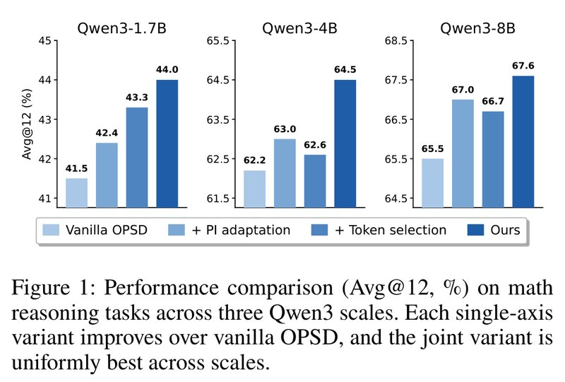
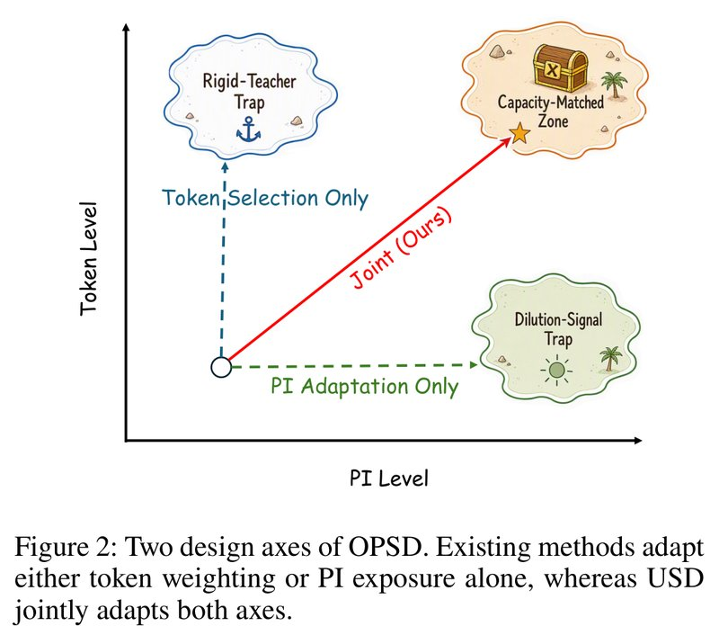
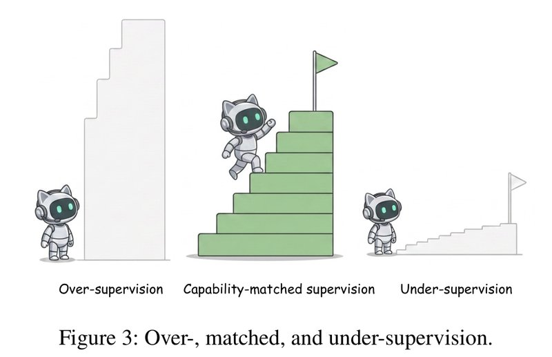
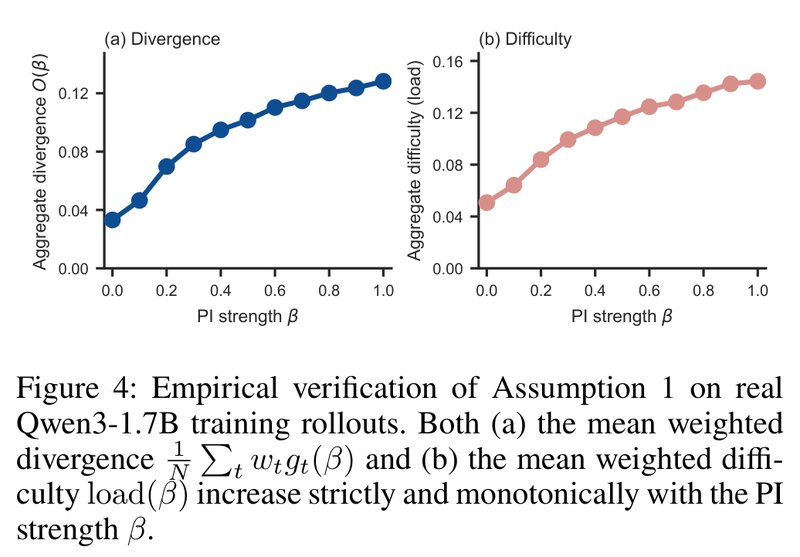
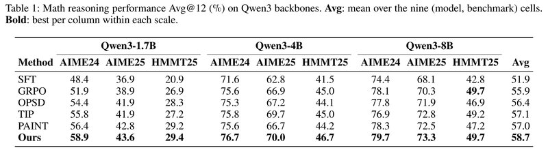
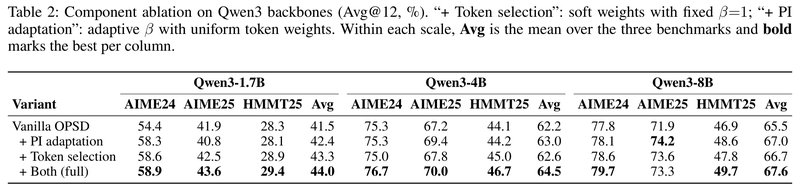
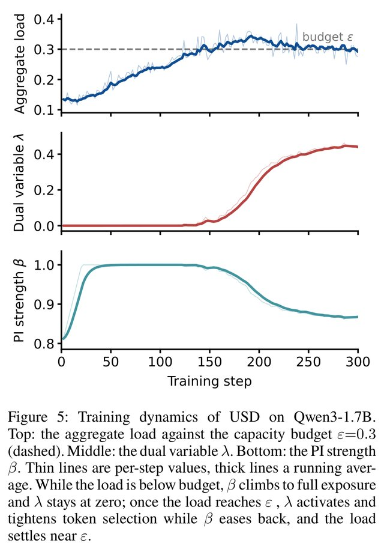
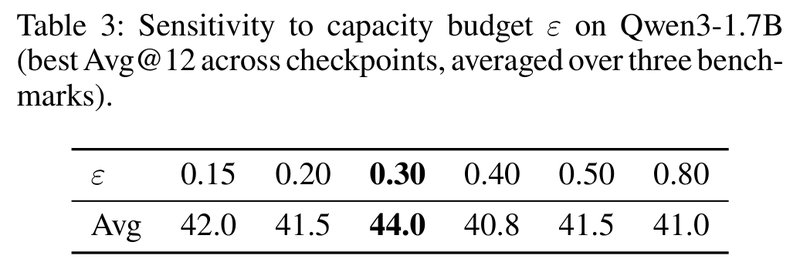

# Matching Supervision to the Student's Learning Capacity: A Unified Framework for On-Policy Self-Distillation

[中文](./USD-Unified-On-Policy-Self-Distillation.md) | English

- **Source**: [Matching Supervision to the Student's Learning Capacity: A Unified Framework for On-Policy Self-Distillation](https://arxiv.org/abs/2608.08176v1)
- **Paper**: [arXiv:2608.08176](https://arxiv.org/abs/2608.08176)
- **Official resources**: [lauvlalala/USD](https://github.com/lauvlalala/USD)
- **Published**: 2026-08-08
- **Scope**: A plain-language explainer based on arXiv v1 (submitted 2026-08-08, the only version so far), not a full translation. The authors are Yongkang Yang and others, 11 people in all, from Tencent's Workbuddy team and Zhejiang University, plus one independent researcher.

## In One Sentence

On-policy self-distillation (OPSD) has one model play two roles: a "teacher" that has seen the reference solution gives per-token corrections to the response written by a "student" that has not. The two existing lines of improvement each control one knob: one picks which tokens the student should focus on, and the other controls how much of the reference solution the teacher gets to see. This paper points out that the two knobs compete for the same "digestive capacity" of the student, so they should be tuned together in one optimization problem with a budget. From this the authors derive a "difficulty price" λ, use it to tune both knobs at once, and propose USD (Unified on-policy Self-Distillation). During training, each batch measures once the average difficulty the student has to digest: above the budget, token selection gets stricter and the teacher sees less of the answer; below the budget, the opposite happens.

Results: the models are Qwen3-1.7B, 4B and 8B, evaluated on three math competition test sets (AIME 2024, AIME 2025, HMMT 2025), and the metric is the average accuracy over 12 samples per problem (Avg@12). Averaged over the three test sets, USD beats plain OPSD by 2.5, 2.3 and 2.1 percentage points respectively (shortened to "points" below); the overall average of all nine scores, three sizes times three test sets, rises from 56.4 to 58.7. The two variants that tune only one knob also beat plain OPSD, but only by 0.4 to 1.8 points, and which knob helps more changes with model size. Compared with plain OPSD, USD adds only one sum and an update of two scalars per batch.



*Figure 1: Math reasoning scores on three Qwen3 sizes (Avg@12, %). In each group, the four bars go from light to dark: plain OPSD, tuning only "how much of the answer the teacher sees" (+ PI adaptation), tuning only "which tokens to learn" (+ Token selection), and tuning both together (Ours, i.e. USD). Both single-knob variants beat plain OPSD, and tuning both together is best at all three sizes. For 4B, the bars are 62.2, 63.0, 62.6 and 64.5: tuning one knob gains at most 0.8 points, while tuning both gains 2.3 points. The numbers on the bars are the averages over the three test sets in Table 2 for each size; the paper's caption does not say so. In all three subplots the y-axis does not start at 0 (it starts at 41, 61.5 and 64.5 respectively).*

---

## 1. Key Terms

| Term | In plain words |
| --- | --- |
| on-policy | The student learns on responses it wrote itself, instead of copying solutions written by others. This is what "on-policy" means in "on-policy self-distillation" and "on-policy distillation"; the "online" in "online adjustment" and "online estimation" below means "adjusted as training runs" instead |
| self-distillation | The teacher and the student are the same model; they only see different inputs |
| privileged information (PI) | Information the teacher can see during training but that is not available at test time; here it is the reference solution, also called the "cheat sheet" below |
| PI strength β | The fraction of the reference solution the teacher can see: 0 means it sees none of the solution steps, 1 means it sees all of it |
| token weight $`w_t`$ | The coefficient that multiplies the loss at each position of the student's response, between 0 and 1; it decides how much is learned at that position |
| KL divergence | A number that measures how far apart two probability distributions are; the smaller, the closer. The "KL distance" below means the same thing |
| gain $`g_t`$ (divergence) | The KL distance between the teacher's and the student's distributions at a position; it stands for how much could be learned there |
| difficulty $`d_t`$ (learning difficulty) | How surprised the student is by the teacher's top-choice token; it stands for how hard this correction is to digest |
| capacity budget ε | The upper limit on the average difficulty allowed per batch |
| load | The actual weighted average difficulty of the current batch |
| dual variable λ | The "price" of difficulty; it sets both the token selection threshold and the direction in which β is adjusted |
| Learnability Frontier | The boundary you get by connecting the largest average gain reachable under each budget |
| Avg@12 | Sample 12 times per problem and compute the average accuracy |
| LoRA | An efficient fine-tuning method that trains only a small number of added parameters |

## 2. What Problem It Tackles

Common ways to make a large model better at math reasoning include the following:

| Approach | What it does | Problem |
| --- | --- | --- |
| SFT (supervised fine-tuning) | Has the model copy the reference solution | It copies others during training but must write on its own at test time, and the two do not match |
| GRPO and other RL | Solves each problem many times and gives a reward based on whether the final answer is right | Many samples and high cost; it only knows whether the whole response is right, not which step went wrong |
| on-policy distillation (OPD) | The student writes on its own, and a stronger large model guides it per token | It needs a separate, larger teacher model, and there is a capability gap between the large and small models |

OPSD (On-Policy Self-Distillation) has one model play two roles:

- **Student**: sees only the problem and writes a response on its own.
- **Teacher**: still the same model, but it also sees a reference solution. The paper calls this kind of "available in training, absent at test time" information privileged information (PI); you can think of it as a "cheat sheet".

The teacher reads what the student wrote, position by position, and gives a probability distribution for "how I, having seen the cheat sheet, would write at this position"; the student moves toward that distribution. This way the information in the cheat sheet gets "internalized" into the model parameters, and later the student writes better even without the cheat sheet. The student is corrected on what it wrote itself, and the teacher and student are the same model, so there is no capability gap between a large and a small model. OPSD can beat RL on math competition problems with very little compute (arXiv 2601.18734).

Plain OPSD has two "one-size-fits-all" default settings, and recent studies have pointed out a problem with each.

**First problem: all tokens are treated the same.** At most positions of the student's response, the teacher and student roughly agree, and the gradient signal is concentrated in a few positions: the top 20% of positions carry about 80% of the signal. Also, many of the positions with the largest disagreement are "out of reach" for the student: the token the teacher recommends falls in a range the student would almost never consider, so forcing the student to learn it gives no useful gradient.

**Second problem: the teacher sees the full reference solution.** The more complete the cheat sheet, the farther the teacher's distribution is from the student's, and one gradient update cannot close such a large gap. If the cheat sheet states the final answer outright, showing all of it to the teacher also "leaks" the answer into the supervision signal.

Two lines of improvement already address these two problems:

| Approach | What it does | Representative method this paper compares against |
| --- | --- | --- |
| token selection | Scores each position and reassigns loss weights, so learning focuses on useful positions | TIP: keeps only the top 20% of tokens by a combined score of entropy and divergence |
| PI control | Adjusts how much of the reference solution the teacher can see | PAINT: adaptively masks the later part of the reference solution based on the degree of overlap, and does sparse interpolation between the teacher's and the student's output scores (logits) |

The question the paper sets out to answer is: **how should the two knobs be tuned together so that the teacher's supervision matches exactly what the student can currently digest?**

## 3. Core Idea: The Two Knobs Are Coupled



*Figure 2: The two design dimensions of OPSD (schematic). The x-axis is how much privileged information the teacher sees (PI Level), and the y-axis is how weights are assigned at the token level (Token Level). Selecting tokens alone (the blue vertical dashed line) gets stuck in the top-left "Rigid-Teacher Trap", tuning PI alone (the green horizontal dashed line) gets stuck in the bottom-right "Dilution-Signal Trap", and only tuning both together (the red solid line, this paper's method) reaches the top-right "Capacity-Matched Zone".*

"Rigid teacher" means the teacher stays fixed (for example, it always sees the whole answer) and cannot become gentler; "diluted signal" means all tokens are treated the same, so the useful signal is diluted by a large number of positions with little gain.

The two knobs control different things:

- **β (PI strength, 0 to 1)**: how much of the reference solution the teacher sees. β = 0 shows none of the solution steps, and β = 1 shows all of it (in the implementation, the final answer is always shown to the teacher). It changes the teacher itself, so it affects the supervision on all tokens at once. In the paper's words, β decides "what supervision is generated".
- **w (the weight of each token, 0 to 1)**: the teacher stays the same; w only decides at which positions of the student's response the supervision is applied, that is, "which supervision actually reaches the student".

Plain OPSD amounts to β = 1 and all w = 1.

The authors' key judgment is: **the two knobs affect each other.** Take a tutor going over homework as an analogy (the analogy is mine, not from the paper):

- If the tutor explains at a simpler level (β turned down), places the student could not follow before become understandable, so there are more places worth correcting.
- If the tutor only corrects places within the student's reach (filtering out the hardest tokens), the explanation can go deeper without leaving the student unable to digest it.

So the best setting of one knob depends on where the other knob is. Fixing one and tuning the other can only find "the best point given that the other is fixed" (a conditional optimum), not the best point when both are tuned together. TIP fixes β = 1 and selects tokens, while PAINT tunes β but treats all tokens the same; both fall into this case.

## 4. Framing the Problem as "Maximizing Gain Within a Budget"



*Figure 3: Over-supervision, matched supervision and under-supervision (schematic). On the left the steps are too high (over-supervision), and the student cannot climb them; on the right the steps are too low (under-supervision), and climbing them brings little progress; only in the middle, where the height is right, can the student go up step by step.*

This figure is the intuition behind the whole paper: good supervision should match the student's current capacity to digest it.

To quantify the "step height", the authors define two quantities for each token position t.

**(1) Gain $`g_t`$: how much the student can learn at this position.** It is the KL distance between the teacher distribution $`p_T^\beta`$ and the student distribution $`p_S`$ at this position. The larger the difference, the larger the possible change at this position.

```math
g_t(\beta) = D_{\mathrm{KL}}\big(p_T^{\beta} \,\|\, p_S\big)_t
```

**(2) Difficulty $`d_t`$: how hard it is for the student to digest this correction.**

```math
d_t(\beta) = \left(\log \frac{p_T^{\beta}(a_t^\star)}{p_S(a_t^\star)}\right)_+
```

$`a_t^\star`$ is the teacher's top-choice token at this position, and $`(\cdot)_+`$ means a negative value counts as 0. Intuitively, it is "how surprised the student is by the token the teacher most wants to write". A few numbers (in every case the teacher gives $`a_t^\star`$ a probability of 0.8):

| Student's probability for $`a_t^\star`$ | Difficulty $`d_t`$ | Meaning |
| --- | --- | --- |
| 0.2 | $`\ln 4 \approx 1.39`$ | The student is very surprised; the correction is large and hard to digest |
| 0.7 | $`\ln(0.8/0.7) \approx 0.13`$ | A small adjustment; easy |
| 0.9 | 0 | The student already favors this token more than the teacher does, so there is no burden |

Both quantities change with β: the more of the answer the teacher sees, the more "certain" the teacher becomes, and gain and difficulty usually grow together. Good supervision has to balance both sides: the correction must be strong enough, yet must not exceed what the student can digest.

**Put the two quantities into one optimization problem.** Maximize the "average gain" subject to "the average difficulty does not exceed the budget ε" (both averages are weighted by the token weights):

- ε is called the capacity budget: the upper limit on the average difficulty the student can digest per batch at its current stage.
- Selecting more tokens and showing the teacher more of the answer both raise the average difficulty, so the two knobs compete for the same budget.
- Connecting the largest gain reachable under each budget ε gives what the paper calls the Learnability Frontier. The two existing lines of work each just fix one variable in this problem: token selection methods fix β, and PI control methods fix w. This amounts to searching along a single line, which lands on the frontier only by chance.

**Optional: the formula of the optimization problem.** You can skip it without losing the thread. $`\frac{1}{N}\sum_t`$ means averaging over the tokens of this batch, and s.t. reads "subject to", followed by the constraint:

```math
\max_{\mathbf{w}\in[0,1]^T,\ \beta\in[0,1]}\ \frac{1}{N}\sum_t w_t\, g_t(\beta) \quad \text{s.t.}\quad \frac{1}{N}\sum_t w_t\, d_t(\beta) \le \varepsilon
```

## 5. One "Price" λ Controls Both Knobs

The authors use the method of Lagrange multipliers (the standard way to handle constrained optimization problems) to fold the budget constraint into the objective, introducing a variable λ ≥ 0 that you can think of as the price of difficulty. Each token's "net value" is $`v_t = g_t - \lambda d_t`$, that is, "gain minus difficulty times price". Two rules follow from this.

**Rule one (for tokens): learn only when the net value is positive.** A token whose gain exceeds λ times its difficulty gets weight 1, otherwise 0. For example, with λ = 0.4: a token with gain 0.5 and difficulty 1.0 has net value 0.1 and is learned; a token with gain 0.3 and difficulty 1.0 has net value −0.1 and is not learned. For tokens with difficulty above 0, this rule is equivalent to "gain divided by difficulty exceeds λ", so the tokens filtered out are those with too little gain relative to their difficulty, while tokens with very high difficulty but even higher gain are still kept.

**Rule two (for β): when the budget is used up (λ > 0) and the optimal β lies between 0 and 1, the gain from showing more of the answer exactly equals λ times the added difficulty.** Each small increase in β raises both the gain and the difficulty of the selected tokens. As long as the added gain exceeds λ times the added difficulty, it is worth raising β further.

**The same λ is both the token selection threshold and the exchange rate for β**, and this is what "unified" means. This link follows directly from "the two knobs share the same budget"; the authors did not design it separately.

**Optional: the formulas for the Lagrangian and the two rules.** You can skip them without losing the thread. The Lagrangian is:

```math
\mathcal{L}(\mathbf{w},\beta,\lambda) = \frac{1}{N}\sum_t w_t \underbrace{\big[g_t(\beta) - \lambda\, d_t(\beta)\big]}_{v_t} + \lambda\varepsilon
```

It is linear in each $`w_t`$, so when the weight ranges between 0 and 1, the optimal weight is a 0/1 switch (rule one):

```math
w_t^\star = \mathbf{1}\big[g_t(\beta) > \lambda\, d_t(\beta)\big]
```

Rule two comes from the condition "the derivative with respect to β equals 0", with the sums taken only over the selected tokens:

```math
\lambda = \frac{\sum_{t:\,w_t^\star=1} \partial g_t/\partial\beta}{\sum_{t:\,w_t^\star=1} \partial d_t/\partial\beta}
```

**You cannot differentiate with respect to β, so how is it tuned?** In practice β means "how long a piece of the reference solution is cut out and shown to the teacher", and truncating text is not differentiable, so rule two cannot be computed directly. The authors switch to a simple method: when the current average difficulty (the paper calls it load) is below the budget, show the teacher a bit more; when it is above the budget, show a bit less.

This method relies on one assumption (Assumption 1 in the paper): on the selected tokens, both the average gain and the average difficulty strictly increase with β. That is, the more of the answer is given, the more the teacher corrects, and the harder the corrections are for the student to digest.



*Figure 4: Checking Assumption 1 on real training responses of Qwen3-1.7B; in both plots the x-axis is the PI strength β. (a) The average weighted gain rises from about 0.03 at β = 0 to about 0.13 at β = 1; (b) the average weighted difficulty, load, rises from about 0.05 to about 0.145, and is about 0.135 at β = 0.8 (read off the plot). The paper does not say at which stage of training this was measured.*

Both curves rise and flatten out toward the right, which shows that the assumption holds and that the marginal effect of giving more of the answer is diminishing. Under this assumption, the paper proves Proposition 1: if some $`\beta^\star`$ makes load exactly equal to the budget, that $`\beta^\star`$ is the optimal solution, and the rule "raise β when below the budget, lower β when above it" converges to it monotonically from either side.

## 6. The USD Algorithm: Like a Thermostat

The optimal rules above cannot be used directly yet: the λ in rule one depends on the current student and keeps changing during training, and a hard 0/1 switch cannot be differentiated. So USD estimates λ, w and β online during training. Each batch does the following:

1. **The student solves problems**: it generates one response per problem (at most 1024 tokens during training).
2. **The teacher scores**: the teacher is the frozen original model; it sees "problem + the first β fraction of the reference solution + final answer" and gives a probability distribution at each position of the student's response.
3. **Compute the two quantities**: the gain $`g_t`$ and the difficulty $`d_t`$ of each token.
4. **Compute soft weights**: replace the 0/1 switch with a smooth value between 0 and 1, $`w_t = \sigma\big((g_t - \lambda d_t)/\tau\big)`$, where σ is the sigmoid function and τ = 0.1 controls how close it is to a hard switch. This form is derived by adding an entropy regularization term $`\tau H(\mathbf{w})`$ to the Lagrangian.
5. **Update the student**: the loss is the weighted average KL, $`\mathcal{L}_{\text{train}} = \sum_t w_t\, D_{\mathrm{KL}}(p_T^\beta \,\|\, p_S)_t \,/\, \sum_t w_t`$, and the student trains only LoRA parameters. Dividing by the total weight means the selection changes only the relative importance of the tokens, not the overall update step size.
6. **Measure the current difficulty**: $`\text{load} = \frac{1}{N}\sum_t w_t\, d_t`$.
7. **Adjust the two scalars**: λ is adjusted by "load minus budget", and β by "budget minus load". $`\eta_\lambda`$ and $`\eta_\beta`$ are two step sizes, and clip means keeping β between $`\beta_{\min}`$ and 1:

```math
\lambda \leftarrow \max\big(0,\ \lambda + \eta_\lambda(\text{load} - \varepsilon)\big), \qquad \beta \leftarrow \mathrm{clip}\big(\beta + \eta_\beta(\varepsilon - \text{load}),\ \beta_{\min},\ 1\big)
```

Step 7 works like an air conditioner's thermostat (the analogy is mine, not from the paper): the set temperature is ε, and the current temperature is load.

- **Too hot (load > ε)**: λ goes up and filters out more "poor value" tokens; β goes down and the teacher sees less of the answer. Both actions bring load down.
- **Too cold (load < ε)**: λ goes down (to 0 at the lowest) and the filter gets looser; β goes up (to 1 at the highest) and the teacher sees more of the answer. Both actions push load up.

In the end, load settles near ε. Compared with plain OPSD, USD adds only one sum over all tokens and an update of two scalars per batch; it needs no extra model and no extra forward pass.

Differences from plain OPSD (I compiled this table from the paper's content):

| Aspect | Plain OPSD | USD |
| --- | --- | --- |
| How much of the reference solution the teacher sees (β) | All of it (β = 1) | Adjusted online by the difficulty budget, in the range 0.1 to 1 |
| Weight of each token (w) | All 1 | A soft weight between 0 and 1, computed from gain, difficulty and λ |
| Extra cost | (baseline) | One extra sum and two scalar updates per batch |

See Section 10 for the specific hyperparameters.

## 7. Experimental Results

### 7.1 How the experiments were set up

- **Models**: three Qwen3 sizes, 1.7B, 4B and 8B, all in non-thinking mode.
- **Training data**: the math reasoning subset of OpenThoughts, up to 30,000 pairs of "problem + reference solution with the reasoning process". The reference solution is the teacher's cheat sheet.
- **Test sets**: three math competitions, AIME 2024, AIME 2025 and HMMT 2025 (30 problems each). Each problem is sampled 12 times and the average accuracy is computed (Avg@12). A checkpoint is saved every 50 steps, and each test set reports its own best checkpoint.
- **Training**: the teacher is the frozen initial model, and the student trains only LoRA (rank 64), for 300 steps in total. The student generates only 1 response per problem, at most 1024 tokens long.
- **Baselines** (all use the same initial model and training data, and all except GRPO train for 300 steps):
  - SFT: copies the reference solution.
  - GRPO: RL with 8 responses per problem, each at most 16k tokens, trained for 500 steps, taking the best checkpoint.
  - Plain OPSD: the teacher sees the full reference solution, and all tokens have the same weight.
  - TIP (token selection only): uses the original authors' open-source code and keeps the top 20% of tokens.
  - PAINT (PI control only): uses the default settings of the original paper.

### 7.2 Main results: first in eight of nine cells, more than 2 points above plain OPSD



*Table 1: Math reasoning scores on each Qwen3 size (Avg@12, %). Avg is the mean of the nine (model, test set) cells; bold marks the best score in each column within each size.*

The average over the three test sets for each size (Table 1 in the paper gives only the overall average of the nine cells; the per-size averages are computed from the numbers in the table):

| Method | 1.7B | 4B | 8B | Overall average of nine cells |
| --- | --- | --- | --- | --- |
| SFT | 35.4 | 58.6 | 61.8 | 51.9 |
| GRPO | 39.2 | 62.5 | 66.0 | 55.9 |
| Plain OPSD | 41.5 | 62.2 | 65.5 | 56.4 |
| TIP (token selection only) | 41.6 | 63.5 | 66.3 | 57.1 |
| PAINT (PI control only) | 42.8 | 62.2 | 66.0 | 57.0 |
| **USD** | **44.0** | **64.5** | **67.6** | **58.7** |

How to read this table:

- **USD is first in 8 of the 9 cells**, and the remaining one (HMMT25 for 8B) is a tie with GRPO, both at 49.7.
- **Above plain OPSD**: by 2.5, 2.3 and 2.1 points at the three sizes, and the overall average rises from 56.4 to 58.7 (+2.3). The paper stresses that the gain is not propped up by any single size or single test set.
- **TIP and PAINT beat plain OPSD at most sizes, but by uneven margins**: TIP is only 0.1 higher at 1.7B, and PAINT ties at 4B. The paper's explanation of why they fall short of USD: TIP fixes β = 1, so it picks tokens for "the strongest teacher", and once the teacher gets a bit gentler, the tokens worth picking change; PAINT tunes β but treats all tokens the same, so the learning signal is mixed with a large number of positions with almost no gain. USD's λ can do two things at once: after the teacher becomes gentler, it loosens the selection and brings in the positions that have become learnable; and the budget saved by selection goes toward showing the teacher more of the answer. Tuning only one dimension cannot achieve this coordination.
- **Above GRPO**: 4.8 points higher at 1.7B, and 2.0 and 1.6 points higher at 4B and 8B. The paper's text says +4.7, +2.0 and +1.5, using unrounded averages; the figures here subtract the table's one-decimal values directly, and the difference comes from rounding. USD uses 1 response per problem, at most 1024 tokens, and 300 training steps; GRPO uses 8 responses per problem, at most 16k tokens, and 500 training steps. Counting by the length caps, the amount sampled per problem differs by more than a hundredfold (the paper does not report the actual generation lengths).
- **SFT is the worst**, with an overall average of only 51.9.

### 7.3 Ablations: each knob works on its own, and tuning both together is best



*Table 2: Ablation on Qwen3 adding components one at a time (Avg@12, %). "+ Token selection" uses soft weights with β fixed at 1; "+ PI adaptation" makes β adaptive, with all tokens weighted the same; "+ Both (full)" is the full USD. Avg within each size is the average over the three test sets, and bold marks the best in each column.*

Looking only at the average over the three test sets (the number in parentheses is the gain over plain OPSD):

| Variant | 1.7B | 4B | 8B |
| --- | --- | --- | --- |
| Plain OPSD | 41.5 | 62.2 | 65.5 |
| + PI tuning only | 42.4 (+0.9) | 63.0 (+0.8) | 67.0 (+1.5) |
| + token selection only | 43.3 (+1.8) | 62.6 (+0.4) | 66.7 (+1.2) |
| + both tuned (USD) | **44.0 (+2.5)** | **64.5 (+2.3)** | **67.6 (+2.1)** |

The paper draws three points from this table:

1. **Each knob works on its own**: both single-knob variants beat plain OPSD at all three sizes.
2. **Tuning both together is best at every size**, with a steady gain of just over 2 points; when only one knob is tuned, the gain swings up and down with model size.
3. **Neither knob is always more important**: at 1.7B token selection contributes more, while at 4B and 8B PI tuning has a slight edge. If you fix "how much each side gets" by hand, you will get the mix wrong at some size; USD derives both actions from the same budget, so no ratio has to be set by hand.

The table also shows something the paper does not go into (my observation): the effects of the two knobs do not simply add up. At 1.7B the single-knob gains sum to 0.9 + 1.8 = 2.7, but the joint gain is only 2.5; at 8B the single-knob gains sum to 2.7, but the joint gain is only 2.1; only at 4B does the joint gain (2.3) clearly exceed the sum of the single-knob gains (1.2). The two knobs complement each other, but their effects also partly overlap. Also, on AIME25 for 8B, "PI tuning only" scores 74.2, even higher than the full USD's 73.3.

### 7.4 Training dynamics: load first climbs to the budget line, then λ and β hold it there together



*Figure 5: USD training dynamics on Qwen3-1.7B; the x-axis is the training step (0 to 300). Top: the average difficulty load and the capacity budget ε = 0.3 (dashed line); middle: the dual variable λ; bottom: the PI strength β. Thin lines are per-step values, and thick lines are moving averages. The paper's caption describes it like this: while load is below the budget, β rises to full exposure and λ stays at 0; once load reaches ε, λ kicks in and tightens token selection, β falls back, and load settles near ε. The readings for each phase are given below.*

In chronological order (the values are approximations read off the plot):

1. **The first 40 steps or so**: β starts at 0.8, the teacher is still fairly gentle, and load is only about 0.13, far below the budget. λ stays at 0, so almost no tokens are filtered; β quickly rises to its upper limit of 1.0, and the teacher sees the full answer.
2. **About steps 40 to 150**: β stays at 1.0, λ is still 0, and load slowly rises from about 0.15 to 0.3.
3. **After about step 150**: load hits the budget line. λ starts to grow and filters out poor-value tokens (the paper says mainly the most difficult ones); at the same time β comes back down, and the teacher sees a bit less of the answer. At one point load shoots up to about 0.34, then gets pulled back.
4. **At the end**: load settles near 0.3, λ stays at about 0.44, and β stays at about 0.87.

The paper's explanation: a larger β makes the teacher more certain and raises the difficulty, pushing load up to the budget line.

**The plot also shows something the paper does not analyze** (my observation): β reaches 1.0 at around step 40, yet load keeps rising between steps 40 and 150. During this time neither the teacher (the frozen initial model) nor the answer it sees changes, and λ stays at 0, so the rise in load more likely comes from changes in the student itself during training (both its probability distribution and the responses it writes are changing). Comparing with Figure 4 leads to the same conclusion: in Figure 4, load is about 0.135 at β = 0.8, almost the same as the load at the start of Figure 5 (β about 0.81), so Figure 4 was most likely measured early in training (the paper does not say). According to Figure 4, raising β from 0.8 to 1.0 adds only about 0.01 to load, whereas in Figure 5 load rose from about 0.135 to 0.3, and most of that rise happened after β hit its ceiling.

This has two implications:

- It supports the idea of online adjustment: the teacher stays the same while the student changes, so the same cheat sheet is not equally hard for the student at different stages.
- By the paper's own account (when λ is about 0, the weights are close to uniform), from step 40 to about step 150 at 1.7B, USD's setup is basically the same as plain OPSD's: the teacher sees the full answer, and the token weights are close to uniform. The coupling of the two knobs happens mainly in the second half of training.

### 7.5 Capacity budget ε: 0.3 is best, and other values do about as well as plain OPSD



*Table 3: Sensitivity to the capacity budget ε on Qwen3-1.7B (the best Avg@12 across checkpoints, averaged over the three test sets). For ε = 0.15, 0.20, 0.30, 0.40, 0.50 and 0.80, the scores are 42.0, 41.5, 44.0, 40.8, 41.5 and 41.0 respectively.*

ε = 0.3 is best (44.0), and results get worse in both directions. The paper's explanation: if the budget is too tight, too many tokens are filtered out and the student has nothing to learn; if it is too loose, the constraint barely does anything, and the method degrades into something close to plain OPSD, with "all tokens treated the same". The best point lies in the middle, which shows that the gain comes from "matching the supervision to what the student can digest", not from filtering as hard as possible.

A caution (this is my view): this optimum is very sharp. Plain OPSD scores 41.5 at 1.7B, and apart from ε = 0.3, all other values fall between 40.8 and 42.0, about the same as plain OPSD, with ε = 0.4 and 0.8 even slightly lower. When ε is not 0.3, the full USD's score (at most 42.0) is below both single-knob versions in Table 2 (42.4 and 43.3). The curve is not smooth either: 0.15 beats 0.20, and 0.50 beats 0.40. The paper does not say how 0.3 was chosen; this table uses the test sets themselves, the sweep was run only at 1.7B, and 4B and 8B simply reuse 0.3.

## 8. Limitations the Authors Acknowledge

The paper has no dedicated discussion of limitations; it only says in the conclusion that it hopes this perspective lays the groundwork for future research on "how much supervision a student should receive, and when". The method section states two preconditions:

- **The optimal β cannot be computed directly.** Section 3.3 of the paper explains that β acts through truncating the teacher's context, a non-differentiable operation, so rule two cannot be evaluated directly and has to be replaced by the rule "raise β when load is below the budget, lower β when it is above".
- **This replacement rule depends on Assumption 1.** Both the average gain and the average difficulty must strictly increase with β. The paper checks this only on training responses of Qwen3-1.7B (Figure 4).

## 9. Points Worth Noticing While Reading

Below are points I noticed while reading the paper that it does not discuss at length, offered for reference.

### How strong the evidence is

- **A key control is missing.** There is no comparison with "tuning both knobs together at fixed values" (for example, grid-searching a fixed β and a fixed selection ratio), or with "simply stacking TIP and PAINT". Without this control, you cannot tell whether the gain comes from "tuning both dimensions" or from "coupling them online through λ".
- **ε is sensitive, and the paper does not say how to choose it.** Only ε = 0.3 is clearly better than plain OPSD; this value came from a sweep on the test sets, only at 1.7B, and 4B and 8B simply reuse it (see Section 7.5).
- **The evaluation is on the optimistic side.** Each test set picks its own best checkpoint. All methods do this, so the relative comparison is fair, but the absolute scores will be inflated. The paper does not report variance across multiple runs; each of the three test sets has only 30 problems, so on a single test set, 1 problem going from all wrong to all right is worth 3.3 points.
- **The untrained original model is not listed.** You cannot see how much each method gains over the starting point. Also, the plain OPSD reproduced in this paper scores lower at 1.7B and 4B than the original OPSD paper (arXiv 2601.18734) reports (1.7B: 41.5 vs 43.4; 4B: 62.2 vs 63.6), and higher at 8B (65.5 vs 64.8). The two papers use different training steps and evaluation settings, so the numbers cannot be compared directly, but the size of the gain over plain OPSD depends on how the baseline was reproduced. For example, USD's 44.0 at 1.7B is only 0.6 above the 43.4 that the original OPSD paper itself reports.
- **"The two knobs are complementary" holds only in part.** The paper says the two complement each other, but at 1.7B and 8B the joint gain is smaller than the sum of the two single-knob gains, and only at 4B does it clearly exceed that sum (see Section 7.3).
- **Most of the rise in load cannot be explained by β.** According to Figure 4, raising β from 0.8 to 1.0 increases load by only about 0.01, whereas in Figure 5 load rises from about 0.135 to 0.3, and most of that rise happens after β hits its ceiling. The paper's explanation that "a larger β pushes load up" accounts for only a small part of it (see Section 7.4).
- **The claim of "following the student's changing capacity" is overstated.** The abstract and Section 3.4 of the paper say that USD makes the supervision follow the student's changing learning capacity. But the capacity budget ε is a fixed constant, 0.3, the same for all three sizes and throughout training. What USD actually does is hold the average difficulty near ε; changes in the student's capacity show up only indirectly, through load.
- **Proposition 1 guarantees less than its wording suggests.** The proof only shows that the update direction is right (β increases when it is below the optimum and decreases when it is above); it gives no condition on the step size. A step size that is too large would overshoot the optimum and oscillate back and forth, so "monotonic convergence" also needs a small enough step size. Given the slope in Figure 4 (as β goes from 0 to 1, load rises only about 0.1) and $`\eta_\beta = 0.03`$, it would not overshoot in practice, so the practical impact is small. Also, the proof treats both the student and the token weights as fixed, while in actual training both change at every step.
- **The definition of "difficulty" is rather coarse.** It looks only at the teacher's single top-choice token, and the paper has no experiment verifying that high-difficulty tokens really cannot be learned. Assumption 1 is also checked only at 1.7B (see Section 8).

### Where it applies

- **The test scope is narrow.** Only one model family, Qwen3, was tested, up to 8B, on only three math competition sets, all in non-thinking mode with short responses of at most 1024 tokens. The introduction mentions that OPSD also works on code and agent tasks, but that is other people's work; USD itself was not tested on those tasks.
- **Answer leakage is not handled.** The introduction says that a cheat sheet containing the final answer leaks the answer into the supervision signal, but in the implementation the teacher sees the final answer no matter how small β is. β only controls how much of the solution steps is given.

### Small issues in the manuscript (none affect the main conclusions)

- **The truncation unit for β is inconsistent.** Section 4.1 of the paper says the teacher sees "the first $`\lfloor \beta L \rfloor`$ characters" of the reference solution, but also says L is "the length in tokens". Whether the truncation is by characters or by tokens needs to be confirmed in the code.

## 10. If You Want to Run It Yourself

The code is at the link at the top. The paper does not give the hardware or the training time. The paper's settings:

| Item | Setting |
| --- | --- |
| Teacher | The frozen initial model; the input is the problem + the first β fraction of the reference solution, always keeping the final answer (the one inside `\boxed{}` in the reference solution) |
| Student training | LoRA rank 64, α = 128; AdamW optimizer, learning rate 5×10⁻⁶; effective batch size 32; gradient norm clipping 0.1; 300 steps |
| Student sampling | Sampling temperature 1.1, top-p 0.95, top-k 20, at most 1024 tokens, 1 response per problem |
| USD hyperparameters (the same for all three sizes) | $`\tau = 0.1`$, $`\varepsilon = 0.3`$, $`\eta_\lambda = 0.1`$, $`\beta_{\text{init}} = 0.8`$, $`\eta_\beta = 0.03`$, $`\beta_{\min} = 0.1`$; the per-token KL is clipped at 0.05 for numerical stability |
| Evaluation | 12 samples per problem, sampling temperature 1.0; a checkpoint every 50 steps, with the best one taken for each test set |

Some practical suggestions (this is my view):

- **The implementation cost is very low.** On top of OPSD, each batch computes one extra weighted average difficulty and keeps two extra scalars, λ and β.
- **ε is what most needs tuning.** The paper's 0.3 was swept only on Qwen3-1.7B, and a different model or task will very likely need a new sweep.
- **Watch the three curves to judge whether the budget is right.** By the algorithm's logic, if λ stays at 0 and β stays pinned at 1, the budget is too loose and USD degrades into plain OPSD; if λ keeps rising and β is pushed down to its lower limit of 0.1, the budget is too tight.

## 11. Relation to Related Work

The works this paper discusses:

| Work | Relation to this paper |
| --- | --- |
| Plain OPSD (arXiv 2601.18734) | This paper's starting point and main baseline: the teacher sees the full reference solution, and all tokens have the same weight. This paper keeps its practice of "using the frozen initial model as the teacher". For a comparison of the OPSD numbers the two papers report, see Section 9 |
| On-policy distillation, OPD (arXiv 2306.13649) | The student learns on responses it wrote itself, guided per token by another, stronger model; OPSD replaces the teacher with the same model after it has seen the reference solution |
| TIP (arXiv 2604.14084) | Representative of the token selection line, and a baseline in this paper: β is fixed at 1, and it keeps the top 20% of tokens by a combined score of entropy and divergence |
| Wang et al. (arXiv 2605.26844) | Also part of the token selection line; one of the sources of the observation that "the top 20% of positions carry about 80% of the signal" |
| PAINT (arXiv 2604.26573) | Representative of the PI control line, and a baseline in this paper: it adaptively masks the later part of the reference solution and does sparse interpolation between the teacher and the student, with all tokens weighted the same |
| GRPO (the paper cites DeepSeek-R1, arXiv 2501.12948) | The RL baseline, which gives rewards based on whether the final answer is right |

Section 2 of the paper argues that neither line tunes the token weights and the PI strength together under one budget: token selection work treats PI as a fixed input, and PI control work treats all positions the same. The paper also notes that most PI control methods adjust the level of exposure by preset rules or heuristic signals, without looking at how much difficulty the student is currently digesting.

## 12. Summary

USD starts from this point: **"how much of the reference solution the teacher sees" and "which tokens the student focuses on" compete for the same digestive capacity of the student, so they should be tuned together under one budget.** The authors define a gain and a difficulty for each token, frame the problem as "maximize the average gain while the average difficulty stays within the budget", and derive a price λ that sets both the token selection threshold and the direction in which β is adjusted. In implementation it works like a thermostat: each batch measures the average difficulty once; if it is too high, selection gets stricter and less of the answer is given; if it is too low, selection loosens and more of the answer is given. Compared with plain OPSD, it adds only an update of two scalars.

On three Qwen3 sizes and three math competition test sets, USD beats plain OPSD by 2.1 to 2.5 points, and also beats TIP and PAINT, which tune only one knob, and GRPO, which samples far more. Everything I checked matches: the nine-cell average recomputed from the cells of Table 1 agrees with the paper's, the bars in Figure 1 agree with the per-size averages in Table 2, and the per-size averages for OPSD and USD in Table 1 also agree with Table 2; the derivation of the hard threshold rule "1 for a positive net value, 0 for a negative one" is sound (the Lagrangian is linear in $`w_t`$). The weak points of the evidence: only one model family, Qwen3, was tested, up to 8B, on three math test sets of 30 problems each; each test set picks its best checkpoint, and no variance is reported; ε is clearly better than plain OPSD only at 0.3, and that value was chosen on the test sets; and there is no control that "tunes both knobs together at fixed values", so you cannot tell whether the gain comes from tuning both dimensions or from λ coupling them online.

---

## Where Things Are in the Paper

| In this note | In the paper |
| --- | --- |
| In One Sentence | Abstract, Section 1, Figure 1 |
| The problem and motivation, the two lines of improvement (Section 2) | Section 1 |
| The two knobs are coupled (Section 3) | Section 1, Section 3.1, Eq. (1), Figure 2 |
| Definitions of gain and difficulty (Section 4) | Section 3.1 |
| The optimization problem within a budget, the Learnability Frontier (Section 4) | Section 3.2, Eqs. (2)(3), Figure 3 |
| The price λ and the two rules (Section 5) | Section 3.3, Eqs. (4) to (6) |
| The replacement rule for tuning β, Assumption 1, Proposition 1 (Sections 5 and 8) | Section 3.3, Figure 4 |
| The USD algorithm (Section 6) | Section 3.4, Eqs. (7) to (10), Algorithm 1 |
| Experimental setup and hyperparameters (Sections 7.1 and 10) | Section 4.1 |
| Main results (Section 7.2) | Section 4.2, Table 1 |
| Ablations (Section 7.3) | Section 4.3, Table 2, Figure 1 |
| Training dynamics (Section 7.4) | Section 4.4, Figure 5 |
| Sensitivity to the capacity budget ε (Section 7.5) | Section 4.4, Table 3 |
| Conclusion and future directions (Section 8) | Section 5 |
| Related work (Section 11) | Section 2 |
| Numbers from the original OPSD paper (Section 9) | Table 2 of arXiv 2601.18734 |
